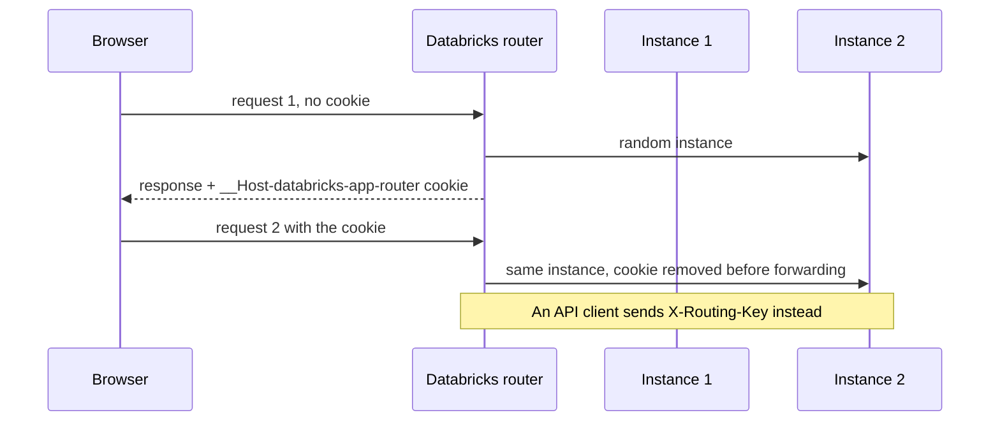

## 1. The question this idea answers

An agent backend keeps three things inside its process. It keeps a cache in memory. It keeps Claude session files on the local file system. And it keeps a lock per chat, so that one chat has only one answer in progress.

All three work when exactly one copy of the app runs. Now traffic grows. Does Databricks start more copies by itself? If three copies run, which copy receives the next message of a chat? Can two copies answer the same chat at the same time?

This lesson gives the documented answers and marks what the docs do not say. It also extends the Flow 1 hit-rate model of [Session files on temporary disks](/notes/ai/claude-agent-sdk/04-sessions/l3-session-files-on-temporary-disks) to session affinity.

## 2. Mental model

> [!analogy] A restaurant chain with one phone number
> A small restaurant has one kitchen. Every order goes there, and the kitchen remembers regular customers.
>
> A chain has up to five kitchens behind one phone number. A receptionist takes each call. If she recognizes the caller, she sends the order to the same kitchen as last time. A new caller goes to a random kitchen.
>
> She cannot always keep that promise. A kitchen closes for renovation, the chain opens or closes a kitchen, or she moves some customers to balance the work. Then a regular customer reaches a kitchen that does not know them.
>
> **Where it stops working:** a real kitchen keeps its pantry overnight. An app instance loses its memory and its local files at every restart. And the receptionist of Databricks is "best-effort": she gives no guarantee at all.

## 3. Terms

| Term | Plain meaning |
|---|---|
| instance | One running copy of the app, with its own memory and its own local file system. |
| standard app | An app without horizontal scaling. |
| horizontally scaled app | An app that runs a configured number of instances, 1 to 5, behind one URL. |
| horizontal scaling | Running several instances and spreading the requests over them. |
| autoscaling | A change of the instance count by the platform, based on load. The Apps docs do not describe it. |
| session affinity | Routing the requests of one session to the same instance. Also called sticky sessions. |
| routing cookie | The `__Host-databricks-app-router` cookie that keeps a browser on one instance. |
| `X-Routing-Key` | A request header with a stable value. It keeps an API client on one instance. |
| rebalancing | The platform moves sessions between instances. |
| instance-local state | Data in the memory or on the disk of one instance. |
| durable store | Storage that survives restarts and that every instance reads, for example Lakebase. |
| build instance | The instance that receives a new deployment first. |
| lease | A database row field that marks a chat as busy until a time. Every instance can read it. |

## 4. Method and math

### 4.1 How many instances run

The compute size page (checked on 2026-10-13) says: "To run an app across multiple instances for higher availability and concurrency, see" the horizontal scaling page. The docs do not state the instance count of a standard app in one sentence. Two facts suggest one instance. Running across multiple instances needs the horizontal scaling feature. And a standard app that you convert gets an instance count of 1.

The horizontal scaling page (AWS and Azure versions, last updated 2026-09-30, checked on 2026-10-13):

| Fact | Text in the docs |
|---|---|
| What it does | "Horizontal scaling distributes requests across instances" |
| Count for a new app | "Specify the **Number of instances** (1–5). Azure Databricks recommends at least 2 instances for availability." (Azure version) |
| Count after conversion | "The instance count is set to **1**." |
| Limit per app | "Each horizontally scaled app can have at most 5 instances." |
| Limit per workspace | At most 20 horizontally scaled apps. Both limits can be raised through your Databricks representative. |
| Cost | "Compute cost scales linearly with the number of instances." |
| Conversion | "Conversion is reversible." and "Conversion introduces no downtime." |
| Libraries | "Newly created horizontally scaled apps don't include the pre-installed Python libraries." |

**Does the platform add instances under load?** The docs describe a fixed count that a person sets in the UI. They do not describe autoscaling.

The Apps API has two fields, `compute_min_instances` and `compute_max_instances`. The first one has the description "Minimum number of app instances the app is configured to run" (Python SDK 0.152.0). The CLI v1.20.0 has matching flags. The horizontal scaling and compute size pages do not explain them. So this lesson assumes no autoscaling.

The field `compute_status.active_instances` reports "The number of active compute instances currently used and billed for this application."

> [!example] Worked example: the DBU count of three instances
> An app runs 3 Medium instances all month. Medium costs 0.5 DBU per hour per instance ([L1](/notes/platforms/databricks/01-apps/l1-databricks-apps)), and cost scales linearly.
>
> - DBU per hour: $3 \times 0.5 = 1.5$
> - DBU per day: $1.5 \times 24 = 36$
> - DBU per 30 days: $36 \times 30 = 1{,}080$
>
> One Medium instance uses 360 DBU in the same month. Three instances cost three times as much.

### 4.2 Routing and session affinity



The rules, quoted from the Azure version (checked on 2026-10-13):

> "The first request from a browser routes to a randomly selected instance, which sets the `__Host-databricks-app-router` cookie."
>
> "Subsequent requests with that cookie route to the same instance."
>
> "Azure Databricks removes this routing cookie before forwarding the request to the app."

For API clients: "To route API clients to the same instance, include the `X-Routing-Key` header in every request". When a request has both, "the header takes precedence". Databricks forwards this header to the app.

And the most important sentence: **"Session affinity is best-effort."** Sessions can move to a different instance in these cases:

1. "An instance becomes unavailable (for example, during deployment or a crash)."
2. "You change the instance count."
3. "Azure Databricks rebalances sessions across instances."
4. "An individual request is misrouted (rare)."

The docs do not say how often rebalancing happens or how many sessions it moves.

> [!trap] A server-side caller has no browser cookie
> Suppose a chat UI app calls the agent backend app from its server code. That caller is an API client. The browser cookie of the user belongs to the UI app, not to the backend. Without `X-Routing-Key`, the docs promise no affinity for these calls. Send `X-Routing-Key: <chat id>` on every call.

### 4.3 What each kind of state does

The page gives the rule: affinity lets an app keep short-lived data, such as an in-memory cache or temporary local files, on one instance. And: "Don't store anything in instance-local state that you can't reconstruct or fetch from a durable store."

| State | One instance | Several instances |
|---|---|---|
| In-memory cache | Lost at restart | One cache per instance. A miss on another instance is normal. |
| Claude session files | Lost at restart | Each file exists on one instance only. Flow 1 needs the next message on that instance. |
| In-process lock per chat | Works | Covers one instance only. Two instances can answer one chat at once. |
| Logs tab | Shows the app | "The Logs tab shows logs from a single instance at a time." Enable app telemetry for all instances. |
| Open streaming connection | Ends at restart | The scaling page does not mention WebSockets or streams. |

### 4.4 The Flow 1 hit rate with affinity

The earlier model assumed random routing. A message of a chat finds its session file with probability $1/N$ for $N$ instances.

With affinity, the next message reaches the same instance unless something moved the session or restarted the instance. Call $q$ the probability of such an event between two messages of one chat. Then:

$$
P(\text{Flow 1}) \approx 1 - q
$$

$N$ no longer appears. A simulation tested both models: 10,000 chats of 10 messages each, with seed 7.

```text
N=1  random routing: 1.000   affinity, p_lost=0.05: 0.950
N=3  random routing: 0.334   affinity, p_lost=0.05: 0.950
N=5  random routing: 0.198   affinity, p_lost=0.05: 0.950
```

The value of $q$ is not documented. It depends on deployments, crashes, count changes and rebalancing. You measure it: $q \approx 1 - $ (the share of messages that take Flow 1).

> [!example] Worked example: q from deployments alone
> A user sends a message every 2 minutes. The team deploys once per day. A deployment restarts every instance.
>
> 1. Minutes per day: $24 \times 60 = 1{,}440$.
> 2. Chance that the deployment falls inside one 2-minute gap: $2 / 1{,}440 \approx 0.0014$.
> 3. So deployments alone give $q \approx 0.0014$, and $P(\text{Flow 1}) \approx 0.9986$.
>
> If a chat pauses for one hour between messages, the chance becomes $60 / 1{,}440 \approx 0.042$. Long pauses lose more sessions. Rebalancing and crashes add to $q$.

> [!key] Affinity raises the hit rate, it does not remove Flow 2
> With a stable routing key per chat, Flow 1 becomes the common case again. But affinity is best-effort, and every deployment restarts the instances. Flow 2 must stay correct, tested and cost-limited. The database stays the source of truth.

### 4.5 Which routing key

| Key | Effect |
|---|---|
| No key, server-side calls | No documented affinity. Treat as random: $P(\text{Flow 1}) \approx 1/N$. |
| User ID | All chats of one user go to one instance. A heavy user can overload it. |
| Chat ID | Each chat stays on one instance. Chats spread over instances. This matches the session file, which belongs to a chat. |

Use the chat ID. Send it in every request that belongs to the chat, also in follow-up calls such as "stop the answer".

### 4.6 Deployments with several instances

The page says: "Databricks rolls a new deployment out to a build instance first". The other instances update only after it succeeds, so they keep serving traffic in the meantime. The docs do not say whether old and new versions serve requests at the same time during the update. Plan for it:

1. A database change must work with the old code and the new code. Add columns first, and remove old columns in a later deployment ([migrations as code](/notes/databases/postgres/04-schema-changes/l2-migrations-as-code)).
2. A message stored by the new version must be readable by the old version, and the reverse.

### 4.7 One answer per chat across instances

An `asyncio.Lock` per chat lives in one process. With several instances, best-effort affinity, and rebalancing, two messages of one chat can reach two instances. Each instance takes its own lock, and both answer.

The lock must live in the durable store. A **lease** row works well, because each claim is one short statement. This test ran on PostgreSQL 16.15:

```sql
UPDATE chats SET busy_until = now() + interval '2 minutes', busy_by = %s
WHERE id = %s AND (busy_until IS NULL OR busy_until < now())
RETURNING id
```

```text
instance A claims: ('chat-42',)
instance B claims: None
instance B claims after release: ('chat-42',)
instance A claims after expiry: ('chat-42',)
```

Instance B gets no row while A holds the lease. After A releases it, B succeeds. If an instance crashes and never releases, the lease expires, and another instance can claim the chat. An advisory lock (`pg_try_advisory_xact_lock`) also works, but it lasts only while its transaction is open. The transaction must then stay open for the whole agent run ([transactions](/notes/databases/postgres/02-transactions/l1-transactions)).

### 4.8 Production view

| Concern | What to do |
|---|---|
| Availability | Use horizontal scaling with at least 2 instances for a service that users depend on. |
| Hit rate | Send `X-Routing-Key` with the chat ID on every server-side call. Measure the Flow 1 share per instance count. |
| Correctness | Keep all chat data in a durable store. Make Flow 2 correct before you add instances. |
| Concurrency | Use a lease row or a database lock for "one answer per chat", never an in-process lock alone. |
| Deployments | Expect a restart of every instance. Keep schema changes compatible with the old and the new code. |
| Observability | Enable app telemetry. The Logs tab shows one instance at a time. |
| Cost | Cost grows linearly: 3 Medium instances use 1.5 DBU per hour. |

## 5. Video

```video
{
  "src": "/notes/media/databricks/manim/m01-app-instances-and-affinity.mp4",
  "caption": "Three instances behind one URL: random routing finds the session file one time in three, a routing key per chat keeps the chat on one instance, and a deployment still clears every disk."
}
```

## 6. Code

These exercises go in the notebook `databricks/03-app-instances.ipynb`. Exercises 3.1 to 3.3 need no workspace.

**Exercise 3.1: simulate affinity.** Write a simulation of $C$ chats with $M$ messages each and $N$ instances. Its inputs are also a routing mode (`random` or `affinity`) and a loss probability $q$ per message gap. A loss restarts the instance or moves the session. Count the share of messages after the first that take Flow 1.

Acceptance tests:

- `random` with $q = 0$ gives about $1/N$ for $N = 1, 3, 5$.
- `affinity` with $q = 0.05$ gives about 0.95 for every $N$.
- Your notebook explains in two sentences why $N$ disappears from the affinity result.

**Exercise 3.2: a client that keeps chats on one instance.** Write `send_message(client, chat_id, text)` with `httpx`. It always sends the header `X-Routing-Key` with the chat ID.

Acceptance tests:

- A test with `httpx.MockTransport` checks that every request carries the header with the right chat ID.
- Two different chats send two different header values.

**Exercise 3.3: a lease for one answer per chat.** Create a `chats` table with `busy_until` and `busy_by`. Write `claim(conn, chat_id, instance_id, seconds)` and `release(conn, chat_id, instance_id)` on your local PostgreSQL.

Acceptance tests:

- Two connections that claim the same chat: exactly one succeeds.
- `release` by the wrong instance does not free the chat.
- After the lease expires, another instance can claim the chat.

**Exercise 3.4: see the routing.** In a development workspace, convert a test app to 2 instances. Add `/whoami`, which returns a random ID that the instance creates at start. Call it 20 times with no header, then 20 times with `X-Routing-Key: chat-1`.

Acceptance test: your notebook records how many distinct IDs each run returned, and the time of the test.

## 7. Common mistakes

1. **Assuming that Databricks adds instances under load.** The docs describe a fixed count that you set. Plan the count yourself.
2. **Trusting affinity as a guarantee.** The docs call it best-effort. Flow 2 must stay correct.
3. **No routing key on server-side calls.** The browser cookie does not cover them. Send `X-Routing-Key`.
4. **A per-chat lock in memory.** It covers one instance only. Use a lease row in the database.
5. **Reading the Logs tab as the whole app.** It shows one instance at a time.
6. **Schema changes that break the old code.** During a deployment, old and new code may both run.

## 8. One-minute explanation

A standard Databricks App runs as one instance. To run more, you enable horizontal scaling and set a fixed number of instances, from 1 to 5. The cost grows linearly with the count, and the docs describe no autoscaling. The router sends a new browser to a random instance and then keeps it there with a cookie. An API client keeps its place with the `X-Routing-Key` header. This affinity is best-effort: deployments, crashes, count changes and rebalancing move sessions. Each instance has its own memory and disk, so caches, session files and in-process locks are local to one instance. With random routing, Flow 1 succeeds about $1/N$ of the time. With a routing key per chat, it succeeds about $1 - q$ of the time, where $q$ is the chance of a move or a restart. So send the chat ID as the routing key, keep every chat in the database, and hold the per-chat lock in the database too.

## 9. Check questions

```check
{
  "question": "Your app runs 4 instances. A chat UI app calls it from server code with no X-Routing-Key. What share of follow-up messages can resume their session file, under the simple random model? What changes if you send the chat ID as X-Routing-Key?",
  "answer": "With no routing key, the docs promise no affinity for these calls, so treat the routing as random: about 1/4 = 0.25. With the chat ID as X-Routing-Key, each chat stays on one instance on a best-effort basis, so the share becomes about 1 - q, where q is the chance that a deployment, crash, count change or rebalancing moved the session or restarted the instance."
}
```

```check
{
  "question": "Does a Databricks App start more instances by itself when traffic grows? Answer from the docs and name what you checked.",
  "answer": "The docs describe no autoscaling. The horizontal scaling page describes a fixed Number of instances, 1 to 5, set in the UI. The API has compute_min_instances and compute_max_instances fields, but the Apps scaling docs do not explain them, so you should not rely on automatic scaling. compute_status.active_instances shows how many instances run and are billed."
}
```

```check
{
  "question": "An agent backend uses an asyncio.Lock per chat to allow one answer at a time. It works on one instance. Why does it fail with 3 instances, and what replaces it?",
  "hint": "Where does the lock live?",
  "answer": "The asyncio.Lock lives in the memory of one process. With 3 instances and best-effort affinity, two messages of one chat can reach two instances, and each takes its own lock, so both answer. The lock must live in the durable store, for example a lease row in Postgres that one short UPDATE claims, with an expiry time so that a crashed instance does not block the chat forever."
}
```

```check
{
  "question": "A user pauses for one hour between two messages. The team deploys once per day, and a deployment restarts every instance. Estimate the chance that the deployment alone sends the second message to Flow 2.",
  "answer": "One hour is 60 of the 1,440 minutes of a day, so the chance that the daily deployment falls inside the pause is 60 / 1,440, about 0.042, or about 4%. Rebalancing, crashes and count changes add to this."
}
```

## 10. Links

- Previous: [L2: App resources and secrets](/notes/platforms/databricks/01-apps/l2-app-resources-and-secrets)
- Next part: [Part 2, L1: CLI profiles](/notes/platforms/databricks/02-identity-and-auth/l1-cli-profiles)
- The Flow 1 and Flow 2 design: [Session files on temporary disks](/notes/ai/claude-agent-sdk/04-sessions/l3-session-files-on-temporary-disks)
- A store for sessions: [Session store and mirror errors](/notes/ai/claude-agent-sdk/04-sessions/l4-session-store-and-mirror-errors)
- Short transactions: [Transactions](/notes/databases/postgres/02-transactions/l1-transactions)
- [Glossary](/notes/platforms/databricks/glossary)
