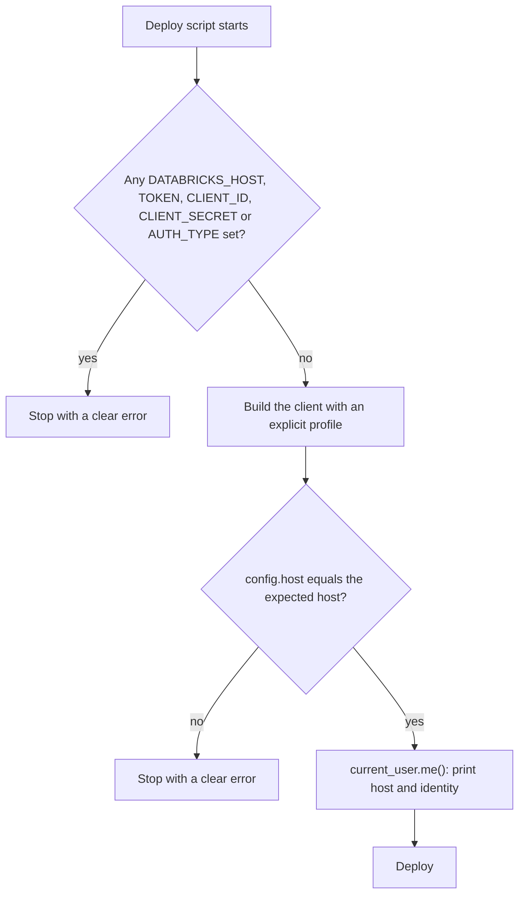

## 1. The question this idea answers

A developer works with two workspaces: development and production. A deploy script creates an app, adds resources and starts it. The script must reach the right workspace, with the right identity, every time.

The Databricks CLI and SDKs read their settings from three places: arguments in code, environment variables and a profile file. When two places disagree, one wins. If you do not know which one, a script can send production credentials to the development host, or deploy development code to production. No error appears.

This lesson explains the profile file and the three ways to authenticate. It gives the exact precedence in the Python SDK (tested) and in the CLI (from its source). It ends with the checks that a deploy script needs.

## 2. Mental model

> [!analogy] A keyring and a key in your hand
> A profile file is a keyring. Each key has a label: `dev`, `prod`. A label names a door (the workspace host) and the key that opens it (a token or an OAuth client).
>
> An environment variable is a key that you already hold in your hand. The Python SDK uses the key in your hand first. It takes a key from the ring only for what your hand does not hold, even when you asked for the `prod` key by name.
>
> **Where it stops working:** a metal key opens one door. A Databricks host and a token are separate settings, so the SDK can combine the door from your hand with the key from the ring. Also, the CLI changed its rule in v1.7.0: a profile named with `--profile` now beats the key in your hand.

## 3. Terms

| Term | Plain meaning |
|---|---|
| `.databrickscfg` | The profile file. Default path `~/.databrickscfg` on Unix and macOS, `%USERPROFILE%\.databrickscfg` on Windows. |
| profile | A named section of the file, for example `[prod]`, with a host and authentication fields. |
| `DEFAULT` profile | The profile that tools use when no profile is named. |
| host | The URL of the workspace, for example `https://adb-1234.5.azuredatabricks.net`. |
| PAT | Personal access token. A long-lived secret string that acts as one user. The docs call it legacy. |
| OAuth U2M | User-to-machine OAuth. A person authenticates in a browser, and the CLI stores and renews short-lived tokens. |
| OAuth M2M | Machine-to-machine OAuth. A service principal uses a client ID and a client secret to get short-lived tokens. |
| auth type | The name of one authentication method in the SDK, for example `pat`, `oauth-m2m` or `databricks-cli`. |
| unified authentication | The shared rules by which the Databricks CLI and SDKs find their settings and credentials. |
| `DATABRICKS_CONFIG_PROFILE` | The environment variable that names the profile to use. |
| `DATABRICKS_CONFIG_FILE` | The environment variable with a different path for the profile file. |
| config source | The place that gave a setting its value: an argument, an environment variable or the profile file. |
| deploy script | A program that creates or changes resources in a workspace, for example an app and its resources. |

## 4. Method and math

### 4.1 The profile file

The configuration profiles page (checked on 2026-10-13) shows the format: a section name in brackets, then `field = value` lines. This file has three profiles:

```text
[DEFAULT]
host = https://dev-workspace-url

[prod]
host      = https://prod-workspace-url
auth_type = databricks-cli

[prod-deployer]
host          = https://prod-workspace-url
client_id     = <client-id>
client_secret = <client-secret>
```

- `[DEFAULT]` holds a host only. A tool that uses it must find credentials elsewhere.
- `[prod]` is what `databricks auth login --host https://prod-workspace-url --profile prod` writes. The CLI source (v1.20.0) saves the host with `auth_type = databricks-cli`, plus other fields such as a workspace ID when they apply. Its help text says: "If a profile with the given name already exists, it is updated."
- `[prod-deployer]` is OAuth M2M for a service principal, as in the docs example.

The docs state the default rule: "If you don't specify a profile name, Databricks tools and SDKs automatically use the `DEFAULT` profile." Both the Python SDK and the Go SDK also read `default_profile` from a `[__settings__]` section, which `databricks auth switch` writes (SDK sources). The profiles page does not document this section.

Two rules from the same page: "Protect your `.databrickscfg` file by setting restricted file permissions (readable only by your user)." And: "Don't commit `.databrickscfg` to version control. Add it to your `.gitignore` file."

### 4.2 Three ways to authenticate

| Method | Profile fields | Lifetime and storage (checked on 2026-10-13) |
|---|---|---|
| PAT | `host`, `token` | The token stays valid until it expires or is revoked. "Where possible, Databricks recommends using OAuth instead of PATs for user account authentication." |
| OAuth U2M | `host`, `auth_type = databricks-cli` | "OAuth tokens expire in under an hour." Since CLI 1.0.0, "U2M tokens are stored in OS-native secure storage: Keychain on macOS, Credential Manager on Windows, and D-Bus Secret Service on Linux." |
| OAuth M2M | `host`, `client_id`, `client_secret` | The SDK exchanges the client secret for short-lived tokens. The client secret itself sits in the file in plain text. |

For U2M, the Python SDK does not handle the browser flow. It runs the CLI and asks it for the cached token. The SDK docstring says the token source will "Obtain the token granted by `databricks auth login` CLI command".

The unified authentication page gives a default order: "Tools and SDKs attempt authentication methods in this order and stop after the first success:" personal access tokens, then OAuth M2M, then OAuth U2M. The Python SDK 0.152.0 has a longer chain. It tries `pat`, `basic`, `metadata-service`, `oauth-m2m`, several OIDC and Azure methods, `external-browser`, `databricks-cli`, and more, in that order.

### 4.3 Precedence in the Python SDK (tested)

The unified authentication page lists three sources for each setting: "SDK Config fields", "Environment variables" and "Configuration profile". The SDK source (`databricks/sdk/config.py`, 0.152.0) gives the exact rules:

1. Arguments that you pass in code are set first.
2. Environment variables fill every setting that is still empty.
3. The profile file fills every setting that is still empty. It never overwrites a value.
4. If no profile is named **and** any credential or a host is already set, the SDK does not read the file at all.
5. If settings from two methods are present, for example a token and a client ID, the SDK fails, unless `auth_type` names one of them.

The test used a profile file with three fake profiles. `DEFAULT` has the dev host and a dev token. `prod` has the prod host and a prod token. `prod-sp` has the prod host, a client ID and a secret. It called `Config(...)` from the Python SDK 0.152.0. `WorkspaceClient(profile=...)` passes the same arguments to `Config`.

| Case | Environment | Code | Result |
|---|---|---|---|
| 1 | nothing | `Config()` | dev host, dev token (`DEFAULT`) |
| 2 | `DATABRICKS_CONFIG_PROFILE=prod` | `Config()` | prod host, prod token |
| 3 | nothing | `Config(profile="prod")` | prod host, prod token |
| 4 | `DATABRICKS_HOST`=dev | `Config(profile="prod")` | **dev host, prod token** |
| 5 | `DATABRICKS_HOST`=dev, `DATABRICKS_TOKEN` | `Config(profile="prod")` | dev host, environment token |
| 6 | `DATABRICKS_HOST`=prod only | `Config()` | Error: `cannot configure default credentials` |
| 7 | `DATABRICKS_TOKEN` | `Config(profile="prod-sp")` | Error: `validate: more than one authorization method configured: oauth and pat` |
| 8 | nothing | `Config(profile="staging")` | Error: `... has no staging profile configured` |

> [!trap] Cases 4 and 5: the named profile loses
> A shell still holds `DATABRICKS_HOST` for development from an earlier task. A script calls `WorkspaceClient(profile="prod")`. In case 4, the SDK takes the host from the environment and the token from the `prod` profile. A production credential travels to the development workspace, which usually rejects it. In case 5, the shell also holds a development token. Then the profile adds nothing, and the script changes the development workspace with no error at all.

Case 6 is the quiet twin of cases 4 and 5. A host in the environment and no named profile make the SDK skip the file. The credentials in `DEFAULT` are never read, and the error message does not mention the file.

> [!key] In the Python SDK, the environment beats the profile
> A named profile only fills the gaps that arguments and environment variables leave. Before you trust `profile="prod"`, make sure that no `DATABRICKS_*` credential or host variable is set, or pass every value explicitly.

### 4.4 The CLI follows a different rule

The CLI changelog for v1.7.0 (2026-07-09) says:

> "An explicitly selected profile (`--profile` or a bundle's `workspace.profile`) now takes precedence over auth environment variables (`DATABRICKS_HOST`, `DATABRICKS_TOKEN`, etc.) instead of being silently shadowed by them; env vars still fill auth fields the profile leaves empty"

The source comment in `libs/databrickscfg/loader.go` adds: "A profile from DATABRICKS_CONFIG_PROFILE keeps env-first precedence; only an out-of-band profile name triggers this chain."

| Setup | CLI v1.7.0 or later | Python SDK 0.152.0 |
|---|---|---|
| `DATABRICKS_HOST`=dev, profile `prod` named by flag or argument | prod host | dev host (tested, case 4) |
| `DATABRICKS_HOST`=dev, `DATABRICKS_CONFIG_PROFILE=prod` | dev host (environment first) | dev host |

The changelog and the source are the evidence for the CLI rows. This lesson did not run the CLI binary. The table shows the practical danger: a shell where `databricks ... --profile prod` reaches production, while a Python script with `profile="prod"` reaches development.

### 4.5 See what was chosen

| Command or call | What it shows (sources checked on 2026-10-13) |
|---|---|
| `databricks auth profiles` | A table with the columns Name, Host and Valid. Valid means a test call to the current-user API succeeded within 5 seconds (CLI source). `--skip-validate` skips the calls. |
| `databricks auth describe` | The host, the user, the auth type, and each setting with its source. The source text has the form `(from <name> <type>)`, where the type is `environment variable` or `config file` (Go SDK source). |
| `databricks auth env --profile prod` | The environment variables that the profile resolves to (configuration profiles page). |
| `w.config.host`, `w.config.auth_type` | The host and auth type that the Python client will use. |
| `w.current_user.me().user_name` | The identity, after a real call to the workspace. |

`auth describe` is the fastest way to find case 4. A line that shows the host "from DATABRICKS_HOST environment variable" and the token from a config file reveals a mixed configuration.

### 4.6 How a deploy script picks the right workspace



1. **Name the target.** The script takes the target as an argument (`dev` or `prod`) and maps it to a profile name and an expected host.
2. **Refuse stray variables.** If any `DATABRICKS_*` host or credential variable is set, stop. In CI, the reverse rule applies: use only environment variables of a deploy service principal, and no profile file.
3. **Check the host.** Compare `w.config.host` with the expected host after you normalize both (scheme, trailing slash).
4. **Print the identity.** Call `current_user.me()` and print the host and the user name before the first change.
5. **For bundles, set the target host.** Each target in `databricks.yml` has `workspace.host`. A profile named in the target counts as an explicit choice in the CLI (v1.7.0 changelog).

> [!example] Worked example: two deploys from one shell
> At 09:00 a developer runs `export DATABRICKS_HOST=https://dev-workspace-url` for a notebook test. At 11:00 the same shell runs two deploys for production.
>
> | Command | Host used | Why |
> |---|---|---|
> | `databricks apps deploy chat-backend --profile prod ...` | prod | CLI v1.7.0 or later: the named profile wins. |
> | A Python deploy script with `WorkspaceClient(profile="prod")` | dev | Python SDK: the environment host fills `host` first, and the prod token goes with it. |
>
> Step 2 of the checklist stops the second command before it changes anything.

### 4.7 Inside an app and in CI

A Databricks App has no profile file. Its environment holds `DATABRICKS_HOST`, `DATABRICKS_CLIENT_ID` and `DATABRICKS_CLIENT_SECRET` ([Apps L1](/notes/platforms/databricks/01-apps/l1-databricks-apps)). So `WorkspaceClient()` uses OAuth M2M as the app service principal, by rule 4. Never copy a `.databrickscfg` into the app source. It would hold personal credentials, and the environment variables would take precedence anyway.

A CI job is similar. Give it the host, client ID and client secret of a deploy service principal through the secret store of the CI system. Do not give it a profile file.

### 4.8 Production view

| Concern | What to do |
|---|---|
| Correctness | Name the profile explicitly, refuse stray `DATABRICKS_*` variables, and check the host before you act. |
| Security | Prefer OAuth U2M for people and OAuth M2M for automation. Keep `.databrickscfg` private, and never commit it. |
| Least privilege | Use a deploy service principal for production deployments, not a personal identity. |
| Observability | Print host, auth type and user at the start of every deploy. Keep that output in the CI log. |
| Consistency | Remember that the CLI and the Python SDK resolve the same shell differently. Test both paths. |

## 5. Video

```video
{
  "src": "/notes/media/databricks/manim/m02-config-precedence.mp4",
  "caption": "Three sources fill one configuration: the Python SDK lets an environment host beat a named profile and mixes it with the profile token, while the CLI lets --profile win."
}
```

## 6. Code

These exercises go in the notebook `databricks/04-cli-profiles.ipynb`. Exercises 4.1 and 4.2 need no workspace. Use fake hosts such as `https://dev.example.invalid`, and pass `retry_timeout_seconds=1` and `http_timeout_seconds=1` to `Config`, so that the host checks fail fast.

**Exercise 4.1: reproduce the precedence table.** Write a temporary profile file with the three profiles of section 4.3. Set `DATABRICKS_CONFIG_FILE` to its path. Run the eight cases with `monkeypatch` for the environment.

Acceptance tests:

- Cases 1 to 5 give the hosts and tokens of the table.
- Cases 6 to 8 raise `ValueError`, and each message contains the text of the table.

**Exercise 4.2: a safe client factory.** Write `client_for(target)`. It maps `dev` and `prod` to a profile and an expected host. It refuses to run when a `DATABRICKS_*` host or credential variable is set. It checks the host of the built configuration.

Acceptance tests:

- With `DATABRICKS_HOST` set, the function raises an error that names the variable.
- With a profile whose host differs from the expected host, it raises an error that names both hosts.
- With a clean environment, it returns a configuration with the expected host.

**Exercise 4.3: inspect your real setup.** Run `databricks auth login --host <dev host> --profile dev`. Then run `databricks auth profiles` and `databricks auth describe --profile dev`. Set `DATABRICKS_HOST` to another value and run `auth describe` again.

Acceptance test: your notebook records the source that `auth describe` names for the host in both runs, and the CLI version.

## 7. Common mistakes

1. **Trusting `profile="prod"` in Python.** Environment variables still win. Clear them or check the host.
2. **A host in the environment and no profile.** The SDK skips the profile file completely.
3. **A token in the environment plus a service principal profile.** The SDK fails with "more than one authorization method configured".
4. **Assuming the CLI and the SDK agree.** Since v1.7.0, `--profile` wins in the CLI, but not in the Python SDK.
5. **Personal tokens for production deployments.** Use a deploy service principal with OAuth M2M.
6. **A profile file in Git or in the app source.** It holds credentials. Keep it private.

## 8. One-minute explanation

The `.databrickscfg` file holds named profiles, and each profile holds a workspace host and one way to authenticate. A PAT is a long-lived token, and the docs call it legacy. OAuth U2M uses `databricks auth login`, which writes `auth_type = databricks-cli` and keeps short-lived tokens in the secure storage of the operating system. OAuth M2M uses the client ID and secret of a service principal. The Python SDK takes code arguments first, then environment variables, then the profile, and the profile never overwrites a value. So `WorkspaceClient(profile="prod")` with a development host in the environment talks to development with the production token. Since v1.7.0 the CLI lets a profile named with `--profile` take precedence over the environment. So the CLI and the SDK can disagree in the same shell. `databricks auth describe` shows every setting and its source. A deploy script must name its profile, refuse stray `DATABRICKS_*` variables, check the host and print the identity before it changes anything.

## 9. Check questions

```check
{
  "question": "Your shell has DATABRICKS_HOST set to the development workspace. A Python script calls WorkspaceClient(profile=\"prod\"), and the prod profile has a host and a token. Which host and which token does the client use? Why?",
  "hint": "Which source fills a setting first, and does the profile overwrite it?",
  "answer": "The development host from the environment and the production token from the profile. The Python SDK fills settings from code arguments, then from environment variables, then from the profile file, and the profile never overwrites a value that is already set. The result is a mixed configuration that sends a production credential to the development workspace."
}
```

```check
{
  "question": "The same shell runs databricks apps deploy chat-backend --profile prod with CLI v1.20.0. Which host does the CLI use, and what changes if the profile comes from DATABRICKS_CONFIG_PROFILE instead of the flag?",
  "answer": "The production host. Since CLI v1.7.0, a profile selected explicitly with --profile takes precedence over auth environment variables, which only fill empty fields. A profile named through DATABRICKS_CONFIG_PROFILE keeps environment-first precedence, so then the development host from DATABRICKS_HOST wins."
}
```

```check
{
  "question": "A teammate sets only DATABRICKS_HOST in the environment and expects the SDK to use the token in the DEFAULT profile. The SDK fails with cannot configure default credentials. Explain.",
  "answer": "When no profile is named and a host or any credential is already set, the SDK skips the profile file completely. So the token in DEFAULT is never read, and no credential is found. The fix is to name the profile, or to remove DATABRICKS_HOST, or to set all credentials explicitly."
}
```

```check
{
  "question": "Why does WorkspaceClient() inside a Databricks App authenticate as the app service principal, even though there is no profile file?",
  "answer": "The platform sets DATABRICKS_HOST, DATABRICKS_CLIENT_ID and DATABRICKS_CLIENT_SECRET in the app environment. The SDK reads environment variables, finds the OAuth M2M fields, and skips the profile file because credentials are already set. So it uses OAuth M2M with the client ID and secret of the app service principal."
}
```

## 10. Links

- Previous part: [Apps L3: App instances](/notes/platforms/databricks/01-apps/l3-app-instances)
- Next: [L2: Unity Catalog service credentials](/notes/platforms/databricks/02-identity-and-auth/l2-uc-service-credentials)
- The app environment: [Apps L1: Databricks Apps](/notes/platforms/databricks/01-apps/l1-databricks-apps)
- Testing with a patched environment: [pytest fixtures and monkeypatch](/notes/software-engineering/python/03-tooling/l2-pytest-fixtures-and-monkeypatch)
- [Glossary](/notes/platforms/databricks/glossary)
