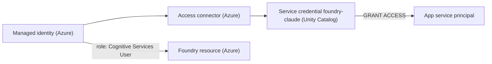
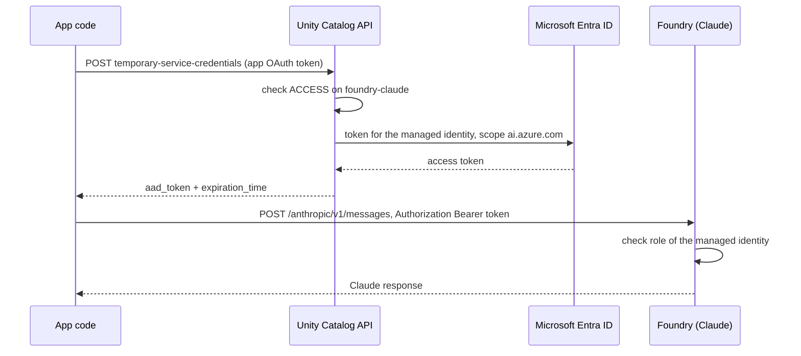

## 1. The question this idea answers

An agent backend calls Claude on Microsoft Foundry. With an API key, the backend holds a long-lived secret. It must be stored as a secret, rotated, and protected from logs and child processes ([Apps L2](/notes/platforms/databricks/01-apps/l2-app-resources-and-secrets)).

Azure offers a keyless alternative: Microsoft Entra ID tokens. A token lasts about one hour and names one target. But someone must hold an Azure identity to request the token. A Databricks App runs as a Databricks service principal, not as an Azure identity.

Unity Catalog closes this gap with a **service credential**. Databricks holds the Azure identity. A caller with the right privilege asks Databricks for a temporary token. This lesson explains the parts, the exact API, the token cache that the client needs, and what can fail.

## 2. Mental model

> [!analogy] A badge office with day passes
> A company gives a master badge to its badge office. The master badge never leaves the office. An employee with permission comes to the window and asks for a day pass to one named building. The office prints a pass that expires in about an hour.
>
> The master badge is the Azure managed identity. The badge office is Unity Catalog. The permission is the `ACCESS` privilege on the service credential. The day pass is a Microsoft Entra token for one scope, for example `https://ai.azure.com/.default`. The building checks the pass, and also checks its own list of who may enter: the Azure role assignment.
>
> **Where it stops working:** a person can see a pass expire and return to the window. Code cannot. It must read the expiry time from the response and ask for a new pass before the old one expires. And the office does not see what you do inside the building. Unity Catalog issues the token, but the model calls go straight from the app to Foundry.

## 3. Terms

| Term | Plain meaning |
|---|---|
| service credential | A Unity Catalog object that wraps a long-term cloud credential for access to external cloud services. |
| managed identity | An Azure identity with no secret that you handle. Azure issues its tokens. |
| system-assigned identity | A managed identity that belongs to one Azure resource and is deleted with it. |
| user-assigned identity | A managed identity that exists as its own Azure resource. |
| access connector | An Azure resource ("Access Connector for Azure Databricks") that connects a managed identity to Databricks. |
| Microsoft Entra ID | The identity service of Azure. It issues tokens. |
| scope | The target that a token is for, written as a URL that ends in `/.default`. |
| temporary service credential | A short-lived token that Unity Catalog issues from a service credential. |
| `ACCESS` | The Unity Catalog privilege that lets a principal use a service credential. |
| `expiration_time` | The time in epoch milliseconds when a temporary credential expires. |
| token provider | A function that the Foundry client calls to get a bearer token. |
| role assignment | An Azure rule that gives an identity a role on a resource, for example Cognitive Services User. |
| refresh margin | The time before expiry when the client asks for a new token. |

## 4. Method and math

### 4.1 The parts

The Azure Databricks docs (checked on 2026-10-13):

> "A service credential in Unity Catalog encapsulates a long-term cloud credential that grants access to such services."
>
> "An Azure Databricks access connector is a first-party Azure resource that lets you connect managed identities" to an Azure Databricks account.

The access connector uses a system-assigned or a user-assigned managed identity. The Unity Catalog API object `AzureManagedIdentity` needs `access_connector_id`. Its docstring says that `managed_identity_id` "is only available for user-assigned identities", and without it "we assume the AzureManagedIdentity is using the system-assigned identity" (Python SDK 0.152.0).



Two separate permission systems guard this path. Unity Catalog decides who may request a token: the `ACCESS` privilege. Azure decides what the token may do: the role assignment of the managed identity on the Foundry resource.

### 4.2 Create and grant

| Step | Rule from the docs (checked on 2026-10-13) |
|---|---|
| Create the credential | You need "`CREATE SERVICE CREDENTIAL` privilege on the Unity Catalog metastore attached to the workspace." "Account admins and metastore admins have this privilege by default." |
| Azure permission to create | "You must have the **Contributor** role or higher on the access connector resource in Azure to add the service credential." |
| Grant use | "Select **ACCESS** to grant the ability to use the service credential to access an external cloud service or services." |
| Name a service principal | "`<principal>` is a user, service principal (represented by its applicationId value), or group." |

The grant for the app service principal of a chat backend:

```sql
GRANT ACCESS ON SERVICE CREDENTIAL `foundry-claude` TO `<application-id-of-the-app>`;
```

The application ID is the `service_principal_client_id` of the app ([Apps L1](/notes/platforms/databricks/01-apps/l1-databricks-apps)). It contains hyphens, so it goes in backticks. App resources have no type for service credentials ([Apps L2](/notes/platforms/databricks/01-apps/l2-app-resources-and-secrets)), so this grant is a separate step.

On the Azure side, give the managed identity a role on the Foundry resource. The Foundry troubleshooting table says, for a 403 error: "For Entra ID, ensure the **Cognitive Services User** role is assigned."

### 4.3 The temporary credential API

| Item | Value (checked on 2026-10-13) |
|---|---|
| REST call | `POST /api/2.1/unity-catalog/temporary-service-credentials` (launch stage GA in the API reference) |
| Request body | `credential_name`, and `azure_options.resources`: a list of scopes |
| Response | `azure_aad.aad_token` and `expiration_time` |
| Python SDK 0.152.0 | `w.credentials.generate_temporary_service_credential(credential_name, azure_options=...)` |
| CLI | `databricks credentials generate-temporary-service-credential CREDENTIAL_NAME` |
| Who may call | "The caller must be a metastore admin or have the metastore privilege **ACCESS** on the service credential." |

The SDK docstring of `resources` says: "These resources are the scopes that are passed to the token provider". The docstring of `expiration_time`: "Server time when the credential will expire, in epoch milliseconds. The API client is advised to cache the credential given this expiration time."

This sketch shows the call from an app. The request and response objects were built in the sandbox with SDK 0.152.0. The call itself was not run, because the sandbox has no workspace.

```python
from databricks.sdk import WorkspaceClient
from databricks.sdk.service.catalog import GenerateTemporaryServiceCredentialAzureOptions

w = WorkspaceClient()  # inside an app: the app service principal, OAuth M2M
cred = w.credentials.generate_temporary_service_credential(
    credential_name="foundry-claude",
    azure_options=GenerateTemporaryServiceCredentialAzureOptions(
        resources=["https://ai.azure.com/.default"]),
)
token = cred.azure_aad.aad_token     # a bearer token: never log it
expires_ms = cred.expiration_time    # epoch milliseconds
```

The request body that the SDK builds:

```json
{"credential_name": "foundry-claude", "azure_options": {"resources": ["https://ai.azure.com/.default"]}}
```

> [!note] What the docs show, and what they do not
> The "Use service credentials" page shows use from notebooks and Python UDFs with `dbutils.credentials.getServiceCredentialsProvider(...)`. It does not show a call from a Databricks App. The REST API and the SDK document the endpoint for any caller with `ACCESS`. So the design in this lesson uses documented parts, but Databricks does not document this combination. Test it in your workspace before you depend on it.

### 4.4 The whole path



The docs do not describe the internal steps between Unity Catalog and Entra ID. The diagram shows the logical path only.

The Foundry endpoint is `https://<resource name>.services.ai.azure.com/anthropic/v1/messages`. The scope for Entra ID is `https://ai.azure.com/.default` (Microsoft Learn and Claude platform docs, checked on 2026-10-13). [Claude on Microsoft Foundry](/notes/ai/llm-apis/04-providers-and-caching/l1-claude-on-microsoft-foundry) covers the endpoint and the deployment names.

### 4.5 The token provider and its cache

The `AnthropicFoundry` client accepts `azure_ad_token_provider`. Its docstring in anthropic 1.13.0: "A function that returns an Azure Active Directory token, will be invoked on every request." The client then sends `Authorization: Bearer <token>`.

"On every request" matters for an agent. One user turn can hold many model calls, one per tool loop. A provider that calls the Unity Catalog API each time adds a network round trip and an API call to every model call. So the provider must cache the token and request a new one only near expiry.

The rule with a refresh margin $m$:

$$
\text{reuse the token while } \quad t_{\text{now}} < t_{\text{exp}} - m
$$

> [!example] Worked example: how often the provider calls Unity Catalog
> The provider fetches a token at 14:02:30 UTC, which is $t_{\text{now}} = 1{,}791{,}900{,}150{,}000$ ms. The response holds $t_{\text{exp}} = 1{,}791{,}903{,}600{,}000$ ms, which is 15:00:00 UTC.
>
> 1. Remaining life: $1{,}791{,}903{,}600{,}000 - 1{,}791{,}900{,}150{,}000 = 3{,}450{,}000$ ms $= 3{,}450$ s $= 57.5$ min.
> 2. With $m = 5$ min, the provider reuses the token until 14:55:00, for $57.5 - 5 = 52.5$ min.
> 3. The backend makes 1,200 model calls per hour. With no cache: 1,200 Unity Catalog calls per hour.
> 4. With the cache: about $60 / 52.5 \approx 1.14$ Unity Catalog calls per hour.

The Claude platform docs say that Entra tokens "typically expire after 1 hour". Databricks does not document a lifetime for temporary service credentials. So never assume a fixed lifetime. Always use `expiration_time`.

> [!trap] A cache shared across threads
> A chat backend serves many requests at once. When the cached token nears expiry, ten requests can see this at the same moment and make ten refresh calls. Guard the refresh with a lock, so that one request refreshes and the others wait for its result.

> [!key] No stored key, but a live token
> A service credential removes the long-lived secret from the app. The app holds only a token that expires within about an hour, for one scope. The price is a dependency at run time: the app must reach the Unity Catalog API to renew the token. Cache the token until shortly before `expiration_time`, and handle a failed refresh as a clear error.

### 4.6 Failure modes

| Symptom | Likely cause | What to do |
|---|---|---|
| The Unity Catalog call fails with a permission error | The app service principal has no `ACCESS` on the credential. Common after an app is deleted and created again, because the app gets a new service principal. | Grant `ACCESS` to the new application ID. |
| The Unity Catalog call fails because the credential is not found | Wrong credential name | Check the name with `DESCRIBE SERVICE CREDENTIAL`. |
| Foundry returns 401 | The troubleshooting table: "Invalid or expired API key, or incorrect Entra ID token scope." | Check the scope string. Check that the cache refreshes before expiry. |
| Foundry returns 403 | "Insufficient permissions on the resource or subscription." The managed identity lacks the role. | Assign Cognitive Services User to the managed identity on the Foundry resource. |
| Foundry returns 404 | "Incorrect endpoint URL or deployment name." | Check the resource name and the deployment name. |
| Errors start about one hour after start | The provider never refreshes. | Compare the current time with `expiration_time` on every call. |
| The Unity Catalog API is slow or down | A run-time dependency on Databricks. | Keep the margin large enough for a retry. Report a clear error if the refresh fails and the old token has expired. |

The docs pages that this lesson checked do not quote the error texts of the Unity Catalog API for these cases. Record the real texts from your workspace in Exercise 5.3.

### 4.7 API key or service credential

| | API key in a secret resource | Service credential |
|---|---|---|
| Secret in the app | A long-lived key in the process environment | None. A token that lives about an hour. |
| Rotation | Manual, on a schedule | Azure handles the managed identity. No key to rotate. |
| Revoke access | Rotate the key at the provider | `REVOKE ACCESS` in Unity Catalog, or remove the Azure role |
| Run-time dependency | Foundry only | Foundry and the Unity Catalog API |
| Code | One environment variable | A token provider with a cache |
| Documented for Apps | Yes ([Apps L2](/notes/platforms/databricks/01-apps/l2-app-resources-and-secrets)) | Parts only. The combination is not documented. |

### 4.8 Production view

| Concern | What to do |
|---|---|
| Security | No key in the app. Grant `ACCESS` only to the app service principal that needs it. Never log the token. |
| Reliability | Cache the token with a refresh margin. Use one refresh at a time. Treat a failed refresh with an expired token as an error, not a retry loop. |
| Latency | With the cache, one Unity Catalog call per token lifetime. Without it, one extra round trip per model call. |
| Operations | After you recreate an app, grant `ACCESS` to its new service principal. |
| Observability | Log each refresh: time, credential name, minutes until expiry. Never the token. |
| Audit | Review the `ACCESS` grants on the credential regularly. Revoke with `REVOKE ACCESS ON SERVICE CREDENTIAL`. |

## 5. Code

These exercises go in the notebook `databricks/05-uc-service-credentials.ipynb`. Exercise 5.1 needs no workspace.

**Exercise 5.1: a cached token provider.** Write a class `CachedTokenProvider(fetch, clock, margin_s)`. `fetch()` returns `(token, expiration_time_ms)`. `clock()` returns the current time in milliseconds. Calling the object returns a token string, so it can be passed as `azure_ad_token_provider`.

Acceptance tests (with a fake `fetch` and a fake `clock`):

- 100 calls within the token life cause exactly 1 fetch.
- A call at $t_{\text{exp}} - m + 1$ ms causes a new fetch.
- 10 threads that call at the same time near expiry cause exactly 1 new fetch.
- A failing `fetch` with an expired token raises an error whose message contains no token text.

**Exercise 5.2: one real token.** In a notebook in your workspace, call `generate_temporary_service_credential` with the scope `https://ai.azure.com/.default`. Use a service credential on which you have `ACCESS`.

Acceptance tests:

- The notebook prints the minutes until `expiration_time`, not the token.
- One `AnthropicFoundry` call with your `CachedTokenProvider` returns a Claude response.

**Exercise 5.3: failure drills.** In a development workspace, run three drills. Call with a wrong credential name. Call after `REVOKE ACCESS`. Call Foundry with a wrong scope.

Acceptance test: your notebook records the exact error text of each drill and the fix.

## 6. Common mistakes

1. **A provider that fetches on every call.** The Foundry client calls it on every request. Cache the token until shortly before `expiration_time`.
2. **Assuming a lifetime of exactly one hour.** Databricks does not document one. Use `expiration_time`.
3. **Granting `ACCESS` only.** Azure also needs a role for the managed identity on the Foundry resource.
4. **The wrong scope.** Foundry expects `https://ai.azure.com/.default`. The older `cognitiveservices` scope on a classic Microsoft page is stale for Claude.
5. **Forgetting the grant after an app is recreated.** The new app has a new service principal.
6. **Logging the token.** It is a bearer credential for up to an hour.

## 7. One-minute explanation

A Unity Catalog service credential wraps an Azure managed identity through an access connector, so no person or app ever holds its secret. A principal with the `ACCESS` privilege calls `POST /api/2.1/unity-catalog/temporary-service-credentials` with the credential name and a scope, such as `https://ai.azure.com/.default`. Unity Catalog returns a Microsoft Entra token and an `expiration_time` in epoch milliseconds. In an app, the caller is the app service principal, so it needs a `GRANT ACCESS` with its application ID. Azure separately needs a role such as Cognitive Services User for the managed identity on the Foundry resource. The `AnthropicFoundry` client calls its token provider on every request. So the provider must cache the token and refresh it a few minutes before expiry, one refresh at a time. A 401 from Foundry means a wrong scope or an expired token, and a 403 means a missing role. The docs describe each part, but not the use from an app, so test the path in your own workspace.

## 8. Check questions

```check
{
  "question": "An app gets a temporary credential and calls Foundry. The call returns 403. The Unity Catalog call succeeded. Which permission system is the problem, and what is the fix?",
  "hint": "Two systems guard the path: who may request a token, and what the token may do.",
  "answer": "Azure, not Unity Catalog. The Unity Catalog call succeeded, so the ACCESS grant works. A 403 from Foundry means that the identity in the token, the managed identity, lacks a role on the Foundry resource. Assign the Cognitive Services User role to the managed identity on that resource."
}
```

```check
{
  "question": "A token provider calls generate_temporary_service_credential each time it is called. A backend makes 1,200 model calls per hour. How many Unity Catalog calls does it make, and how many with a cache that reuses a token for 52.5 minutes?",
  "answer": "Without a cache, 1,200 per hour, because AnthropicFoundry calls the provider on every request. With the cache, about 60 / 52.5, which is about 1.14 calls per hour."
}
```

```check
{
  "question": "The team deletes an app and creates it again with the same name. Every model call now fails at the Unity Catalog step. Why?",
  "answer": "Deleting an app deletes its service principal. The new app has a new service principal with a new application ID, and the ACCESS grant on the service credential still names the old one. Grant ACCESS on the service credential to the new application ID."
}
```

```check
{
  "question": "Compare an API key in a secret resource with a service credential on two points: what secret lives in the app process, and what new run-time dependency appears.",
  "answer": "With the API key, a long-lived key sits in the process environment and must be rotated by hand. With a service credential, the app holds no long-lived secret, only a token that expires within about an hour. The new dependency is the Unity Catalog API: the app must reach it to renew the token, so its cache and error handling matter."
}
```

## 9. Links

- Previous: [L1: CLI profiles](/notes/platforms/databricks/02-identity-and-auth/l1-cli-profiles)
- Next: [L3: User identity in Apps](/notes/platforms/databricks/02-identity-and-auth/l3-user-identity-in-apps)
- The Foundry endpoint and client: [Claude on Microsoft Foundry](/notes/ai/llm-apis/04-providers-and-caching/l1-claude-on-microsoft-foundry)
- The key-based alternative: [Apps L2: App resources and secrets](/notes/platforms/databricks/01-apps/l2-app-resources-and-secrets)
- [Glossary](/notes/platforms/databricks/glossary)
