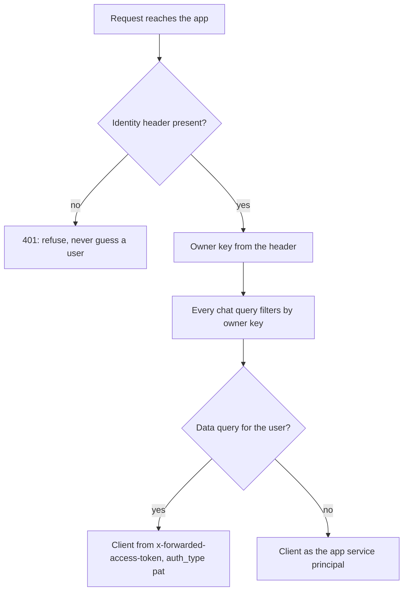

## 1. The question this idea answers

A chat service on Databricks Apps stores chats for many users. It must answer two questions on every request. Who is this user, so that the service shows only their chats? And with whose rights does the agent query data: the rights of the app, or the rights of the user?

The app service principal answers neither question. It is one identity, and every user shares it ([Apps L1](/notes/platforms/databricks/01-apps/l1-databricks-apps)). The platform gives the app more information in HTTP headers that its proxy adds to each request. This lesson lists those headers word for word from the docs. It separates what the docs promise from what they do not. And it explains the report of stale tokens. That report is from a community thread, not from the docs.

## 2. Mental model

> [!analogy] A visitor badge from reception
> A large building has one entrance with a reception desk. Reception checks each visitor's ID and gives a badge with the visitor's name. Inside, staff read the badge and trust it, because every visitor passed reception.
>
> The Databricks Apps proxy is reception. The `X-Forwarded-Email` header is the name on the badge. The app reads it and trusts it.
>
> **Where it stops working:** the trust holds only if every visitor passes reception and nobody can bring a badge from home. The docs say that the proxy adds the headers. They do not say that it removes a header that the client sent itself. They also do not say that no other path reaches the app.

## 3. Terms

| Term | Plain meaning |
|---|---|
| reverse proxy | The server in front of the app that receives each request first and forwards it to the app. |
| forwarded header | A header that the proxy adds to a request before it forwards the request. |
| IdP | Identity provider: the system that authenticates users, for example Microsoft Entra ID. |
| `X-Forwarded-User` | "The user identifier provided by the IdP." |
| `X-Forwarded-Email` | "The user email provided by the IdP." |
| `X-Forwarded-Preferred-Username` | "The user name provided by the IdP." |
| `X-Request-Id` | "The UUID of the request." |
| app authorization | The app acts as its own service principal, with the same rights for every user. |
| user authorization | The app acts with a token of the signed-in user, within approved scopes. |
| `x-forwarded-access-token` | The header with the access token of the user, present when user authorization is on. |
| scope | A named group of APIs that a user token may call, for example `sql`. |
| consent | The user's one-time approval that the app may act with their token for a set of scopes. |
| owner key | The value that a chat service stores with each chat to name its owner. |

## 4. Method and math

### 4.1 The forwarded headers

The HTTP headers page (last updated 2026-09-11, checked on 2026-10-13): "Databricks Apps passes specific `X-Forwarded-*` HTTP headers from the reverse proxy to your app." The table on the page, word for word:

| Header | Description |
|---|---|
| `X-Forwarded-Host` | "The original host or domain requested by the client." |
| `X-Forwarded-Preferred-Username` | "The user name provided by the IdP." |
| `X-Forwarded-User` | "The user identifier provided by the IdP." |
| `X-Forwarded-Email` | "The user email provided by the IdP." |
| `X-Real-Ip` | "The IP address of the client that made the original request." |
| `X-Request-Id` | "The UUID of the request." |

The page also says: "These headers are only available when the app runs inside Databricks Apps." And: "When testing locally, you must simulate or manually include them."

The access token of the user is not in this table. The authorization page documents it separately, with code such as `st.context.headers.get('x-forwarded-access-token')`. It is present only when user authorization is configured (section 4.3).

### 4.2 Two identities

The authorization page (checked on 2026-10-13): "Databricks Apps can use app and user authorization independently or together."

| | App authorization | User authorization |
|---|---|---|
| Identity | The app service principal | The signed-in user |
| Credentials | `DATABRICKS_CLIENT_ID` and `DATABRICKS_CLIENT_SECRET` in the environment | `x-forwarded-access-token` on each request |
| Rights | What the developer granted to the service principal | What the user has, limited to the approved scopes |
| Same for every user | Yes: "All users of the app share this identity and have access to the same set of permissions." | No |
| Good for | Writing chat rows, logging, system tasks | Data queries that must respect the user's Unity Catalog permissions |

A chat service usually needs both. It writes chat rows to Lakebase as the app service principal. It runs a data query as the user, so that a plant manager sees only the plants that Unity Catalog allows them to see.

### 4.3 User authorization in detail

| Fact | Source (checked on 2026-10-13) |
|---|---|
| Scope examples | "`sql` for querying SQL warehouses", "`genie` for managing your Genie Agent", "`files` for managing your files and directories" |
| No scope chosen | Defaults `iam.access-control:read` and `iam.current-user:read`, which "don't permit access to data or compute resources" |
| Admin control | Workspace admins choose which scopes developers can add, under Settings, Development, Apps. Selecting None disables user authorization. |
| Consent | "Users consent one time per app and set of scopes." |
| Limit to scopes | "Azure Databricks blocks access to any functionality outside the approved scopes, even if the user has permission." |
| Workspace limit | "The forwarded user token is scoped to the workspace where the app runs." |
| Change takes effect | The API field `forward_user_access_token` says: "Requires stopping and starting app compute to take effect." (Python SDK 0.152.0) |
| Token handling | "Don't print, log, or write tokens to files." |

The docs do not state the lifetime of the forwarded token or how it is renewed.

To act as the user, the app builds a client from the token on each request. Inside an app, the environment already holds the OAuth M2M settings of the service principal. The test from [CLI profiles](/notes/platforms/databricks/02-identity-and-auth/l1-cli-profiles) shows what happens. With fake app variables in the environment, the Python SDK 0.152.0 gave:

```text
A. Config(token=user_token): ERROR validate: more than one authorization method configured: oauth and pat
B. Config(token=user_token, auth_type='pat'): auth_type=pat
```

So a client for the user names the auth type explicitly. This sketch follows case B:

```python
import os
from databricks.sdk import WorkspaceClient

def user_client(request) -> WorkspaceClient:
    token = request.headers.get("x-forwarded-access-token")
    if not token:
        raise PermissionError("user authorization is not available for this request")
    # A new client per request. Never cache it across users.
    return WorkspaceClient(host=os.environ["DATABRICKS_HOST"], token=token, auth_type="pat")
```

> [!trap] One cached client for everyone
> Suppose a client is built from one user's token and stored in a module variable, or in a cache that all sessions share. It serves the next user with the first user's rights. Build user clients per request, or cache them with the token as part of the key.

### 4.4 What is documented and what is not

| Claim | Status |
|---|---|
| The proxy adds the six `X-Forwarded-*` headers to forwarded requests. | Documented |
| The proxy adds `x-forwarded-access-token` when user authorization is on. | Documented |
| Developers share an app by granting `CAN_USE` or `CAN_MANAGE` to users or groups. | Documented (key concepts page) |
| The proxy removes the routing cookie before it forwards a request. | Documented ([Apps L3](/notes/platforms/databricks/01-apps/l3-app-instances)). So the proxy does rewrite some request data. |
| The proxy removes `X-Forwarded-*` headers that the client sent itself. | **Not documented** |
| The app port is reachable only through the proxy. | **Not documented** |
| The headers carry a signature that the app can check. | No. They are plain values. |
| The access token belongs to the user in `X-Forwarded-Email`. | **Not documented.** Check it with a call to the current-user API. |

The app itself cannot tell who set a header. This FastAPI test ran in the sandbox with no proxy in front:

```python
@app.get("/whoami")
def whoami(request: Request):
    return {"email": request.headers.get("x-forwarded-email")}
```

```text
{'email': None}
{'email': 'plant.manager@example.com'}
```

The second request simply sent `X-Forwarded-Email: plant.manager@example.com`. The app accepted it. On Databricks Apps, the protection is the proxy, not the code. [Identity headers behind a proxy](/notes/software-engineering/security-and-operations/01-access-control/l2-identity-headers-behind-a-proxy) gives the general rule: trust a header only when the proxy sets it and the client cannot.

> [!key] The headers are as trustworthy as the path to the app
> On Databricks Apps, the documented path to the app passes the proxy, and the proxy authenticates the user and adds the headers. The docs do not promise more than that. Use the headers to scope ordinary reads and writes. For an action with high impact, confirm the identity with the user token and the current-user API.

### 4.5 A design for a chat service



1. **Owner key.** Store an owner key with every chat, from the identity headers. The docs do not show example values of `X-Forwarded-User` and `X-Forwarded-Email`. Record real values in Exercise 6.1, and choose the value that does not change when a user's email changes.
2. **Fail closed.** When the app runs in Databricks Apps (`DATABRICKS_APP_NAME` is set) and the header is missing, refuse the request.
3. **Never from the body.** Never read a user ID from the request body or the query string ([Self-asserted identity](/notes/software-engineering/security-and-operations/01-access-control/l1-self-asserted-identity)).
4. **Every query filters by owner.** "Load chat 42" means "load chat 42 if its owner is this user" ([Ownership checks](/notes/ai/conversation-state/03-lifecycle/l1-ownership-checks)).
5. **Local tests inject headers.** Tests add the headers in the test client. Production code has no "default user" path.
6. **Calls between apps.** The docs do not describe the headers on a call from one app to another. Do not assume that the end user's identity reaches the second app. Test it.

### 4.6 The stale-token report (community claim only)

A post on the Databricks Community forum, dated July 15, 2026, reports a problem with a Streamlit app that uses user authorization. The poster writes that `X-Forwarded-Access-Token` and `X-Forwarded-Email` sometimes hold values from a previous session. This happens in the same browser window, after the previous user ended the session. The poster reports a query that ran under the wrong identity.

One reply, from a user marked as a Databricks employee, gives a different cause. It says that the cause is "almost always" `st.cache_resource` on the connection, which all users and sessions of the app process share. It also says that Streamlit fills `st.context.headers` only at the initial page load or WebSocket connection, so a long-lived tab can hold an old token. It suggests a check: call the current-user API with the token and compare the user name with `X-Forwarded-Email`.

| Point | Status |
|---|---|
| Stale tokens from the Databricks proxy | A community claim. Not confirmed in the docs or in the thread. |
| Shared caches of user clients cause cross-user errors | A plausible cause, given by an employee in a forum reply. Not in the docs. |
| Streamlit reads headers once per connection | Stated in the same reply. Not in the Databricks docs. |

The safe design does not depend on who is right. Build user clients per request, never share them across users, and check the identity before actions with high impact.

### 4.7 Production view

| Concern | What to do |
|---|---|
| Correctness | Take the owner key from the identity headers on every request. Filter every chat query by it. |
| Security | Refuse requests without identity headers. Never take a user ID from the request body. |
| Least privilege | Request only the scopes that the app needs. Use the user token for user data, the service principal for app data. |
| Token handling | Never log, print or store the user token. Build user clients per request. |
| High-impact actions | Confirm that the token belongs to the user in `X-Forwarded-Email` before you act. |
| Testing | Inject headers in tests. Test the missing-header path and a wrong-owner path. |

## 5. Code

These exercises go in the notebook `databricks/06-user-identity.ipynb` and a small FastAPI app. Exercises 6.2 and 6.3 need no workspace.

**Exercise 6.1: record the real headers.** Deploy a development app with `/whoami`. It returns the six `X-Forwarded-*` headers and a true or false value for the presence of `x-forwarded-access-token`, never the token itself.

Acceptance tests:

- Your notebook records the values for two different users.
- The notebook states which header you choose as the owner key, and why.

**Exercise 6.2: a current-user dependency.** Write a FastAPI dependency `current_user(request)` that returns the owner key. When `DATABRICKS_APP_NAME` is set and the header is missing, it raises HTTP 401.

Acceptance tests (with `TestClient` and `monkeypatch`):

- A request with the header returns the owner key.
- A request without the header returns 401 when `DATABRICKS_APP_NAME` is set.
- A request with `{"user_id": "someone.else"}` in the body still returns the owner key from the header.

**Exercise 6.3: verify a token.** Write `verify_token_matches(email_header, me)`. `me()` returns the user name for the token. The function raises an error when they differ.

Acceptance tests:

- Equal values pass. The comparison ignores letter case.
- Different values raise an error that names both values and contains no token.
- An exception inside `me()` raises an error, not a pass.

## 6. Common mistakes

1. **Using the app service principal for user data.** Every user then sees what the app can see. Use the user token, or filter by owner.
2. **Reading a user ID from the request body.** The client controls the body. Take the identity from the proxy headers.
3. **A default user when the header is missing.** It turns a missing header into access. Refuse the request.
4. **One cached client for all users.** The next user gets the first user's rights. Build clients per request.
5. **Treating the stale-token report as a documented bug.** It is a community claim. Design so that either explanation is safe.
6. **`Config(token=...)` without `auth_type` inside an app.** The SDK sees two methods and fails. Set `auth_type="pat"`.

## 7. One-minute explanation

The Databricks Apps proxy authenticates each user and adds headers before it forwards the request. The headers are `X-Forwarded-User`, `X-Forwarded-Email`, `X-Forwarded-Preferred-Username`, `X-Forwarded-Host`, `X-Real-Ip` and `X-Request-Id`. With user authorization, it also adds `x-forwarded-access-token`, a token of the user that works only in this workspace and only within the approved scopes. The app service principal acts with the same rights for every user. The user token acts with the user's own Unity Catalog permissions. Inside an app, a user client needs `auth_type="pat"`, because the environment already holds the service principal settings. The docs do not say that the proxy removes headers that a client sends itself, and the headers carry no signature. So the trust rests on the proxy, and high-impact actions should confirm the identity with the current-user API. A chat service stores an owner key from the headers, filters every query by it, and refuses requests without it. The stale-token report is a community claim, and per-request clients make the design safe either way.

## 8. Check questions

```check
{
  "question": "A chat backend writes chat rows and also runs data queries for plant managers. Which identity should do each, and why?",
  "answer": "The app service principal writes chat rows, because that is app data that the app owns and that needs the same rights for every user. Data queries run with the user's token from x-forwarded-access-token, so that Unity Catalog applies the plant manager's own permissions. Using the service principal for data queries would show every user what the app can see."
}
```

```check
{
  "question": "Name two things about the X-Forwarded-* headers that the Databricks docs do not promise, and say what the app should do about them.",
  "hint": "Think about headers that the client sends, and paths to the app.",
  "answer": "The docs do not say that the proxy removes X-Forwarded-* headers that the client sent itself, and they do not say that the app port is reachable only through the proxy. The headers also carry no signature. So the app should treat the proxy as its protection, fail closed when headers are missing, and for high-impact actions confirm the identity by calling the current-user API with the user token."
}
```

```check
{
  "question": "Inside a Databricks App, the code runs WorkspaceClient(host=os.environ[\"DATABRICKS_HOST\"], token=user_token) and fails. What is the error, and what is the fix?",
  "answer": "The environment also holds DATABRICKS_CLIENT_ID and DATABRICKS_CLIENT_SECRET of the app service principal, so the SDK sees OAuth and a token and fails with: validate: more than one authorization method configured: oauth and pat. The fix is to pass auth_type=\"pat\", so that the SDK uses only the user token."
}
```

```check
{
  "question": "A forum post says that x-forwarded-access-token sometimes holds a previous user's token. How do you treat this claim in a design review?",
  "answer": "As a community claim, not a documented platform bug. The only reply, from a Databricks employee, points instead to a shared st.cache_resource connection and to Streamlit reading headers only once per connection. The design should be safe in both cases: build user clients per request, never share them across users, and confirm the identity with the current-user API before high-impact actions."
}
```

## 9. Links

- Previous: [L2: Unity Catalog service credentials](/notes/platforms/databricks/02-identity-and-auth/l2-uc-service-credentials)
- Next part: [Part 3, L1: Statement Execution API and Delta tables](/notes/platforms/databricks/03-sql-and-delta/l1-statement-execution-and-delta)
- The general rule: [Identity headers behind a proxy](/notes/software-engineering/security-and-operations/01-access-control/l2-identity-headers-behind-a-proxy)
- Why a body field proves nothing: [Self-asserted identity](/notes/software-engineering/security-and-operations/01-access-control/l1-self-asserted-identity)
- Filtering by owner: [Ownership checks](/notes/ai/conversation-state/03-lifecycle/l1-ownership-checks)
- [Glossary](/notes/platforms/databricks/glossary)
