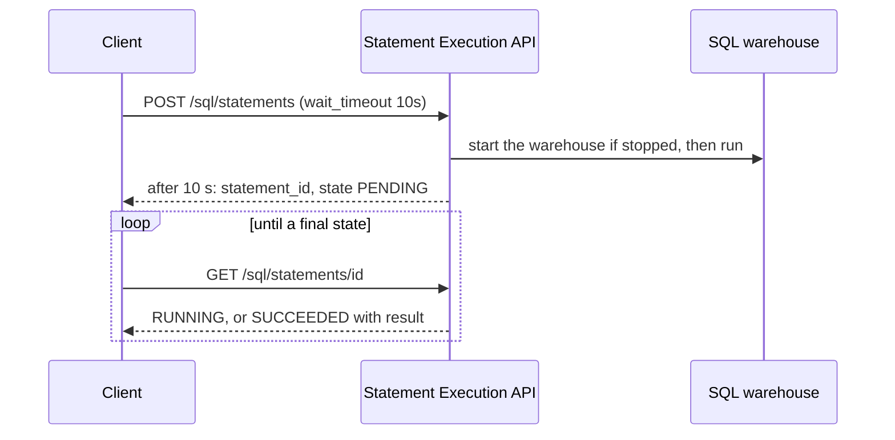

## 1. The question this idea answers

A first version of a chat service stored its history in Delta tables. Each turn sent an `INSERT` through a SQL warehouse, over HTTP. Each new message read the earlier turns with a `SELECT`. It worked in a demo. In daily use, the first message of the morning waited for the warehouse to start, and the table grew thousands of tiny files.

This lesson is "know only". It explains what the SQL Statement Execution API is and how Delta tables commit writes. It shows why both are strong for analytics and weak for chat rows. It gives the reasons in numbers, so that you can defend the move to an OLTP database such as Lakebase ([Lakebase vs Delta](/notes/platforms/databricks/05-lakebase/l4-lakebase-vs-delta)).

## 2. Mental model

> [!analogy] A freight train and a delivery van
> A freight train moves huge loads at a low cost per ton. But it leaves from a station, the engine needs time to start, and each departure carries a full set of paperwork.
>
> A SQL warehouse with Delta tables is the freight train. It scans billions of rows well. A chat turn is a small parcel that must arrive in milliseconds. Sending each parcel by freight train means a cold engine after every quiet hour. It also means new paperwork, a file and a log entry, for every parcel.
>
> An OLTP database is the delivery van: always running, fast for small loads, and built for many small trips.
>
> **Where it stops working:** a train company does not care how many small parcels it carried last month. A Delta table does. Every small write stays as a separate file until compaction joins them, and every later read must open those files.

## 3. Terms

| Term | Plain meaning |
|---|---|
| SQL warehouse | Databricks compute that runs SQL. Types: serverless, pro and classic. |
| Statement Execution API | The REST API that runs one SQL statement on a warehouse and returns its result. |
| `statement_id` | The ID of one statement execution. Clients use it to poll and to fetch results. |
| `wait_timeout` | How long the first call waits for the result: `0s`, or 5 to 50 seconds. |
| `on_wait_timeout` | What happens when the wait ends first: `CONTINUE` or `CANCEL`. |
| disposition | How the result returns: `INLINE` in the response, or `EXTERNAL_LINKS` to cloud storage. |
| auto stop | The idle time after which a warehouse stops by itself. |
| Delta table | A table stored as Parquet data files plus a transaction log. |
| transaction log | The `_delta_log` folder. Each commit adds one JSON file that names the files added and removed. |
| optimistic concurrency control | Writers work without locks and check for conflicts only at commit time. |
| WriteSerializable | The default isolation level of Delta writes on Databricks. |
| small files | Many data files far below the target file size. They slow reads. |
| compaction | Rewriting many small files into fewer large ones, for example with `OPTIMIZE`. |
| OLTP database | A database built for many small transactions, such as PostgreSQL. |

## 4. Method and math

### 4.1 The Statement Execution API

The class docstring of the Python SDK 0.152.0 (checked on 2026-10-13): "The Databricks SQL Statement Execution API can be used to execute SQL statements on a SQL warehouse and fetch the result."

| Call | Purpose |
|---|---|
| `POST /api/2.0/sql/statements` | Run a statement |
| `GET /api/2.0/sql/statements/{statement_id}` | Poll the status, and get the result when it is ready |
| `GET /api/2.0/sql/statements/{statement_id}/result/chunks/{chunk_index}` | Get one more chunk of the result |
| `POST /api/2.0/sql/statements/{statement_id}/cancel` | Cancel the statement |

A request that saves one chat message, with named parameters. This is a sketch: it was not sent, because the sandbox has no workspace.

```http
POST /api/2.0/sql/statements
Content-Type: application/json

{
  "warehouse_id": "a1b2c3d4e5f67890",
  "statement": "INSERT INTO main.chat.messages (chat_id, seq, role, body) VALUES (:chat_id, :seq, :role, :body)",
  "parameters": [
    {"name": "chat_id", "value": "c-42"},
    {"name": "seq", "value": "7", "type": "INT"},
    {"name": "role", "value": "user"},
    {"name": "body", "value": "How long was line 3 down yesterday?"}
  ],
  "wait_timeout": "10s",
  "on_wait_timeout": "CONTINUE"
}
```

The docstring states the parameter rules: "If the `type` field is omitted, the value is interpreted as a string." And: "positional parameters denoted by a `?` marker are not supported".

The three modes:

| Mode | Settings | Behavior (docstring) |
|---|---|---|
| Synchronous | `wait_timeout=30s`, `on_wait_timeout=CANCEL` | Waits up to 30 s. A longer statement is canceled and returns `CANCELED`. |
| Asynchronous | `wait_timeout=0s` | Returns a statement ID at once. The client polls. |
| Hybrid (default) | `wait_timeout=10s`, `on_wait_timeout=CONTINUE` | Waits up to 10 s. A longer statement returns its ID, and the client polls. |

The states of a statement: `PENDING` ("waiting for warehouse"), `RUNNING`, `SUCCEEDED`, `FAILED`, `CANCELED`, `CLOSED`. One detail surprises many clients: "If the SQL warehouse fails to execute the provided statement, a 200 response is returned with `status.state` set to `FAILED`". An HTTP 200 does not mean success. Check `status.state`.



Limits from the docstring: `INLINE` results "are limited to 25 MiB", `EXTERNAL_LINKS` results "are limited to 100 GiB", and "The maximum query text size is 16 MiB". `INLINE` supports only `JSON_ARRAY`. `EXTERNAL_LINKS` also supports `ARROW_STREAM` and `CSV`. "To keep a statement alive, poll for its status at least once every 15 minutes."

### 4.2 Warehouse start and auto stop

| Warehouse type | Start time (warehouse types page, checked on 2026-10-13) | Default auto stop |
|---|---|---|
| Serverless | "Rapid startup time (typically between 2 and 6 seconds)." | 10 minutes. UI minimum 5 minutes. The API allows "as low as 1 minute." |
| Pro | "typically approximately 4 minutes" | 45 minutes. Minimum 10 minutes. |
| Classic | "typically approximately 4 minutes" | 45 minutes. Minimum 10 minutes. |

"Running a query against a stopped warehouse starts it automatically if you have access to the warehouse." So a chat message after a quiet period pays the start time.

> [!example] Worked example: the first message after lunch
> A chat service saves and loads turns through a warehouse. Nobody writes between 12:00 and 13:00, so the warehouse stops after its auto stop time.
>
> 1. Serverless, auto stop 10 minutes: the first message at 13:00 waits about 2 to 6 seconds for the start, before any SQL runs.
> 2. Pro, auto stop 45 minutes: the first message waits about 4 minutes. With the default `wait_timeout` of 10 seconds, the API returns `PENDING` after 10 seconds, and the client polls for about $240 - 10 = 230$ more seconds.
> 3. To avoid the wait, the warehouse must run all day, and you pay for idle compute.

### 4.3 How a Delta table commits

The Databricks ACID page (checked on 2026-10-13): "Delta Lake uses optimistic concurrency control to provide transactional guarantees between writes." A write passes three stages:

1. **Read.** The writer reads the latest version of the table to find the files that it must change. An append-only write skips this.
2. **Write.** The writer writes new data files.
3. **Validate and commit.** The writer checks for conflicts with commits that happened in the meantime. "If there are no conflicts, all the staged changes are committed as a new versioned snapshot."

The open Delta protocol (`PROTOCOL.md` in the delta-io repository) describes the log. "Delta files are the unit of atomicity for a table, and are named using the next available version number, zero-padded to 20 digits." For example `./_delta_log/00000000000000000000.json`. Each such file "contains an atomic set of actions", such as "adding or removing a file".

Reads use snapshot isolation, and "Databricks uses write serializable isolation by default for all table writes and updates."

### 4.4 Write conflicts

Optimistic concurrency means no locks. A conflict appears at commit time as an exception, and the writer must retry. The row-level concurrency page (checked on 2026-10-13) gives the table. These rows matter for chat data:

| Operation pair | With row-level concurrency (WriteSerializable) | Without row-level concurrency (WriteSerializable) |
|---|---|---|
| `INSERT` + `INSERT` | Cannot conflict | Cannot conflict |
| `INSERT` + `UPDATE`, `DELETE`, `MERGE INTO` | Cannot conflict | Cannot conflict |
| `UPDATE`, `DELETE`, `MERGE INTO` + the same | Can conflict when modifying the same row | Can conflict |

The `INSERT` rows cover append-only inserts "that don't use subqueries reading the same table". Row-level concurrency is on automatically from Databricks Runtime 14.3 LTS when the table is not partitioned and has deletion vectors enabled.

The conflict exceptions include `ConcurrentAppendException`, `ConcurrentDeleteReadException`, `ConcurrentDeleteDeleteException`, `MetadataChangedException`, `ConcurrentTransactionException` and `ProtocolChangedException`.

For a chat service, appending messages is safe. But a design can also update a `chats` row on each turn, for example `updated_at` or a title, or upsert with `MERGE`. Then two turns of one chat that commit at the same time can conflict. The losing write fails and must retry.

### 4.5 One file and one log entry per small write

The test below ran in the sandbox with the open-source `deltalake` package 1.6.6 (delta-rs) on a local disk. It is not Databricks, but it follows the same protocol. It appended 100 single-row writes, one per chat message.

```python
for i in range(100):
    row = pa.table({"chat_id": ["c1"], "seq": [i], "role": ["user" if i % 2 == 0 else "assistant"], "body": [f"turn {i}"]})
    write_deltalake(path, row, mode="append")
```

```text
appends: 100
table version: 99
parquet data files: 100
log json files: 100 first: 00000000000000000000.json last: 00000000000000000099.json
rows: 100
avg parquet bytes: 1284
after compact version: 100 active files: 1
```

Each write created one data file and one log entry. A compaction joined the 100 files into 1 active file, as a new version.

In three runs, one append took 27 to 45 ms on average. The same 100 rows as single-row `INSERT` transactions on the local PostgreSQL 16.15 took 0.5 to 4.9 ms each. These are local numbers. On Databricks, each write also crosses HTTP and the warehouse, and the files go to cloud storage. This lesson did not measure that.

> [!example] Worked example: the file count of a month of chat
> 200 users each send 20 messages per day. Each turn saves 2 rows: the user message and the answer.
>
> 1. One `INSERT` per row: $200 \times 20 \times 2 = 8{,}000$ commits per day.
> 2. One `INSERT` per turn, with both rows: $200 \times 20 = 4{,}000$ commits per day.
> 3. Each commit adds at least one data file. With 4,000 commits per day, 30 days give $4{,}000 \times 30 = 120{,}000$ files before compaction.
> 4. The tuning page says that tables below 2.56 TB get an autotuned target file size of 256 MB. A 1,284-byte file is about $256{,}000{,}000 / 1{,}284 \approx 199{,}000$ times smaller than that target.

Databricks has tools for this: auto compaction, optimized writes, `OPTIMIZE` and predictive optimization. The tuning page says auto compaction "runs synchronously on the cluster that performs the write, after the write succeeds". So the cleanup adds work after writes. Compaction treats the symptom, not the cause.

### 4.6 Why chat rows fit an OLTP database

| Need of a chat service | Warehouse + Delta | OLTP database (for example Lakebase) |
|---|---|---|
| Save one turn in milliseconds | An HTTP call to a warehouse, a start delay after idle time, a file and a log entry per commit | One short transaction on an open connection |
| Load the last 20 messages of one chat | A query over many files | An index lookup |
| Update one chat row per turn | Optimistic commit that can conflict and must retry | A row lock for a few milliseconds |
| Always ready | Costs compute while it runs, or waits to start | Built to stay connected |
| Analytics over all chats | Strong: scans, governance, time travel | Weak for large scans |

> [!key] Use each store for its access pattern
> Delta tables and SQL warehouses are built for large reads and batch writes. A chat service makes many tiny writes and reads of single chats. Keep live chat rows in an OLTP database, and copy them to Delta for analytics. [Lakebase vs Delta](/notes/platforms/databricks/05-lakebase/l4-lakebase-vs-delta) builds this argument for an administrator.

### 4.7 Production view

| Concern | What to do |
|---|---|
| Latency | Do not put a SQL warehouse on the path of every chat turn. A start after idle time costs 2 to 6 s (serverless) or about 4 minutes (pro, classic). |
| Correctness | Check `status.state`, not only the HTTP status. A failed statement returns 200 with `FAILED`. |
| Concurrency | Expect conflict exceptions on concurrent `UPDATE` or `MERGE` of the same rows. Retry, or avoid per-turn updates. |
| Storage health | Many small commits create many small files. Rely on compaction only for analytics tables. |
| Cost | A warehouse that must stay warm for chat latency bills all day. |
| Analytics | Keep Delta for reporting over chat history. Copy the rows from the OLTP store in batches. |

## 5. Common mistakes

1. **Treating HTTP 200 as success.** A failed statement also returns 200. Check `status.state`.
2. **Ignoring the warehouse start time.** After auto stop, the first statement waits 2 to 6 seconds on serverless. On pro or classic it waits about 4 minutes.
3. **One commit per message row.** Each commit adds a data file and a log entry. At least, write the two rows of a turn in one statement.
4. **Updating a chat row on every turn in Delta.** Concurrent updates of the same rows can conflict and fail at commit time.
5. **Expecting compaction to fix a wrong access pattern.** It only joins the files after the fact.
6. **Positional `?` parameters.** The API supports only named parameters such as `:chat_id`.

## 6. One-minute explanation

The SQL Statement Execution API runs one SQL statement on a SQL warehouse through `POST /api/2.0/sql/statements`. By default it waits 10 seconds and then returns a statement ID. The client polls with `GET` until the state is `SUCCEEDED`, `FAILED` or `CANCELED`. A stopped warehouse starts on the first query: 2 to 6 seconds for serverless, about 4 minutes for pro and classic. A Delta table commits each write as a new version: new Parquet files, then one JSON entry in the `_delta_log` folder. It uses optimistic concurrency, with conflict checks at commit time. Appends do not conflict, but concurrent updates or merges of the same rows can, and the loser must retry. A chat service that writes each turn as its own commit creates one file and one log entry per turn. A local test showed 100 appends making 100 files of about 1,284 bytes. That pattern of small writes and single-chat reads fits an OLTP database such as Lakebase, while Delta stays the place for analytics.

## 7. Check questions

```check
{
  "question": "A client sends an INSERT with the default settings and gets HTTP 200. The row is not in the table. What should the client have checked, and why?",
  "answer": "status.state in the response body. The API returns 200 with status.state set to FAILED when the warehouse fails to execute the statement, so the HTTP status alone does not show success. With the default hybrid mode, the state can also be PENDING or RUNNING, and the client must poll until a final state."
}
```

```check
{
  "question": "A chat service on a pro warehouse with a 45-minute auto stop gets its first message after a 2-hour pause. Describe what the user waits for, with numbers.",
  "hint": "Start time and the default wait_timeout.",
  "answer": "The warehouse stopped after 45 idle minutes, so the first query starts it, which typically takes about 4 minutes on a pro warehouse. With the default wait_timeout of 10 seconds, the API returns PENDING after 10 seconds, and the client polls for about 230 more seconds before the statement runs."
}
```

```check
{
  "question": "Two turns of the same chat commit at the same moment to Delta tables. One design only appends message rows. Another also updates chats.updated_at for each turn. Which design can see a conflict exception, and why?",
  "answer": "The second. Append-only INSERT operations cannot conflict with each other under WriteSerializable. Two UPDATE operations on the same chats row can conflict, with or without row-level concurrency, because both modify the same row. The losing commit fails and must retry."
}
```

```check
{
  "question": "Give two numbers from this lesson that argue for an OLTP database for chat rows, and say what each one measures.",
  "answer": "First, about 4 minutes: the typical start time of a pro or classic warehouse after auto stop, which a chat message would wait for. Second, 100 files for 100 appends: the local delta-rs test showed one data file of about 1,284 bytes and one log entry per single-row write, so per-turn commits create many small files that slow later reads until compaction."
}
```

## 8. Links

- Previous part: [Part 2, L3: User identity in Apps](/notes/platforms/databricks/02-identity-and-auth/l3-user-identity-in-apps)
- Next part: [Part 4, L1: Databricks MCP servers](/notes/platforms/databricks/04-mcp-and-genie/l1-databricks-mcp-servers)
- The full comparison: [Lakebase vs Delta](/notes/platforms/databricks/05-lakebase/l4-lakebase-vs-delta)
- Short transactions in PostgreSQL: [Transactions](/notes/databases/postgres/02-transactions/l1-transactions)
- [Glossary](/notes/platforms/databricks/glossary)
