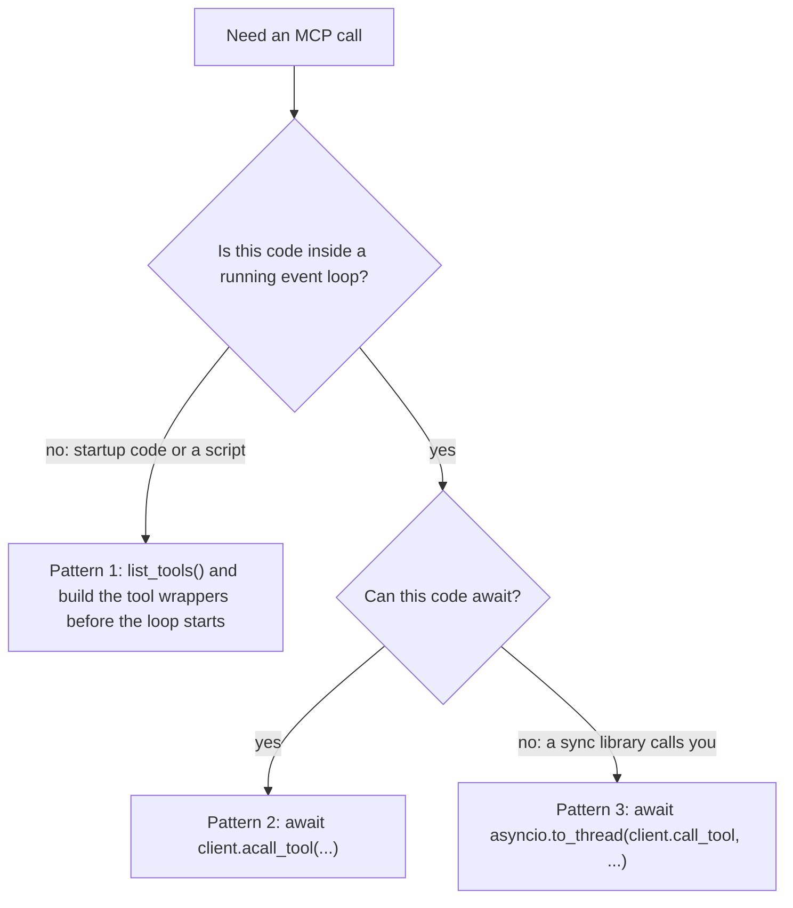

## 1. The question this idea answers

An agent backend in a Databricks App needs data tools: ask a data question, run SQL, call a Unity Catalog function. Databricks offers these tools as **MCP servers**. The agent connects to a server URL, lists the tools and calls them.

The official Python helper is `DatabricksMCPClient` from the `databricks-mcp` package. Its methods `list_tools()` and `call_tool()` look like normal blocking functions. Inside, each one calls `asyncio.run()`. That is fine in a script. It fails in an `async def` web handler, in an async agent tool, and anywhere else where an event loop is already running. The error appears only at run time, often on the first real user message.

This lesson answers four questions. Which MCP servers does Databricks provide, at which URLs? How does the client authenticate? Where exactly does the client call `asyncio.run()`, and why does that fail? Which patterns are safe?

## 2. Mental model

> [!analogy] One head chef per kitchen
> A thread is a kitchen. A running event loop is the head chef of that kitchen. The chef switches between many dishes, one step at a time.
>
> `asyncio.run()` means: "Hire a new head chef for this kitchen, cook this one dish, then dismiss the chef." In an empty kitchen, that works. In a kitchen that already has a head chef, the request is refused at the door: there can be only one.
>
> A worker thread is a second, empty kitchen next door. There, `asyncio.run()` can hire its own chef, cook the dish and return the plate.
>
> **Where it stops working:** a second kitchen is not free. Each `asyncio.run()` in a worker thread creates and closes a whole event loop. Objects that belong to one loop, such as an open HTTP client or an async lock, cannot move to another loop. Also, the refusal is not a slow failure: Python checks for a running loop first and raises at once.

## 3. Terms

| Term | Plain meaning |
|---|---|
| MCP server | A service that offers tools to an agent through the Model Context Protocol. The agent lists the tools and calls them. |
| Databricks-provided MCP | An MCP server that Databricks hosts in the `system.ai` schema, for example `system.ai.genie_one_mcp`. |
| Unity Gateway | The Databricks gateway that receives calls to `system.ai` MCPs and applies grants, policies and tracing. |
| legacy workspace endpoint | An older MCP URL under `/api/2.0/mcp/...` that bypasses Unity Gateway. |
| custom MCP server | Your own MCP server, hosted as a Databricks App. |
| streamable HTTP | The MCP transport over HTTP that Databricks servers use. |
| `DatabricksMCPClient` | The client class in the `databricks-mcp` package. It lists and calls the tools of one server URL. |
| `WorkspaceClient` | The Databricks SDK object that holds the workspace URL and the credentials. |
| OAuth scope | A label on an OAuth token that limits what the token can do, for example `ai-gateway`. |
| event loop | The asyncio scheduler. It runs coroutines on one thread and switches between them at each `await`. |
| running event loop | An event loop that is active on the current thread at this moment. |
| `asyncio.run()` | A function that creates a new event loop, runs one coroutine to the end, then closes the loop. |
| `asyncio.to_thread()` | A coroutine that runs a blocking function in a worker thread and waits for its result. |
| worker thread | A second thread. It has no running event loop unless code creates one there. |

## 4. Method and math

### 4.1 The MCP servers that Databricks provides

The page "Databricks-provided MCPs" (last updated Oct 8, 2026, checked on 2026-10-13) starts: "Databricks provides MCPs in the `system.ai` schema for data and external services." All of them use one URL pattern:

```text
https://<workspace-hostname>/ai-gateway/mcp-services/<mcp-name>
```

The page says to replace `<mcp-name>` "with the full name from the tables below, such as `system.ai.dbsql`."

| MCP name | What it does (docs words) | Status |
|---|---|---|
| `system.ai.genie_one_mcp` | "Recommended for natural-language analytics across your workspace." "Answers questions with Genie One, grounded in Genie Ontology." | "The Genie One MCP is generally available." |
| `system.ai.dbsql` | "Runs specific SQL queries for development and data engineering on a SQL warehouse", "using the caller's Unity Catalog and warehouse permissions." | Needs the Unity Gateway beta |
| `system.ai.web_search` | Searches the public web and returns an answer with citations | Needs the Unity Gateway beta |
| `system.ai.sandbox` | Runs Python, SQL or shell code in an isolated environment. It "does not have network egress." | Needs the Unity Gateway beta |
| `system.ai.slack`, `system.ai.github`, `system.ai.atlassian` and others | External services | Some tools need a separate sign-in |

The beta rule, in the docs' words: "To use `system.ai.dbsql`, `system.ai.sandbox`, or `system.ai.web_search`, an account admin must enable the Unity Gateway beta from the account console Previews page." For data questions the docs advise: "For analytics use cases, start with the Genie One MCP server." [L2](/notes/platforms/databricks/04-mcp-and-genie/l2-genie-one-mcp) covers that server.

The older **legacy workspace endpoints** still work, but "bypass Unity Gateway". The docs say that their calls do not appear in Unity Gateway tracing tables, and that they have no MCP-level grants, policies or guardrails. A workspace admin must enable **Managed MCP Servers** on the Previews page to use them.

| Legacy server | URL | OAuth scope |
|---|---|---|
| Genie Agent | `https://<workspace-hostname>/api/2.0/mcp/genie/{genie_space_id}` | `genie` |
| AI Search | `https://<workspace-hostname>/api/2.0/mcp/ai-search/{catalog}/{schema}/{index_name}` | `ai-search` |
| Databricks SQL | `https://<workspace-hostname>/api/2.0/mcp/sql` | `sql` |
| Unity Catalog functions | `https://<workspace-hostname>/api/2.0/mcp/functions/{catalog}/{schema}/{function_name}` | `unity-catalog` |

Pricing, from the same page: "Unity Catalog functions use serverless general compute pricing." "Genie Agents and Databricks SQL use Databricks SQL pricing." "AI Search indexes use AI Search pricing."

> [!trap] The helper code knows only the old paths
> `databricks-mcp` 0.9.2 (checked on 2026-10-13) recognizes four URL shapes in `mcp.py` lines 101–106: `/api/2.0/mcp/functions/...`, `/api/2.0/mcp/vector-search/...`, `/api/2.0/mcp/genie/...` and `/api/2.0/mcp/external/...`. The current docs name `/api/2.0/mcp/ai-search/...` and the `/ai-gateway/mcp-services/...` pattern. A test in the sandbox gave `None` for both of these. So `get_databricks_resources()` (lines 319–361) logs an error and returns an empty list for them. It matters only when you log an agent to Model Serving. Listing and calling tools still work for any URL.

### 4.2 Custom MCP servers on Databricks Apps

You can host your own MCP server as a Databricks App. The "Custom MCP servers" page (last updated Oct 7, 2026) says that Apps give "the compute to run the server and an HTTPS URL for agents to connect to it." The rules in short:

1. Use the Streamable HTTP transport. Listen on `0.0.0.0` and on the port in `DATABRICKS_APP_PORT` ([Apps L1](/notes/platforms/databricks/01-apps/l1-databricks-apps)).
2. The server URL is the app URL plus `/mcp` for the starter and OpenAPI templates.
3. Callers need `CAN USE` on the app.
4. The authentication page says: "Servers hosted on Databricks Apps require OAuth and do not accept personal access tokens."

The client enforces rule 4 early. Lines 209–216 of `mcp.py` raise a `ValueError` in `__init__` when the URL ends with `.databricksapps.com` and the `WorkspaceClient` does not use OAuth.

### 4.3 Authentication through WorkspaceClient

The client takes one `WorkspaceClient`. If you pass none, line 206 creates `WorkspaceClient()` with the default configuration. The SDK reads the configuration from environment variables. In `databricks-sdk` 0.152.0, `config.py` line 92 maps `host` to `DATABRICKS_HOST`, and lines 125–126 map `client_id` and `client_secret` to `DATABRICKS_CLIENT_ID` and `DATABRICKS_CLIENT_SECRET`. A Databricks App receives exactly these three variables for its app service principal ([Apps L1](/notes/platforms/databricks/01-apps/l1-databricks-apps)). So `WorkspaceClient()` inside an App authenticates as the app service principal with OAuth machine-to-machine.

How does the token reach the MCP server? The file `oauth_provider.py` of `databricks-mcp` 0.9.2:

```python
TOKEN_EXPIRATION_SECONDS = 60

class DatabricksTokenStorage(TokenStorage):
    ...
    async def get_tokens(self) -> OAuthToken | None:
        headers = self.workspace_client.config.authenticate()
        authorization_header = headers["Authorization"]
        ...
        token = authorization_header.split("Bearer ")[1]
        return OAuthToken(access_token=token, expires_in=TOKEN_EXPIRATION_SECONDS)
```

The MCP library asks the storage for a token. The storage asks the SDK for a fresh `Authorization` header and returns the bearer token. The SDK refreshes its own token when it is due.

| Identity | When to use it (MCP docs pages, checked on 2026-10-13) |
|---|---|
| The app service principal | Shared access. Every user of the app gets the same data. |
| The calling user (on-behalf-of) | Per-user access. Unity Catalog permissions apply per user. |
| A personal access token | Local testing and some legacy or registered endpoints. Not for servers on Apps. |

For `system.ai` MCPs the docs name one OAuth scope: `ai-gateway`. The legacy endpoints use the scopes in the table of section 4.1. [Identity in Apps](/notes/platforms/databricks/02-identity-and-auth/l3-user-identity-in-apps) covers the per-user case.

> [!note] A small block on the event loop
> `get_tokens` is a coroutine, but `config.authenticate()` is a normal blocking call. When the SDK must refresh its token, that HTTP request runs on the event loop thread and blocks other coroutines for its duration. This follows from the source. It is not documented.

### 4.4 Where the client calls asyncio.run

This is the core of `mcp.py` in `databricks-mcp` 0.9.2 (checked on 2026-10-13), with its line numbers:

```python
227    async def _get_tools_async(self) -> List[Tool]:
228        """Fetch tools from the MCP endpoint asynchronously."""
229        async with _open_mcp_session(
230            self.server_url, DatabricksOAuthClientProvider(self.client)
231        ) as session:
232            return (await session.list_tools()).tools
...
269    @_handle_mcp_errors
270    def list_tools(self) -> List[Tool]:
...
277        return asyncio.run(self._get_tools_async())
...
279    @_handle_mcp_errors
280    def call_tool(self, tool_name: str, arguments: dict[str, Any] | None = None) -> CallToolResult:
...
291        return asyncio.run(self._call_tools_async(tool_name, arguments))
...
293    @_handle_mcp_errors
294    async def alist_tools(self) -> List[Tool]:
...
301        return await self._get_tools_async()
...
303    @_handle_mcp_errors
304    async def acall_tool(
```

| Method | Kind | What it does inside |
|---|---|---|
| `list_tools()` (line 270) | sync | `asyncio.run(self._get_tools_async())` at line 277 |
| `call_tool(name, args)` (line 280) | sync | `asyncio.run(self._call_tools_async(...))` at line 291 |
| `alist_tools()` (line 294) | async | `await self._get_tools_async()` at line 301 |
| `acall_tool(name, args)` (line 304) | async | `await self._call_tools_async(...)` at line 317 |
| `get_databricks_resources()` (line 319) | sync | calls `self.list_tools()` at line 346, so it also runs `asyncio.run` |

Two more facts come from the source:

1. **Every call opens a new MCP session.** Lines 229 and 240 open `_open_mcp_session(...)` inside each call. A test against a local MCP server (mcp 2.2.0) logged 3 HTTP `POST` requests for each `call_tool()`, from a new client port each time. The three requests match the MCP handshake plus the call: the initialize request, the initialized notification and the tool call.
2. **The official example uses the sync method.** The page "Use MCP tools in a Python agent" (last updated Oct 7, 2026) shows `tools = mcp_client.list_tools()` at module level. That page says nothing about event loops.

### 4.5 Why it fails inside a running loop

CPython checks for a running loop before it does anything else. From `asyncio/runners.py` in Python 3.13.16, lines 190–193:

```python
    if events._get_running_loop() is not None:
        # fail fast with short traceback
        raise RuntimeError(
            "asyncio.run() cannot be called from a running event loop")
```

The docstring says: "This function cannot be called when another asyncio event loop is running in the same thread."

The sandbox test ran the real `DatabricksMCPClient` (0.9.2) against a local fake MCP server with two tools. The output:

```text
1 sync, no loop: ['genie_ask', 'genie_poll_response']
2 sync, in loop: RuntimeError: asyncio.run() cannot be called from a running event loop
3 to_thread: {"status": "completed", "answer": "Plant 3 had 42 minutes of downtime."}
4 acall_tool: {"conversation_id": "c1", "response_id": "r1", "status": "in_progress"}
```

Case 2 is `client.list_tools()` inside an `async def` that `asyncio.run` started. A minimal stand-in class with the same line 277 gave the same error and one more line:

```text
RuntimeWarning: coroutine 'StandInMCPClient._get_tools_async' was never awaited
```

Why the warning? Python evaluates the argument `self._get_tools_async()` first. That creates a coroutine object. Then `asyncio.run` raises, and nobody awaits the coroutine.

> [!trap] Tested on Python 3.13, the Apps run 3.11
> The quoted lines come from Python 3.13.16 in the sandbox. Databricks Apps run Python 3.11 ([Apps L1](/notes/platforms/databricks/01-apps/l1-databricks-apps)). Exercise 1 asks you to confirm the message there.

### 4.6 Where a loop is already running

| Place where your code runs | Running loop on this thread? | `client.list_tools()` |
|---|---|---|
| A plain script, at module level, before `asyncio.run(main())` | No | Works |
| Inside `async def main()` started by `asyncio.run` | Yes | `RuntimeError` |
| An `async def` web handler (FastAPI, Starlette) | Yes | `RuntimeError` |
| A Claude Agent SDK custom tool (`@tool` on an `async` function) | Yes | `RuntimeError` |
| A LangChain tool built from a coroutine, called with `ainvoke` | Yes | `RuntimeError` |
| A LangChain tool built from a plain function, called with `ainvoke` | No: it runs in a worker thread | Works |
| Inside `asyncio.to_thread(...)` | No | Works |

The LangChain rows come from `langchain_core` 1.6.10. In `tools/structured.py` lines 120–123, a tool with no coroutine uses `run_in_executor(config, self.invoke, ...)` instead. The sandbox test confirmed both rows:

```text
sync func via ainvoke: ['genie_ask', 'genie_poll_response'] thread=asyncio_0
coroutine via ainvoke: RuntimeError: asyncio.run() cannot be called from a running event loop
```

`asyncio_0` is the name of a thread in the default executor of the loop. So the sync function did not run on the loop thread.

### 4.7 Three safe patterns



**Pattern 1: prepare before the loop starts.** Call `list_tools()` once at startup, before `uvicorn.run(...)` or `asyncio.run(main())`. Build the tool wrappers from the result. The wrappers then call the async methods at run time. The cost: the tool list is fixed until the process restarts, and the process cannot start while the MCP server is unreachable.

**Pattern 2: await the async methods.** In 0.9.2, `alist_tools()` and `acall_tool()` exist (lines 293–317). In async code they are the natural choice. They create no extra loop and no extra thread.

**Pattern 3: move the sync call to a worker thread.** `await asyncio.to_thread(client.call_tool, name, args)`. The worker thread has no running loop, so line 291 creates a fresh loop there. The client opens a new session for each call anyway (section 4.4), so a fresh loop per call adds little.

For LangChain, the docs show a fourth way: `DatabricksMultiServerMCPClient` from `databricks-langchain`. Its `get_tools()` is a coroutine (`multi_server_mcp_client.py` line 336 in 0.21.0), so you await it.

> [!key] Match the call to the thread
> A method that calls `asyncio.run` must never run on a thread whose event loop is running. In async code, await the async method. In startup code, call the sync method before the loop starts. To reuse sync code from async code, move it to a worker thread.

> [!example] Worked example: the cost of one session per call
> A user message makes the agent call the Genie One MCP 3 times: one ask and two polls. Each call opens a new session.
>
> 1. HTTP requests to the MCP server: 3 calls × 3 `POST` requests = 9 requests.
> 2. New TCP and TLS connections: 3, one per call, because each call uses a new HTTP client.
> 3. One session that stays open for the whole message needs 2 + 3 = 5 requests. These are one initialize request, one initialized notification and 3 tool calls.
>
> Result: 9 versus 5 requests. The sandbox test against the local fake server measured both numbers. 3 calls in one session gave 5 `POST` requests, and each `call_tool()` gave 3.
>
> The difference grows with the number of polls. The time cost of each extra request depends on the network, so measure it in your own workspace before you optimize it.

### 4.8 Production view

| Concern | What to do |
|---|---|
| Correctness | Never call `list_tools()`, `call_tool()` or `get_databricks_resources()` from async code. Use `alist_tools()` and `acall_tool()`. |
| Startup | If you list tools at startup, retry with a timeout, and log the tool names and the server URL. |
| Latency | Each call opens a new session. For many calls in one message, measure the extra requests (section 4.7). |
| Security | Choose the identity on purpose: app service principal for shared data, on-behalf-of user for per-user data. |
| Governance | Prefer `system.ai` MCPs. The legacy endpoints bypass Unity Gateway grants, policies and tracing. |
| Versions | The docs pin `"mcp>=1.24,<2"` in their install line, but `databricks-mcp` 0.9.2 supports mcp 1.x and 2.x (lines 15–32). Pin both versions in your project. |
| Observability | Log the tool name, the duration and the error type of every call. A `RuntimeError` with "running event loop" is a code bug, not a server failure. |

## 5. Video

```video
{
  "src": "/notes/media/databricks/manim/m03-asyncio-run-in-a-running-loop.mp4",
  "caption": "list_tools() calls asyncio.run. On a thread with a running loop it raises at once. In a worker thread it creates its own loop and returns the result."
}
```

## 6. Code

These exercises go in `databricks/07-mcp-clients-and-event-loops.ipynb`. Exercises 1, 2 and 4 need no workspace.

**Exercise 1.1: reproduce the error.** Write a stand-in class with two methods. `_get_tools_async()` is an `async def` that sleeps 0.01 s and returns two names. `list_tools()` calls `asyncio.run` on it, exactly like line 277. Call it four ways: at module level, inside an `async def` run by `asyncio.run`, through `asyncio.to_thread`, and through an async method.

Acceptance tests:

- Module level and `to_thread` return the two names.
- The `async def` case raises `RuntimeError` with the text "asyncio.run() cannot be called from a running event loop".
- You run the same file in a Databricks App (Python 3.11) or a Python 3.11 venv and record whether the message is identical.

**Exercise 1.2: a guard for the trap.** Write a pytest test that monkeypatches `asyncio.run` with a wrapper. The wrapper fails the test if `asyncio.get_running_loop()` succeeds, and otherwise calls the real `asyncio.run`. Run your async tool handler under this test.

Acceptance tests:

- A handler that calls the sync `list_tools()` fails the test.
- A handler that awaits `alist_tools()` passes.
- A handler that uses `asyncio.to_thread` passes.

**Exercise 1.3: list real tools.** In your workspace, create a `DatabricksMCPClient` for `https://<workspace-hostname>/ai-gateway/mcp-services/system.ai.genie_one_mcp` with a `WorkspaceClient` from your CLI profile. List the tools with `alist_tools()` inside `asyncio.run(main())`.

Acceptance tests:

- You print the name, the description and the input schema of every tool.
- You record which identity the token belongs to (`w.current_user.me().user_name`).
- You record the error, word for word, if the call fails.

**Exercise 1.4: count requests per call.** Start a local MCP server with one tool (mcp `MCPServer` and `streamable_http_app()`, uvicorn with access logs). Call the tool 3 times with `call_tool()`, then 3 times inside one session that you open yourself with the mcp client.

Acceptance tests:

- The log shows the number of `POST` requests for each design.
- You state the number of requests per call for each design.

## 7. Common mistakes

1. **"list_tools() is a normal sync function, so it is safe anywhere."** It calls `asyncio.run`. It fails on any thread with a running loop.
2. **Calling the sync method inside an `async def` tool.** Await `acall_tool()`, or use `asyncio.to_thread`.
3. **Fixing the error with `nest_asyncio`.** Its PyPI page says: "This module patches asyncio to allow nested use of `asyncio.run`". The patch changes the whole process and hides the design problem. Use one of the three patterns.
4. **Using a legacy `/api/2.0/mcp/...` URL for new work.** It bypasses Unity Gateway grants, policies and tracing. Use the `system.ai` MCP URL.
5. **A personal access token for a server on Databricks Apps.** These servers require OAuth. The client raises a `ValueError` at construction.
6. **Assuming the client keeps one connection open.** Each call opens a new MCP session.

## 8. One-minute explanation

Databricks gives agents data tools as MCP servers. The current ones live in the `system.ai` schema behind Unity Gateway, at `https://<host>/ai-gateway/mcp-services/<name>`, for example `system.ai.genie_one_mcp` for data questions. Older `/api/2.0/mcp/...` endpoints still work but bypass the gateway's grants and tracing. The `databricks-mcp` package has a `DatabricksMCPClient` that takes a `WorkspaceClient`, which in an App authenticates as the app service principal from three environment variables. Its sync methods `list_tools()` and `call_tool()` call `asyncio.run()` at lines 277 and 291. Python refuses `asyncio.run()` on a thread whose event loop is running, with "asyncio.run() cannot be called from a running event loop". So inside an async web handler or an async agent tool, these methods fail. There are three safe patterns. List the tools before the loop starts, await `alist_tools()` and `acall_tool()` in async code, or use `asyncio.to_thread`.

## 9. Check questions

```check
{
  "question": "A FastAPI endpoint is declared with async def. Inside it, the code calls mcp_client.call_tool(\"genie_ask\", {...}). What happens, and why?",
  "hint": "Which thread runs an async def endpoint, and what does line 291 do?",
  "answer": "It raises RuntimeError: asyncio.run() cannot be called from a running event loop. The async endpoint runs on the event loop thread, so a loop is running. call_tool calls asyncio.run at line 291, and asyncio.run checks for a running loop first and raises. The fix is await mcp_client.acall_tool(...), or await asyncio.to_thread(mcp_client.call_tool, ...)."
}
```

```check
{
  "question": "Why does asyncio.to_thread(client.call_tool, name, args) work inside a running loop, when client.call_tool(name, args) does not?",
  "answer": "to_thread runs call_tool in a worker thread. That thread has no running event loop, so asyncio.run can create a new loop there, run the coroutine to the end and close the loop. The main loop only awaits the result and keeps serving other coroutines."
}
```

```check
{
  "question": "Name two differences between the URL https://<host>/ai-gateway/mcp-services/system.ai.genie_one_mcp and https://<host>/api/2.0/mcp/genie/<space-id>.",
  "answer": "The first is a Databricks-provided MCP in system.ai, called through Unity Gateway, so MCP-level grants, policies and tracing apply, and its OAuth scope is ai-gateway. The second is a legacy workspace endpoint for one Genie Agent. It bypasses Unity Gateway, needs the Managed MCP Servers preview and uses the genie scope. The first covers the whole workspace through Genie One, the second covers one space."
}
```

```check
{
  "question": "A LangChain tool is built with StructuredTool.from_function(func=f), where f calls client.list_tools(). The agent runs with ainvoke. Does it fail? Why?",
  "answer": "No. The tool has no coroutine, so langchain_core falls back to run_in_executor and runs f in a worker thread of the default executor. That thread has no running loop, so asyncio.run works. The same code fails if f is an async def passed as coroutine=, because it then runs on the loop thread."
}
```

## 10. Links

- Previous: [Statement Execution API and Delta tables](/notes/platforms/databricks/03-sql-and-delta/l1-statement-execution-and-delta)
- Next: [L2: Genie One MCP](/notes/platforms/databricks/04-mcp-and-genie/l2-genie-one-mcp)
- The asyncio side in depth: [Sync code calling async code](/notes/software-engineering/python/01-asyncio/l3-sync-code-calling-async-code)
- The event loop itself: [The event loop and coroutines](/notes/software-engineering/python/01-asyncio/l1-event-loop-and-coroutines)
- The App identity: [Databricks Apps](/notes/platforms/databricks/01-apps/l1-databricks-apps)
- Tool calls and results: [tool_use and tool_result](/notes/ai/llm-apis/01-messages-api/l2-tool-use-and-tool-result)
- [Glossary](/notes/platforms/databricks/glossary)
