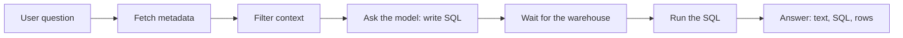
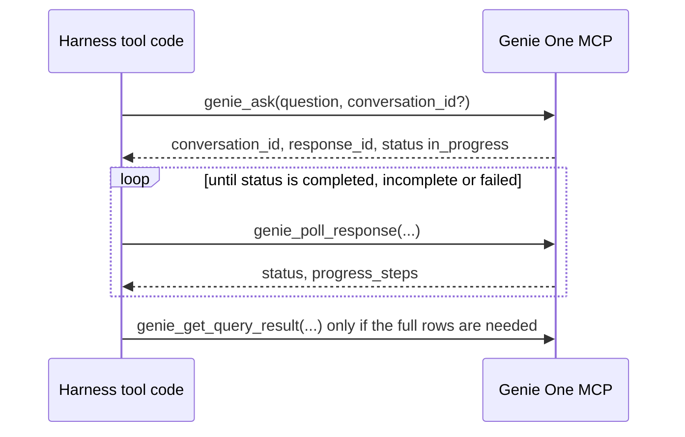

## 1. The question this idea answers

A user asks a chat agent: "How many minutes of downtime did plant 3 have on the night shift yesterday?" The model cannot query a warehouse itself. It needs a data tool that turns the question into SQL, runs the SQL with the user's permissions and returns the answer.

On Databricks, that tool is Genie. Genie does not answer at once. It searches metadata, asks a model, waits for a warehouse and runs SQL. That takes seconds, sometimes minutes. So four design questions appear:

1. Which tools does the Genie One MCP server give, and how does the slow answer reach the caller?
2. Who polls for the answer: the model, or your code?
3. How large is the result, and what does it cost in the context window?
4. How does the user see progress while the query runs?

This lesson answers them from the official docs and the official source code. It also answers a fifth question: is there a documented tool named `query_agent`?

## 2. Mental model

> [!analogy] A deli counter with a ticket screen
> You order at the counter and get a ticket number. The kitchen works on your order. A screen shows the steps: "slicing", "packing", "ready". You check the screen until it says "ready", then you collect the order. A very large order comes as a sample tray at the counter, and a pickup slip for the full order.
>
> `genie_ask` is the order. The `response_id` is the ticket. `genie_poll_response` is a check of the screen. The `progress_steps` are the screen messages. The truncated rows are the sample tray. `genie_get_query_result` and the "Explore in Databricks" link are the pickup slip.
>
> **Where it stops working:** at a deli, a check of the screen is free. If the model itself polls, every check is a full model call that sends the whole conversation again. So the checks should happen in your code, not in the model.

## 3. Terms

| Term | Plain meaning |
|---|---|
| Genie | The Databricks feature that answers data questions in natural language by writing and running SQL. |
| Genie Agent | A configured Genie for one data domain: tables, instructions and examples. The docs say: "Genie Agents were formerly known as Genie Spaces." |
| Genie One | The workspace-wide Genie that answers across your data and can route parts of a question to Genie Agents. |
| Genie Ontology | The governed semantic layer that Genie One uses for business terms, metric definitions and table relationships. |
| Genie One MCP server | The MCP server `system.ai.genie_one_mcp`. It exposes Genie One as tools. |
| conversation | A thread of questions and answers in Genie. A `conversation_id` names it. |
| response | One answer that Genie is producing or has produced. A `response_id` names it. |
| polling | Asking again and again for the state of a slow job until it ends. |
| progress step | One status message that Genie reports while it works. |
| truncated result | A result that holds only part of the rows, to protect the context window. |
| deep link | A URL that opens the full conversation in the Databricks UI. |
| wrapper tool | One tool in your harness that calls several MCP tools in code and returns one result to the model. |
| stream writer | The LangGraph function that sends custom events to the caller of `stream()` while a node or tool runs. |
| context cost | The tokens that a tool result adds to every later model call while it stays in the history. |

## 4. Method and math

### 4.1 How Genie answers a data question

The Genie Agents conversation API reference (checked on 2026-10-13) lists the states of one message. They show the work inside Genie, in order:

| Status | Docs text |
|---|---|
| `SUBMITTED` | "Message has been submitted." |
| `FETCHING_METADATA` | "Fetching metadata from the data sources." |
| `FILTERING_CONTEXT` | "Running smart context step to determine relevant context." |
| `ASKING_AI` | "Waiting for the LLM to respond to the user's question." |
| `PENDING_WAREHOUSE` | "Waiting for warehouse before the SQL query can start executing." |
| `EXECUTING_QUERY` | "Executing a generated SQL query." |
| `COMPLETED` | "Message processing is completed. Results are in the `attachments` field." |
| `FAILED` | "The response generation or query execution failed. See `error` field." |
| `CANCELLED` | "Message has been cancelled." |
| `QUERY_RESULT_EXPIRED` | "SQL result is not available anymore. The user needs to rerun the query." |



These statuses belong to the Genie Agents conversation API. The Genie One MCP server reports its own status values, in lowercase (section 4.3). The idea is the same: an answer moves through several slow steps, and the caller must wait.

Genie One adds one layer on top. The GA announcement (September 22, 2026) says that Genie One's "intelligent routing dynamically delegates complex sub-tasks to tailored, domain-specific Genie Agents." The MCP page says: "Genie resolves business terms, metric definitions, and table relationships through Genie Ontology, your governed semantic layer, which produces more accurate answers than an agent writing SQL directly against raw tables."

### 4.2 The Genie One MCP server

The page "Genie One MCP server" (last updated Oct 8, 2026, checked on 2026-10-13):

- URL: `https://<workspace-hostname>/ai-gateway/mcp-services/system.ai.genie_one_mcp`
- It "exposes Genie as a conversational tool over the Model Context Protocol (MCP)."
- "Unity Catalog permissions are enforced on every request, so results are scoped to what the user can access."
- On-behalf-of user OAuth is recommended. "Service principal authentication is also supported for programmatic and automated workloads." With on-behalf-of auth, "include the `ai-gateway` OAuth scope."
- Pricing: "The Genie One MCP server uses Chat in Genie One. See Genie pricing."

The tools, word for word from the docs table:

| Tool | Description |
|---|---|
| `genie_ask` | "Ask Genie a natural-language data question and start a response." "Returns `conversation_id`, `response_id`, and `status`." "Pass a `conversation_id` to continue a previous conversation." |
| `genie_poll_response` | "Fetch the latest state of an in-flight or completed response, including progress steps, the final answer, and deep links to your Databricks sources." |
| `genie_get_query_result` | "Fetch the full SQL result, including column schema and rows, for a query Genie ran." |
| `genie_cancel_response` | "Request cancellation of an in-flight Genie turn." |
| `view_ask` | "Ask Genie a question and open the interactive View." "Offered instead of `genie_ask` to MCP Apps clients, and preferred when available." |

To run on one SQL warehouse, "pass `warehouse_id` in the `_meta` parameters on `genie_ask` or `view_ask`." The page does not publish the full input schemas or the output schemas of the tools. `list_tools()` returns the input schemas ([L1](/notes/platforms/databricks/04-mcp-and-genie/l1-databricks-mcp-servers)). Read the output shape from a real response.

> [!trap] The old beta endpoint ends on October 31, 2026
> The docs say: "The previous Beta endpoint, `https://<workspace-hostname>/api/2.0/mcp/genie`, is deprecated" "and will be sunset on October 31, 2026." "Move all workloads to the MCP before then." Note the URL: `/api/2.0/mcp/genie` with no space id. The legacy Genie Agent endpoint `/api/2.0/mcp/genie/{genie_space_id}` is a different endpoint.

### 4.3 Is there a query_agent tool?

You may meet a design that calls Genie through one free-form tool named `query_agent`. A search of the official sources on 2026-10-13 covered these pages:

- the Genie One MCP page, on AWS and on Azure
- the Databricks-provided MCPs page
- the legacy Genie Agent MCP page
- the page "Connect agents to structured data"
- both Databricks blog posts on the Genie One MCP

**None of them contains `query_agent`.** The documented Genie One MCP tools are the five in section 4.2.

So treat `query_agent` as unknown. Two rules follow:

1. If your workspace shows a tool with that name, `list_tools()` is the source of truth. Record its description and input schema, and test it. Do not assume that it behaves like `genie_ask`.
2. Check the URL that serves it. If that URL is the old `/api/2.0/mcp/genie` endpoint, the endpoint ends on October 31, 2026. The docs do not list the tools of that endpoint, so it is not confirmed that `query_agent` came from it.

The rest of this lesson teaches the documented tools.

### 4.4 Polling and latency

The MCP page describes the flow:

- "Because Genie runs an agent that searches data and executes SQL, answers are asynchronous."
- "`genie_ask` starts the response and returns a `conversation_id` and `response_id` with `status: in_progress`."
- "The agent polls `genie_poll_response` until the response completes, surfacing `progress_steps` and a `narration_instruction` along the way to keep you informed."
- "When `status` is `completed` (or `incomplete` / `failed`), the agent returns the rendered answer, including an **Explore in Databricks** deep link".
- "Polling cadence: Wait for the prior `genie_poll_response` call to complete before polling again."



The MCP page gives no polling interval and no timeout. Two other official sources give numbers:

| Source (checked on 2026-10-13) | Numbers |
|---|---|
| Genie Agents API page | Poll "every 1 to 5 seconds". Use exponential backoff up to a maximum of one minute between polls. Limit polling to 10 minutes for most queries. |
| Databricks blog "Genie One MCP: Give any AI Agent the Right Business Context" | "Account for the 90-second SQL execution timeout and the workspace Genie QPM limit when sizing a rollout". The blog gives no QPM number. |
| `databricks_ai_bridge/genie.py` 0.22.0, lines 13–15 | `MAX_ITERATIONS = 500  # for 250 s total` and `ITERATION_FREQUENCY = 0.5  # seconds` |

> [!trap] A wrong number in the bridge's timeout message
> Line 342 of `genie.py` returns the text "Genie query for result timed out after {MAX_ITERATIONS} iterations of 5 seconds". The constant on line 15 is 0.5 seconds, and line 459 uses the correct value. Read the constants, not the message.

Now the main design choice: who polls?

| | The model polls | Your wrapper tool polls |
|---|---|---|
| What the model sees | `genie_ask`, `genie_poll_response` and the other tools | One tool, for example `ask_data_question(question, conversation_id)` |
| One poll costs | A model call that sends the whole context again | One HTTP call |
| Risk | The model stops early, polls too fast or forgets the `response_id` | None of these. Your code has a fixed loop with a timeout. |
| Progress for the user | Appears as model text between tool calls | Sent as stream events from the tool |

> [!example] Worked example: model-driven polling cost
> Assume a conversation context of 30,000 tokens when the agent asks Genie, and an answer that needs 8 polls.
>
> 1. Model-driven: each poll is one model call. Input tokens: 8 × 30,000 = 240,000, plus the growing tool results.
> 2. Wrapper tool: the model makes one call that requests the tool, and one call after the result. The polls cost no model tokens.
> 3. Extra input for model-driven polling: about 240,000 tokens for one question. Prompt caching lowers the price of repeated prefixes ([prompt caching](/notes/ai/context-engineering/01-foundations/l7-prompt-caching)), but each poll still adds a model round trip to the latency.
>
> The 30,000 and the 8 are assumptions for the example. Measure both in your service.

> [!key] Poll in code, not in the model
> Give the model one data tool. Inside it, call `genie_ask`, poll `genie_poll_response` with a fixed interval and a timeout, send progress events, and return one small result. Call `genie_cancel_response` when the timeout ends the wait.

### 4.5 What the model receives, and what it costs

The MCP page says: "To protect the model's context window, `genie_ask` and `genie_poll_response` return truncated query results." And: "Very large results are still subject to a size limit; if it's exceeded, the response is truncated." The page gives no row count or byte count for either limit. `genie_get_query_result` returns the full result with the column schema.

How large is a table of rows as text? The sandbox rendered production-order rows as a markdown table with pandas, like the bridge does. The columns were plant, order id, line, shift, downtime minutes and reason:

| Rows | Characters |
|---|---|
| 10 | 947 |
| 100 | 8,159 |
| 1,000 | 81,161 |

So each row cost about 80 characters in this shape. The token count depends on the tokenizer of your model. Count it with the token counter of your provider before you choose a limit.

The `databricks_ai_bridge` `Genie` class has its own cap. Line 13 sets `MAX_TOKENS_OF_DATA = 20000`. When `truncate_results=True`, lines 132–162 find the largest number of rows whose markdown fits under that cap. The tokens are counted with the `gpt-4o` encoding of `tiktoken` (line 29), not with a Claude tokenizer. The sandbox could not download that encoding through its proxy, so the network access of your App matters if you enable this option.

> [!example] Worked example: a result that stays in the history
> A tool result stays in the message history. Every later model call sends it again ([tool_use and tool_result](/notes/ai/llm-apis/01-messages-api/l2-tool-use-and-tool-result)). Take the bridge cap of 20,000 tokens per result.
>
> 1. A chat asks 3 data questions. Each answer fills the cap: 3 × 20,000 = 60,000 tokens of tool results.
> 2. The chat continues for 10 more model calls. These calls send the results again: 10 × 60,000 = 600,000 input tokens.
> 3. With a 20-row result of about 80 characters per row, each result is about 20 × 80 = 1,600 characters. The cost drops by a large factor.
>
> Return few rows to the model. Give the full result to the user interface by other means.

A good return value from a wrapper tool is a small JSON object. This shape is a suggestion, not a Databricks format:

```json
{
  "status": "completed",
  "answer": "Plant 3 had 42 minutes of downtime on the night shift.",
  "sql": "SELECT ...",
  "columns": ["plant", "shift", "downtime_min"],
  "rows": [["Plant 3", "C", 42]],
  "rows_shown": 1,
  "truncated": false,
  "conversation_id": "c1",
  "explore_url": "https://..."
}
```

Fill each field only when the real Genie response gives it. The docs do not publish the response schema, so exercise 2.3 records it.

### 4.6 Progress events while the query runs

A wrapper tool can send each new progress step to the user interface while it polls. In LangGraph, a tool calls `get_stream_writer()` and writes a dictionary. The caller receives it in the `custom` stream mode ([stream modes](/notes/ai/langchain-langgraph/05-streaming/l1-stream-modes-and-stream-writer)).

This test ran in the sandbox with langchain 1.4.5, langgraph 1.2.14, a fake chat model and a fake Genie with three polls:

```python
@tool
async def ask_genie(question: str) -> str:
    """Ask Genie a data question and wait for the answer."""
    write = get_stream_writer()
    for status, step in FAKE_POLLS:          # stands for genie_poll_response calls
        await asyncio.sleep(0.05)
        if step:
            write({"type": "progress", "tool": "ask_genie", "step": step})
    return json.dumps({"status": "completed", "rows": [["Plant 3", 42]]})

# ... agent = create_agent(model, tools=[ask_genie])
# async for mode, chunk in agent.astream(inputs, stream_mode=["custom", "updates"]): ...
```

The output:

```text
updates: ['model']
custom : {'type': 'progress', 'tool': 'ask_genie', 'step': 'Finding relevant tables'}
custom : {'type': 'progress', 'tool': 'ask_genie', 'step': 'Running SQL'}
updates: ['tools']
updates: ['model']
```

The progress events arrive before the tool's update. So the user sees "Running SQL" while the tool still waits. The step texts here are invented for the fake. Genie's real `progress_steps` give the texts in production. The tool awaits, so it must use `acall_tool()`, never `call_tool()` ([L1](/notes/platforms/databricks/04-mcp-and-genie/l1-databricks-mcp-servers)).

### 4.7 Conversations

`genie_ask` accepts a `conversation_id`. The docs: "To continue the same conversation, the follow-up question reuses the previous `conversation_id`." So a chat service can store the Genie `conversation_id` with its own chat and pass it on the next data question. Genie then sees the earlier data questions of that chat.

The legacy Genie Agent MCP server works differently. Its page lists the limitation "No conversation history." and explains: "The server invokes Genie as a tool, so it doesn't pass conversation history to the Genie API."

### 4.8 Production view

| Concern | What to do |
|---|---|
| Latency | Poll in code with a fixed interval. Start at 1 to 5 seconds and increase the interval step by step. Stop after a timeout, and call `genie_cancel_response`. |
| Concurrency | Never send a new poll before the previous one returns. The docs require it. |
| Context cost | Return a few rows, the SQL and a link. Never send `genie_get_query_result` output to the model by default. |
| User experience | Send each new progress step as a stream event. Send the full table to the user interface, not to the model. |
| Security | Prefer on-behalf-of user OAuth with the `ai-gateway` scope, so Unity Catalog permissions apply per user. |
| Reliability | Treat `incomplete` and `failed` as results that the model can explain. Return them with a clear status, not as exceptions. |
| Lifecycle | Move from `/api/2.0/mcp/genie` before October 31, 2026. |
| Observability | Log `conversation_id`, `response_id`, the poll count, the seconds waited and the final status for each question. |

## 5. Code

These exercises go in `databricks/08-genie-polling-tool.ipynb`. Exercises 2.1, 2.2 and 2.4 need no workspace.

**Exercise 2.1: a polling wrapper.** Write `async def ask_and_wait(ask, poll, cancel, question, *, interval, max_interval, timeout, on_progress)`. `ask`, `poll` and `cancel` are injected async functions, so the test can use fakes. The function returns a final status dictionary.

Acceptance tests:

- With a fake that completes on poll 4, it returns the completed result after exactly 4 polls.
- With a fake that never completes, it stops at the timeout, calls `cancel` once and returns a status that says "timeout".
- Two polls never overlap: a fake that records the start and end time of each poll proves it.
- The wait between polls grows and never exceeds `max_interval`.
- `on_progress` receives each new progress step once, even when a poll repeats an old step.

**Exercise 2.2: a small result for the model.** Write `compact_result(columns, rows, *, max_rows, max_chars)`. It returns the JSON text for the model.

Acceptance tests:

- For 1,000 rows and `max_rows=20`, the output has 20 rows, `rows_shown = 20` and `truncated = true`.
- The output never exceeds `max_chars` characters. It drops rows, not columns, to fit.
- For 0 rows, the output says so clearly, with `rows_shown = 0`.

**Exercise 2.3: record the real shapes.** In your workspace, call `genie_ask` and then `genie_poll_response` through `acall_tool()` with the Genie One MCP URL. Ask one question about a table that you can read.

Acceptance tests:

- You save the raw JSON of the ask result and of each poll.
- You list the keys of each, and the values of `status` that you saw.
- You record the number of polls, the total seconds and the size in characters of the final result.

**Exercise 2.4: progress events.** Build a `create_agent` agent with a fake model that calls your wrapper tool once. Stream with `stream_mode=["custom", "updates"]`.

Acceptance tests:

- At least one `custom` event arrives before the `tools` update.
- Each event has the keys `type`, `tool` and `step`.

## 6. Common mistakes

1. **Giving the model the raw ask and poll tools.** Every poll becomes a model call. Poll in a wrapper tool.
2. **Assuming a `query_agent` tool exists because a design names it.** It is not in the official docs (checked on 2026-10-13). Use `list_tools()` and record what your workspace really offers.
3. **Sending the full result to the model.** It stays in the history and costs tokens on every later call. Return few rows and a link.
4. **Polling with no timeout.** A stuck answer blocks the chat. Use a timeout, then cancel.
5. **Starting a new poll before the last one returns.** The docs forbid it.
6. **Calling `call_tool()` inside the async wrapper.** It raises the event-loop error of L1. Use `acall_tool()`.
7. **Forgetting the conversation id.** Follow-up questions then lose their context in Genie.

## 7. One-minute explanation

Genie answers in slow steps: it fetches metadata, filters context, asks a model for SQL, waits for a warehouse and runs the query. The Genie One MCP server, `system.ai.genie_one_mcp`, exposes this through five documented tools. `genie_ask` starts an answer, and `genie_poll_response` returns its state and progress steps. `genie_get_query_result` returns the full rows, `genie_cancel_response` stops an answer, and `view_ask` serves MCP Apps clients. The docs list no tool named `query_agent`. Answers are asynchronous, so someone must poll. Poll in your own wrapper tool, not in the model, because each model poll sends the whole context again. The wrapper sends each progress step as a stream event and stops after a timeout. It returns a small JSON result: the answer, the SQL, a few rows and a link. Tool results stay in the history, so a big result costs tokens on every later call.

## 8. Check questions

```check
{
  "question": "Name the five documented tools of the Genie One MCP server and the job of each one.",
  "answer": "genie_ask starts an answer and returns conversation_id, response_id and status. genie_poll_response returns the latest state, the progress steps, the final answer and deep links. genie_get_query_result returns the full SQL result with the column schema and rows. genie_cancel_response asks Genie to stop an in-flight answer. view_ask asks a question and opens the interactive View, for clients that support MCP Apps."
}
```

```check
{
  "question": "Your context is 50,000 tokens when the agent asks Genie, and the answer needs 6 polls. Compare the extra model input of model-driven polling with a wrapper tool.",
  "hint": "Each model-driven poll is one model call with the whole context.",
  "answer": "Model-driven: 6 polls × 50,000 tokens = 300,000 extra input tokens, plus the growing poll results. Wrapper tool: 0 extra model tokens for the polls, because the code polls. The model makes one call that requests the tool and one call after the result in both designs."
}
```

```check
{
  "question": "Why should a data tool return 20 rows and a link instead of the full 1,000-row result, even if the model can read 1,000 rows?",
  "answer": "The tool result stays in the message history, so every later model call sends it again. In the sandbox test, 1,000 rows were 81,161 characters, and 20 rows are about 1,600 characters. Over many later calls, the difference multiplies. The full table can go to the user interface instead, and genie_get_query_result or the deep link gives the full data when it is really needed."
}
```

```check
{
  "question": "A teammate says: our agent uses the query_agent tool of the Genie One MCP, as documented. What do you check, and what do you tell them?",
  "answer": "The official docs, checked on 2026-10-13, list five tools and no query_agent. So I run list_tools() against the URL that the agent uses, record the real tool names and schemas, and check the URL. If it is the old /api/2.0/mcp/genie beta endpoint, it is deprecated and ends on October 31, 2026, so the agent must move to system.ai.genie_one_mcp."
}
```

## 9. Links

- Previous: [L1: Databricks MCP servers](/notes/platforms/databricks/04-mcp-and-genie/l1-databricks-mcp-servers)
- Next: [Lakebase L1: What Lakebase is](/notes/platforms/databricks/05-lakebase/l1-what-lakebase-is)
- Progress events: [Stream modes and get_stream_writer](/notes/ai/langchain-langgraph/05-streaming/l1-stream-modes-and-stream-writer)
- Why results stay in the history: [tool_use and tool_result](/notes/ai/llm-apis/01-messages-api/l2-tool-use-and-tool-result)
- Async calls from tools: [Sync code calling async code](/notes/software-engineering/python/01-asyncio/l3-sync-code-calling-async-code)
- [Glossary](/notes/platforms/databricks/glossary)
