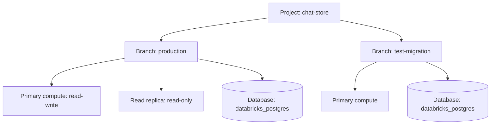

## 1. The question this idea answers

A chat service writes a few rows on every user message: the message, the answer, the tool calls and a new `updated_at` on the chat. It reads the last messages of one chat many times per minute. This is an **OLTP** workload: many small reads and writes, each one fast, each group of writes in one transaction ([transactions](/notes/databases/postgres/02-transactions/l1-transactions)).

Databricks offers a database for this workload: **Lakebase**, a managed PostgreSQL. To use it well, you must know what you create, what runs when, which Postgres you get and how a program authenticates. The login is the unusual part: the password is a short-lived OAuth token, not a fixed secret.

This lesson describes the current product model as the docs state it on 2026-10-13. The product changed in 2026, so older blog posts and examples may use names that no longer apply.

## 2. Mental model

> [!analogy] A Git repository with a database engine per branch
> A Lakebase project is like a Git repository. It holds branches. The default branch in the docs' examples is `production`. You can create a branch for a test, like a feature branch.
>
> Each branch gets a compute: a running Postgres engine that serves that branch's data, like a development server that runs one checkout. When nobody uses the engine for a while, it stops. The next connection starts it again.
>
> **Where it stops working:** a Git checkout holds its own files. A Lakebase compute holds no data. The architecture page says: "Lakebase separates storage from compute." The data stays in the storage layer while the compute is stopped. And a stopped engine loses its session state, such as temporary tables and prepared statements.

## 3. Terms

| Term | Plain meaning |
|---|---|
| Lakebase | The managed PostgreSQL database service of Databricks. |
| OLTP | Online transaction processing: many small, fast reads and writes of single rows, grouped in transactions. |
| project | The top-level container of a Lakebase database: its branches, computes and databases. |
| branch | A version of the project's data, used like a Git branch. Each branch has its own compute and databases. |
| compute | The running Postgres engine of a branch. The primary compute reads and writes. |
| read replica | An extra compute of a branch that only reads. |
| endpoint | The stable connection point of a compute. Its resource name has the form `projects/.../branches/.../endpoints/...`. |
| compute unit (CU) | The size unit of a compute. One CU has about 2 GB of RAM, with CPU and local SSD. |
| autoscaling range | The minimum and maximum CU between which a compute changes its size by load. |
| scale to zero | The compute stops after a period with no activity and starts again on the next connection. |
| database credential | An OAuth token that a program uses as the Postgres password. It expires after one hour. |
| Postgres role | A database user. A Databricks identity connects as a role with the same name. |
| `databricks_postgres` | The default database in every project. |
| Lakebase Provisioned | The original version of Lakebase with fixed-size compute. All instances are now upgraded. |

## 4. Method and math

### 4.1 One product, one platform

The overview page (last updated Oct 9, 2026, checked on 2026-10-13): "Lakebase is a fully managed Postgres database integrated into the Databricks platform."

In 2026 Lakebase moved to one platform. The upgrade page says:

- "Since March 12, 2026, new Lakebase instances are created as Autoscaling projects, not Provisioned instances."
- "The upgrade of Lakebase Provisioned instances to Autoscaling completed in July 2026."
- "The Provisioned UI remains available until September 1, 2026".

The Provisioned page adds: "All Lakebase Provisioned instances have been upgraded to the Lakebase Autoscaling platform, now known simply as Lakebase." So "Lakebase" today means the autoscaling model with projects. You still meet the old names in APIs, libraries and app resources. This table maps them:

| Item | Lakebase Provisioned (old) | Lakebase Autoscaling (current) |
|---|---|---|
| Top-level object | Database instance | Project |
| Size unit | Capacity unit: 16 GB RAM | CU: about 2 GB RAM |
| SDK and REST API | Database instance API (`w.database`) | Postgres API (`w.postgres`) |
| Credential call | `w.database.generate_database_credential(...)` | `w.postgres.generate_database_credential(endpoint=...)` |
| `LakebasePool` parameter | `instance_name` | `project` and `branch`, or `autoscaling_endpoint` |
| App resource key (default) | `database` | `postgres` |

The upgrade page also says which API manages what. Projects created in the Autoscaling UI or with the Postgres API use the "Postgres API only". Upgraded Provisioned instances can use "Both APIs". The last three rows of the table come from the SDK source and the app resource page, covered in [L2](/notes/platforms/databricks/05-lakebase/l2-lakebase-as-an-app-resource) and [L3](/notes/platforms/databricks/05-lakebase/l3-lakebase-pool).

### 4.2 Project, branch, compute, database

The core concepts page (last updated Sep 11, 2026): "A Lakebase project is the top-level container for all your database resources." "Database branches in Lakebase work similarly to Git branches for your code." "A Lakebase endpoint is the stable connection point your application uses to reach a database." A branch "typically has one read-write endpoint (your primary compute) and optionally one or more read-only endpoints (read replicas)."



A program names a compute by its endpoint resource name. The authentication page gives the format: `projects/{project-id}/branches/{branch-id}/endpoints/{endpoint-id}`. The quickstart page says: "Each project contains a default database named `databricks_postgres` that you can connect to."

### 4.3 Computes, autoscaling and scale to zero

The page "Manage computes" (last updated Sep 25, 2026) gives the sizes:

- "Each Compute Unit (CU) allocates approximately 2 GB of RAM to the database instance".
- Autoscaling works from 0.5 CU to 64 CU. "The difference between your maximum and minimum compute sizes cannot exceed 16 CU."
- Larger computes have a fixed size. The page gives two ranges: "Larger fixed-size computes: 65 CU to 112 CU" in a list and "(80-112 CU)" in a table heading. The docs disagree with themselves here.

The size also limits the number of connections:

| Compute size | RAM | Max connections |
|---|---|---|
| 0.5 CU | ~1 GB | 105 |
| 1 CU | ~2 GB | 218 |
| 2 CU | ~4 GB | 443 |
| 4 CU | ~8 GB | 894 |
| 8 CU | ~16 GB | 1795 |
| 16 CU | ~32 GB | 3597 |
| 32 CU | ~64 GB | 3993 |

For an autoscaling compute, "the maximum number of connections is determined by the smaller of your maximum CU and 8× your minimum CU." Also, "Some connections are reserved for system and administrative use."

> [!example] Worked example: connection limits of three autoscaling ranges
> The rule: limit size = min(maximum CU, 8 × minimum CU). Then read the table.
>
> 1. Range 2 to 8 CU: min(8, 8 × 2) = min(8, 16) = 8 CU. Limit 1,795. This matches the docs' own example.
> 2. Range 0.5 to 8 CU: min(8, 8 × 0.5) = min(8, 4) = 4 CU. Limit 894.
> 3. Range 1 to 8 CU: min(8, 8 × 1) = min(8, 8) = 8 CU. Limit 1,795.
>
> Lesson: a low minimum also lowers the connection limit. Raising only the maximum does not help.

The scale-to-zero page (last updated May 15, 2026):

| Fact | Docs text |
|---|---|
| What it does | "Scale to zero automatically suspends your Lakebase compute after a period of inactivity." |
| Default | "The inactivity timeout defaults to 24 hours." "Manage computes" adds: "By default, the `production` branch has scale to zero enabled with a 24-hour timeout." |
| Range | The timeout can be "set between 60 seconds and 7 days." |
| Size limit | "Scale to zero is available only for computes of 32 CU or smaller." |
| Wake time | The compute "reactivates within a few hundred milliseconds" when a new query arrives. |
| Cost | A suspended compute "consumes no resources and incurs no compute costs." |
| Side effect | "When a compute suspends and later reactivates, the session context resets." The page lists temporary tables, prepared statements, session settings, connection pools and active transactions among the affected items. |

The upgrade page adds one exception: "Scale-to-zero is not enabled by default for upgraded instances."

> [!trap] A suspend breaks the connections in your pool
> After a suspend, the connections that your service holds no longer have a live session. A connection pool must check or replace a connection before it lends it out. [L3](/notes/platforms/databricks/05-lakebase/l3-lakebase-pool) shows how.

The quickstart page sets two more limits for every connection: "All database connections are subject to a 24-hour idle timeout and 3-day maximum connection life."

### 4.4 Postgres versions

The page "Postgres version support" (last updated Oct 9, 2026):

| Major version | Status (checked on 2026-10-13) |
|---|---|
| 16 | Supported |
| 17 | Supported. "Postgres 17 is the default." |
| 18 | Supported. Added in June 2026, starting with 18.4. |

The release notes of Aug 24, 2026 say: "Lakebase updated its supported Postgres versions to 16.15, 17.11, and 18.6." The local test server of these notes runs 16.15.

Two rules matter for planning:

1. "Lakebase aligns end-of-life for each major version with the official PostgreSQL five-year support window."
2. "Lakebase does not upgrade a project to a new major Postgres version in place." To move up, you create a new project with the new version and migrate the data with `pg_dump` and `pg_restore`.

Projects that were created with the Database instance API use PostgreSQL 16. The upgrade page says: "The default for projects created using the Autoscaling UI or Postgres API is PostgreSQL 17".

The compatibility page lists what you do not get. There is no access to Postgres logs, no tablespaces and no host access. There is no superuser login: the role `databricks_superuser` takes its place. Native logical replication is "not yet available". You can set only parameters with a `user` context.

### 4.5 Authentication: a token as the password

The page "About authentication" (last updated Sep 11, 2026) lists two methods: "OAuth token authentication" and "Native Postgres password authentication". The OAuth method works like this:

1. A Databricks identity (a user or a service principal) asks Databricks for a database credential for one endpoint.
2. Databricks returns a token.
3. The program connects to Postgres with the identity's role name as the user and the token as the password.

The key rules, word for word:

- "OAuth tokens expire after one hour."
- "Open connections remain active even after the token expires." The token is checked only at login.

Two ways to get a token:

```bash
databricks postgres generate-database-credential projects/my-project/branches/production/endpoints/my-compute --output json
```

```python
from databricks.sdk import WorkspaceClient

w = WorkspaceClient()
cred = w.postgres.generate_database_credential(
    endpoint="projects/<project-id>/branches/<branch-id>/endpoints/<endpoint-id>"
)
password = cred.token          # use as the Postgres password
expires = cred.expire_time     # UTC timestamp
```

The Python block is a sketch: it needs a workspace. The method signature comes from `databricks-sdk` 0.152.0 (`service/postgres.py` line 4957): `generate_database_credential(self, endpoint, *, claims=None, expire_time=None, ttl=None)`. The docstring says that `ttl` "Must be at least 300 seconds (5 minutes) and at most 3600 seconds (1 hour)". The call is a `POST` to `/api/2.0/postgres/credentials`.

> [!example] Worked example: token time versus connection time
> A service mints a token at 09:00. It expires at 10:00.
>
> 1. 09:50: the service opens connection A with the token. Login succeeds.
> 2. 10:20: connection A runs a query. It works. The token was checked only at 09:50.
> 3. 10:20: the service opens connection B with the same token. Login fails, because the token expired at 10:00.
> 4. Connection A stays usable until it is idle for 24 hours or reaches the 3-day maximum life.
>
> So the rule is simple: every new connection needs a token that is valid at that moment.

A role for a Databricks identity comes from the `databricks_auth` extension. The roles page: `CREATE EXTENSION IF NOT EXISTS databricks_auth;` then `SELECT databricks_create_role('identity_name', 'identity_type');` with the types `USER`, `SERVICE_PRINCIPAL` and `GROUP`. The function "creates a Postgres role with `LOGIN` permission only." The project owner role "owns the default `databricks_postgres` database".

The second method, native Postgres passwords, uses a normal role with a fixed password. The quickstart page says that "Lakebase includes a built-in connection pooler for native Postgres password roles."

### 4.6 Connection details

The values come from the **Connect** dialog of the project. The official psycopg example uses:

| Parameter | Example value in the docs |
|---|---|
| `host` | `ep-example.database.region.databricks.com` (the endpoint host name) |
| `port` | `5432` |
| `dbname` | `databricks_postgres` |
| `user` | The Databricks identity, for example `your.email@company.com`. For an app service principal, its client ID ([L2](/notes/platforms/databricks/05-lakebase/l2-lakebase-as-an-app-resource)). |
| `password` | The OAuth token |
| `sslmode` | `require` |

As a connection string: `dbname=databricks_postgres user=your.email@company.com host=ep-example.database.region.databricks.com port=5432 sslmode=require`. The token travels separately, as the password.

### 4.7 Pricing in one paragraph

Compute is billed per CU-hour: the Databricks blog on Always-On pricing (May 27, 2026) applies the standard rate to "every CU-hour". A suspended compute "incurs no compute costs" (scale-to-zero page). For storage, the architecture page says "you pay only for the storage you consume". The same blog describes Always-On pricing. With scale to zero disabled, the minimum CU becomes a baseline. After 24 hours of continuous use, you "automatically receive a 25% lower price on your baseline capacity". It also mentions a 50% promotional discount "through January 31, 2027". The fetched pricing page showed no rates, so check the rates for your cloud and region on https://www.databricks.com/product/pricing/lakebase before you estimate a budget.

> [!key] Lakebase in one sentence
> Lakebase is a Postgres engine (a compute) on separate storage, organized as project, branch and database. It scales by CU, can stop when idle, and accepts a one-hour OAuth token as the password at login.

### 4.8 Production view

| Concern | What to do |
|---|---|
| Version | Choose the major version at project creation. Changing it later means a new project and a dump and restore. |
| Latency | Expect a cold start of a few hundred milliseconds after a suspend. Set the inactivity timeout to match your traffic. |
| Reliability | Check pooled connections before use. A suspend resets the session, and connections live at most 3 days. |
| Capacity | Size the minimum CU for the connection count, not only for CPU. Use the rule min(max CU, 8 × min CU). |
| Security | Use OAuth tokens. Mint a new token for each new connection, or cache it for less than one hour. |
| Cost | Use scale to zero for test branches. For a steady production load, compare Always-On pricing. |
| Observability | There is no access to Postgres logs. Use Postgres views such as `pg_stat_activity` and the Lakebase monitoring pages. |

## 5. Code

These exercises go in `databricks/09-lakebase-basics.ipynb`. Exercises 1.1 and 1.3 need a Lakebase project.

**Exercise 1.1: connect by hand.** Create a token with the CLI command of section 4.5. Connect with `psql` or `psycopg` to the `production` branch, with your email as the user and the token as the password.

Acceptance tests:

- `SELECT current_user, current_database(), version();` shows your email, `databricks_postgres` and the major version that you chose.
- `SHOW max_connections;` returns a number. You compare it with the table of section 4.3 and explain the difference with the reserved connections.

**Exercise 1.2: a connection-limit function.** Write `connection_limit(min_cu, max_cu)` that applies the rule of section 4.3 and the table. Use no network.

Acceptance tests:

- `connection_limit(2, 8)` returns 1795.
- `connection_limit(0.5, 8)` returns 894.
- A range wider than 16 CU raises `ValueError`.

**Exercise 1.3: prove that expiry is checked only at login.** Generate a token with `ttl` of 300 seconds. Open connection A. Wait 6 minutes.

Acceptance tests:

- After 6 minutes, connection A still runs `SELECT 1`.
- A new connection with the same token fails. You record the exact error text.
- A new connection with a fresh token succeeds.

## 6. Common mistakes

1. **"Lakebase Provisioned and Autoscaling are two products to choose from."** Since July 2026 all instances run on the autoscaling platform. Provisioned names survive only in APIs, libraries and app resources.
2. **Storing the database token as a fixed secret.** It expires after one hour. Mint it in code.
3. **"An expired token kills open connections."** It does not. Open connections remain active. Only new logins need a valid token.
4. **Planning an in-place major upgrade.** Lakebase does not do it. Plan a new project and a migration.
5. **Ignoring scale to zero in a pooled service.** After a suspend, the session context resets. Pooled connections must be checked.
6. **Setting a low minimum CU for a service with many instances.** The connection limit follows min(max CU, 8 × min CU).

## 7. One-minute explanation

Lakebase is managed PostgreSQL inside Databricks, for OLTP work like chat history. Since 2026 there is one model: a project holds branches, like Git. Each branch has a compute, which is the Postgres engine, and databases, by default `databricks_postgres`. Storage is separate from compute, so a compute can scale between 0.5 and 64 CU and can stop after an idle timeout. A stopped compute wakes in a few hundred milliseconds, and the compute size also sets the connection limit. Postgres 16, 17 and 18 are supported, 17 is the default, and there is no in-place major upgrade. A program authenticates with an OAuth token as the password. The token expires after one hour, but Postgres checks it only at login. So open connections keep working, and each new connection needs a fresh token. Compute is billed per CU-hour and costs nothing while suspended.

## 8. Check questions

```check
{
  "question": "A service holds 10 open connections that it opened with a token at 08:30. At 09:45 one connection breaks, and the pool opens a new one with the same token. What happens to the 9 old connections and to the new one?",
  "answer": "The 9 old connections keep working, because Lakebase checks the token only at login. The new connection fails, because the token expired at 09:30, one hour after it was minted at 08:30. The pool must mint a fresh token for every new connection."
}
```

```check
{
  "question": "A compute autoscales between 0.5 and 8 CU. What is its connection limit, and how do you raise it without raising the maximum?",
  "hint": "min(max CU, 8 × min CU)",
  "answer": "min(8, 8 × 0.5) = 4 CU, so the limit is 894 connections. Raising the minimum to 1 CU gives min(8, 8) = 8 CU and a limit of 1,795, with the same maximum."
}
```

```check
{
  "question": "Your project runs Postgres 16. A new feature needs Postgres 18. What must you do?",
  "answer": "Lakebase does not upgrade a major version in place. Create a new project with Postgres 18, migrate the data with pg_dump and pg_restore, then move the application to the new project's endpoint."
}
```

```check
{
  "question": "Name three things that a scale-to-zero suspend resets, and one thing that it keeps.",
  "answer": "It resets the session context: for example temporary tables, prepared statements, session settings, connection pools and active transactions. It keeps the data, because storage is separate from compute, and it keeps the endpoint, so the same connection string and credentials still work."
}
```

## 9. Links

- Previous: [MCP and Genie L2: Genie One MCP](/notes/platforms/databricks/04-mcp-and-genie/l2-genie-one-mcp)
- Next: [L2: Lakebase as an App resource](/notes/platforms/databricks/05-lakebase/l2-lakebase-as-an-app-resource)
- Transactions in Postgres: [Transactions](/notes/databases/postgres/02-transactions/l1-transactions)
- Lakebase compared with Delta: [L4: Lakebase vs Delta](/notes/platforms/databricks/05-lakebase/l4-lakebase-vs-delta)
- [Glossary](/notes/platforms/databricks/glossary)
