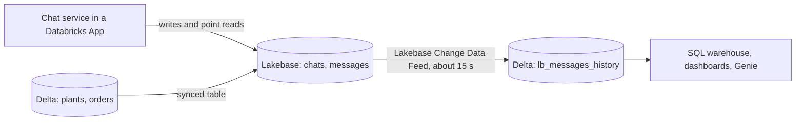

## 1. The question this idea answers

A team stores chat history in Delta tables today. It works for a demo. Then an administrator asks a fair question about the plan to move it to Lakebase: "We already have Delta tables, Unity Catalog and SQL warehouses. Why add a second database to run, secure and pay for?"

"Postgres is faster" is not an answer that an administrator accepts. The answer must name the workload and show what each system does with it. It must cite official sources and say how analytics will still reach the data. This lesson builds that argument, with measurements from the sandbox and quotes from Databricks docs and from the official Databricks article on this exact choice.

## 2. Mental model

> [!analogy] A ledger and an archive of sealed boxes
> An office keeps two kinds of records. The ledger is a bound book at the front desk. A clerk adds one line in seconds, corrects a line, and finds any customer's page at once through the index tabs.
>
> The archive is a warehouse of sealed boxes. To add records, a clerk packs a new box, seals it and writes it into the archive register. The archive is excellent for questions across millions of records: "How many orders per month in 2025?"
>
> Adding one line to the archive means one new box and one new register entry. Do that 60,000 times a day and the archive fills with tiny boxes.
>
> **Where it stops working:** a real office copies the ledger into the archive at night. With Lakebase and Delta, the copy can run every few seconds (section 4.6), so analytics need not wait for the next day.

## 3. Terms

| Term | Plain meaning |
|---|---|
| OLTP | Many small reads and writes of single rows, each fast, grouped in transactions. Chat history is OLTP. |
| OLAP | Large reads that scan, join and aggregate many rows. Reports and dashboards are OLAP. |
| point read | A read of a few rows found by a key, for example the last 50 messages of one chat. |
| commit (Delta) | One new version of a Delta table: new data files plus one entry in the transaction log. |
| small files | Many tiny data files from many small writes. They slow reads until compaction merges them. |
| `OPTIMIZE` | The Delta command that merges small files into larger ones. |
| optimistic concurrency control | Writers do not lock. Each one checks for conflicts only at commit time, and a conflicting commit fails. |
| write conflict | A failed commit because another writer changed the same data first. |
| row lock | A Postgres lock on one changed row. A second writer waits for it instead of failing. |
| informational constraint | A key that the table declares but does not enforce. |
| synced table | A read copy of a Unity Catalog table inside Lakebase Postgres. |
| Lakebase Change Data Feed | A Lakebase feature that writes every insert, update and delete of a Postgres table into a Delta table. The official article calls the pattern Lakehouse Sync. |
| catalog commits | A Unity Catalog setting for managed tables that allows transactions across several statements and tables. |

## 4. Method and math

### 4.1 Two workload shapes

| Access in a chat service | Shape | Frequency |
|---|---|---|
| Save a user message and an answer, with their parts | 2 to 10 row inserts, all or nothing | Every message |
| Update `chats.updated_at` and the title | 1 row update | Every message |
| Load the last 50 messages of one chat | Point read by `chat_id` | Every message, and every page view |
| Delete one chat for a user request | A few row deletes | Rare, but must be exact |
| Messages per day by plant, tool errors per week | Scan and aggregate all chats | Daily or weekly |

The first four rows are OLTP. Only the last row is OLAP. So the main workload of chat history is OLTP, with a smaller analytics need on the side.

### 4.2 What one small write costs

A Delta commit writes data files and a log entry. The sandbox measured this with the open-source `deltalake` package 1.6.6 (delta-rs). It is not Databricks Runtime, but it writes the same table format. 100 appends of one row each, on local disk:

```text
rows: 100 | table version: 99
parquet data files: 100 | JSON commit files: 100
mean ms per single-row append (local disk): 39.9
after OPTIMIZE: version 100 | files in current snapshot: 1
parquet files still on disk until VACUUM: 101
```

Each one-row write made one new data file and one new commit. `OPTIMIZE` then merged the 100 files into 1 for readers, but the old files stayed on disk until a `VACUUM`.

The same machine ran 100 one-row `INSERT` statements on PostgreSQL 16 in autocommit mode: **0.48 ms** each on average, and the table took 32 kB. Both numbers are local. On Databricks, a Delta write also travels through a SQL warehouse ([Statement Execution API](/notes/platforms/databricks/03-sql-and-delta/l1-statement-execution-and-delta)), and a Lakebase write travels over the network to the compute. These lessons have no official latency figure for either path. The local test shows the difference in work per write, not production latency.

Databricks docs confirm the file side (page "Control data file size", checked on 2026-10-13): "Writing fewer large files is more efficient than writing many small files." Auto compaction "combines small files within table partitions to reduce small file problems", and it "runs synchronously on the cluster that performs the write, after the write succeeds." For Unity Catalog managed tables, predictive optimization "automatically runs `OPTIMIZE` on tables with predictive optimization enabled."

> [!example] Worked example: commits per day for chat history in Delta
> Assume 1,000 users, 20 messages per user per day, and 3 rows per message (user message, answer, chat update).
>
> 1. Messages per day: 1,000 × 20 = 20,000.
> 2. If each message is one Delta write: 20,000 commits per day, so at least 20,000 new data files before compaction.
> 3. If each row is its own write: 20,000 × 3 = 60,000 commits per day.
> 4. In Postgres, the same day is 20,000 short transactions. Each one changes a few rows and a few index entries in place.
>
> Compaction can merge the Delta files later, but every write still pays for a commit, and compaction runs as extra work on top.

### 4.3 Transactions and concurrent writes

**Delta on Databricks.** The ACID page (checked on 2026-10-13) says: "For managing concurrent transactions, Databricks uses optimistic concurrency control." The steps:

1. Read: "Reads (if needed) the latest available version of the table to identify which files need to be modified".
2. Write: "Writes data files to the directory used to define the table."
3. Validate and commit: "Checks whether the proposed changes conflict with any other changes that may have been concurrently committed".

"Databricks uses write serializable isolation by default for all table writes and updates." By default "each SQL statement executes as its own atomic transaction against one table". Transactions across several statements and tables exist, but the transactions page requires Unity Catalog managed tables "with catalog commits enabled". Its limits: "A transaction can read from or write to up to 100 tables combined." "All transactions automatically roll back after 48 hours total duration." "Interactive transactions roll back after 10 minutes of inactivity." Conflicts are still checked only at commit, and a conflicting transaction fails.

Row-level concurrency reduces conflicts. The page "Row-level concurrency" says it "reduces conflicts between concurrent write operations by detecting changes at the row level". It is enabled automatically with Databricks Runtime 14.3 LTS or above, no partitions and deletion vectors. Even then, `UPDATE`, `DELETE` and `MERGE` can conflict "when modifying the same row", and metadata changes "might cause all concurrent write operations to fail, including `INSERT`."

The sandbox reproduced a conflict with delta-rs: two writers read version 0, and each updated a different chat row of the same file.

```text
both read version: 0 0
writer A committed, table version: 1
writer B failed: CommitFailedError: Failed to commit transaction: Commit failed: a concurrent transactions added new data.
two blind appends from the same version: both committed, version 3
```

delta-rs detected this conflict at the file level. With row-level concurrency on Databricks, these two updates of different rows would not conflict. Two updates of the same row still would.

**Postgres.** A second writer of the same row waits for the first one's row lock, then continues. The sandbox ran two transactions that both incremented the message count of chat `c1`. Writer A held its transaction open for 1 second:

```text
A: updated at 0.01 s, holding 1.0 s
A: committed at 1.01 s
B: updated at 1.01 s, holding 0.0 s
B: committed at 1.01 s
n_messages = 2
```

Writer B waited, then succeeded. No error, no retry code, no lost update ([isolation and upserts](/notes/databases/postgres/02-transactions/l2-isolation-and-upserts)).

| Case in a chat service | Delta | Postgres |
|---|---|---|
| Two messages of one chat arrive at once (two browser tabs) | Both update the same chat row. One commit fails and needs a retry. | The second update waits for the first, then succeeds. |
| Save a message with its parts, all or nothing | One statement per table by default. Several tables need catalog commits. | `BEGIN` ... `COMMIT` across any tables ([transactions](/notes/databases/postgres/02-transactions/l1-transactions)). |
| A schema change while writes run | A metadata change can fail all concurrent writes. | `ALTER TABLE` takes a lock and the writers wait ([schema changes](/notes/databases/postgres/04-schema-changes/l1-alter-table-add-column)). |

### 4.4 Constraints and indexes

The page "Constraints on Databricks" (checked on 2026-10-13) lists two enforced constraints: `NOT NULL` and `CHECK`. Then: "Primary key, foreign key, and unique constraints are informational only and aren't enforced." So a Delta table cannot reject a second message with the same id. A retry after a lost answer can write a turn twice. In Postgres, a `UNIQUE` key plus `INSERT ... ON CONFLICT DO NOTHING` makes the retry safe ([constraints](/notes/databases/postgres/01-relational-basics/l1-tables-keys-and-constraints)).

For reads, Delta skips files. The page "Data skipping" says: "Data skipping statistics are collected automatically when you write data to a Delta Lake or managed Apache Iceberg table." It recommends liquid clustering for new tables. The page describes no row-level index like a Postgres B-tree. A point read on Delta is a scan of the files whose statistics match.

Postgres finds the rows of one chat through a B-tree index. The sandbox loaded 200,000 messages across 1,000 chats and indexed `(chat_id, id)`:

```text
 Limit (actual time=0.025..0.071 rows=50 loops=1)
   ->  Index Scan Backward using msg_bench_chat_id_id on msg_bench (actual time=0.024..0.068 rows=50 loops=1)
         Index Cond: (chat_id = 417)
 Planning Time: 0.231 ms
 Execution Time: 0.083 ms
```

The last 50 messages of one chat took 0.083 ms inside the server ([indexes](/notes/databases/postgres/01-relational-basics/l3-indexes)).

### 4.5 The official article

Databricks published an article with the title "When should a team use Lakebase instead of Delta tables for a Databricks application?" on its developer site: https://developers.databricks.com/perspectives/when-should-a-team-use-lakebase-instead-of-delta-tables-for-a-databricks-application (read on 2026-10-13). The page shows no author and no date. Its answer, word for word:

- "Use Lakebase instead of Delta tables when a Databricks application needs operational Postgres for transactions".
- "Keep Delta tables as the analytical system of record".
- "The practical rule is direct: Delta tables store analytical truth, while Lakebase stores operational behavior."
- "Do not rely on Delta tables as the direct operational store for high-frequency app state."
- "In that case, Lakebase should sit beside Delta tables rather than replace them."

Its decision table has four columns. Two rows matter most for chat history:

| Criterion | Choose Lakebase when | Do not use Lakebase when | Choose Delta tables when | Do not use Delta tables when |
|---|---|---|---|---|
| State | "Sessions, approvals, chat history, memory, or preferences must be durable" | "There is no app state to store" | "State is not part of the workload" | "App state must be changed by users, agents, or workflows" |
| Query pattern | "The app needs low-latency point reads, relational lookups, or Postgres access" | "Large analytical scans are the main pattern" | "The workload needs scans, joins, aggregations, and historical queries" | "The app needs frequent point reads and writes" |

Its FAQ answers "Can Lakebase Replace Delta Tables In A Databricks Application?" with "No." And it names chat history directly: "AI apps often write state during a request", including chat turns, memory and tool outputs.

The article does not discuss small files, write conflicts, constraints or indexes. Sections 4.2 to 4.4 add that evidence from the Databricks docs and from tests.

### 4.6 Analytics still reach the data

Moving chat history to Lakebase does not cut it off from the lakehouse. Two features connect the systems, one in each direction.



**Lakebase to Delta: Lakebase Change Data Feed.** Release notes: "Lakehouse sync (Beta): Continuously replicate Lakebase Postgres tables to Unity Catalog Delta tables using CDC." (Mar 12, 2026). Then "Lakebase Change Data Feed (CDF) is now in Public Preview" (May 12, 2026). The feature page (checked on 2026-10-13):

- Changes are "captured from the write-ahead log and stored as a new row in a Unity Catalog managed Delta table."
- Rows include "a `_pg_change_type`, an LSN, a transaction ID, and a timestamp." "Each `lb_<table_name>_history` table is an append-only Delta table."
- Changes are "batched and flushed every ~15 seconds."
- "For a Lakebase table to participate in CDF, it must have `REPLICA IDENTITY FULL` set." The statement `ALTER TABLE chat.messages REPLICA IDENTITY FULL;` ran on the local PostgreSQL 16.
- "Lakebase partitioned tables are not supported." "A table is only synced if it contains data."

**Delta to Lakebase: synced tables.** The page "Serve lakehouse data with synced tables" says "Unity Catalog tables sync into Postgres so applications can query lakehouse data directly with low latency." Snapshot mode copies all data each time. Triggered and Continuous modes need a change data feed on the source, and Continuous has a minimum interval of 15 seconds. The page recommends read queries only on synced tables. A chat service can join its chats with a synced copy of a plants table, inside Postgres.

> [!key] Each system for its own workload
> Chat history is operational state: small transactional writes, point reads and concurrent updates of the same rows. That is Lakebase. Analytics over all chats is a scan workload. That is Delta, fed from Lakebase by the Change Data Feed. The official Databricks article states the same rule: "Delta tables store analytical truth, while Lakebase stores operational behavior."

### 4.7 The one-page argument

An administrator wants the decision, the evidence, the risks and the cost on one page. This template uses the facts of this part. Replace the numbers in brackets with your own measurements.

```text
DECISION
Store chat history (chats, messages, message parts) in a Lakebase project.
Keep Delta tables for analytics. Replicate chat tables to Delta with Lakebase Change Data Feed.

WORKLOAD
[20,000] messages per day, [3] rows each, written during user requests.
Every message reads the last [50] messages of one chat. Two tabs can write the same chat at once.

WHY NOT DELTA FOR THIS
1. Each Delta write is a commit with new files: [60,000] commits per day, plus compaction.
2. Concurrent updates of the same chat row fail at commit and need retry code.
3. Primary and unique keys are informational only, so a retried save can duplicate a turn.
4. Databricks' own guidance: "Do not rely on Delta tables as the direct operational store for high-frequency app state."

WHY LAKEBASE
Postgres transactions across tables, row locks that wait, enforced keys, B-tree point reads.
Managed inside Databricks: OAuth login with Databricks identities, app resource, no password.

ANALYTICS
Lakebase Change Data Feed writes lb_<table>_history Delta tables about every 15 seconds.
Dashboards and Genie keep using SQL warehouses.

COST AND OPERATIONS
Compute billed per CU-hour, autoscaling [0.5 to 4] CU, scale to zero on test branches.
Connection limit [894] covers [80] pooled connections.

RISKS AND MITIGATIONS
Change Data Feed is Public Preview: keep a daily export job as a fallback.
Token expiry: tokens are minted in code by the pool, checked only at login.
Exit plan: standard Postgres, so pg_dump works.
```

| Question | If yes | If no |
|---|---|---|
| Do users or agents change the data during a request? | Lakebase | Delta |
| Are most reads point reads by a key? | Lakebase | Delta |
| Can two writers change the same row at the same time? | Lakebase | Either |
| Must the database reject duplicate keys? | Lakebase | Either |
| Is the main use scans and aggregates over all rows? | Delta | Lakebase |
| Must dashboards see the data within minutes? | Lakebase plus Change Data Feed to Delta | Lakebase alone |

### 4.8 Production view

| Concern | What to do |
|---|---|
| Correctness | Save each turn in one Postgres transaction with client-chosen ids and `ON CONFLICT DO NOTHING`. |
| Latency | Index `messages (chat_id, ...)` for the history read. Measure it on the real compute. |
| Analytics | Enable the Change Data Feed on the chat tables. Set `REPLICA IDENTITY FULL`. Avoid partitioned tables. |
| Governance | Keep analytics in Unity Catalog through the history tables. Grant the app only table privileges in Lakebase. |
| Cost | Size the minimum CU by connections, use scale to zero for test branches, and compare Always-On pricing for steady load. |
| Risk | Change Data Feed is Public Preview (checked on 2026-10-13). Plan a fallback export. |

## 5. Code

These exercises go in `databricks/12-lakebase-vs-delta.ipynb`. Exercises 4.1 and 4.2 run locally with `deltalake` and PostgreSQL 16.

**Exercise 4.1: small files.** With `deltalake`, write 200 single-row appends to one table, and one append of 200 rows to a second table. Then run `optimize.compact()` on the first table.

Acceptance tests:

- You report the version number, the number of Parquet files and the number of JSON commit files for both tables.
- After compaction, the first table's snapshot has fewer files, and you explain why the old files remain on disk.
- You report the mean time per write for both designs.

**Exercise 4.2: the same row, twice.** Write two concurrent updates of one chat row. First use Postgres with two threads, where the first thread holds its transaction for 1 second. Then use `deltalake` with two `DeltaTable` objects at the same version.

Acceptance tests:

- In Postgres, both updates succeed and the count increases by 2.
- In `deltalake`, the second commit raises an error, and your retry loop then applies it, so the count also increases by 2.
- You record how many lines of retry code each design needed.

**Exercise 4.3: your one-page argument.** Fill the template of section 4.7 with numbers from your own service. Use messages per day, rows per message, history size per read, the compute range and the pool sizes.

Acceptance tests:

- It fits on one page: 400 words or fewer.
- Every number is measured or calculated, and the calculation is shown.
- It names one risk with a mitigation, and an exit plan.

## 6. Common mistakes

1. **"Lakebase replaces Delta."** It does not. The official article answers "No." Lakebase holds operational state, and Delta stays the analytical system of record.
2. **"Delta has no transactions."** It has ACID transactions, per statement by default, and multi-statement transactions with catalog commits. The difference is optimistic concurrency: conflicts fail at commit.
3. **Trusting a Delta primary key to stop duplicates.** Primary, foreign and unique keys are informational only on Databricks.
4. **Arguing with local latency numbers alone.** Local tests show the work per write. Measure production paths on Databricks before you quote milliseconds.
5. **Forgetting analytics in the plan.** Name the Change Data Feed path, or the administrator sees a data silo.
6. **Writing to synced tables.** They are copies of Unity Catalog tables. The docs recommend read queries only.

## 7. One-minute explanation

Chat history is an OLTP workload: every message saves a few rows in one transaction and updates the chat row. It also reads the last messages of one chat by key. Delta tables are built for analytics, and each Delta write is a commit with new data files. So small writes create many small files that need compaction. Delta uses optimistic concurrency, so two updates of the same chat row conflict, and one fails at commit. Its primary and unique keys are informational only. Postgres in Lakebase runs transactions across tables, makes a second writer wait on a row lock, and enforces keys. It reads a chat's messages through a B-tree index in a fraction of a millisecond. The official Databricks article gives the rule: "Delta tables store analytical truth, while Lakebase stores operational behavior." Analytics keep the data: Lakebase Change Data Feed writes every change into Delta history tables about every 15 seconds.

## 8. Check questions

```check
{
  "question": "Two browser tabs send a message to the same chat at the same moment. Both writes update chats.updated_at. What happens on Delta with row-level concurrency, and what happens on Postgres?",
  "answer": "On Delta, both writers update the same row. Even with row-level concurrency, UPDATE pairs conflict when they modify the same row, so one commit fails and the code must retry. On Postgres, the second UPDATE waits for the first transaction's row lock, then runs on the committed row and succeeds. No retry code is needed."
}
```

```check
{
  "question": "A save of a chat turn is retried after a network error, and the turn may already be stored. Why is this safe in Postgres and not in Delta?",
  "answer": "In Postgres, a UNIQUE key on the client-chosen message id plus INSERT ... ON CONFLICT DO NOTHING makes the second insert a no-op. On Databricks, primary key and unique constraints are informational only and are not enforced, so the retry can store the turn twice."
}
```

```check
{
  "question": "An administrator says: if chat history moves to Lakebase, our dashboards lose it. Answer with the specific feature and its main limits.",
  "answer": "Lakebase Change Data Feed writes every insert, update and delete of a Lakebase table into an append-only Delta table named lb_<table_name>_history, batched about every 15 seconds. Dashboards and Genie read those Delta tables. Limits: it is Public Preview, each table needs REPLICA IDENTITY FULL, partitioned tables are not supported, and a table syncs only when it contains data."
}
```

```check
{
  "question": "1,000 users each send 20 messages a day, and each message writes 3 rows. How many Delta commits per day is that if each row is a separate write, and why does it matter?",
  "answer": "1,000 × 20 = 20,000 messages, and 20,000 × 3 = 60,000 commits per day. Each commit creates at least one new data file and a log entry, so the table collects tens of thousands of small files that compaction must merge, and every write pays the commit cost."
}
```

## 9. Links

- Previous: [L3: LakebasePool](/notes/platforms/databricks/05-lakebase/l3-lakebase-pool)
- Delta and the SQL warehouse: [Statement Execution API and Delta tables](/notes/platforms/databricks/03-sql-and-delta/l1-statement-execution-and-delta)
- Postgres transactions: [Transactions](/notes/databases/postgres/02-transactions/l1-transactions)
- Concurrent writes and upserts: [Isolation and upserts](/notes/databases/postgres/02-transactions/l2-isolation-and-upserts)
- The chat tables: [Chats, messages and parts](/notes/ai/conversation-state/02-chat-history-model/l1-chats-messages-and-parts)
- Moving old chats: [Moving old chats](/notes/ai/conversation-state/03-lifecycle/l3-moving-old-chats)
- [Glossary](/notes/platforms/databricks/glossary)
