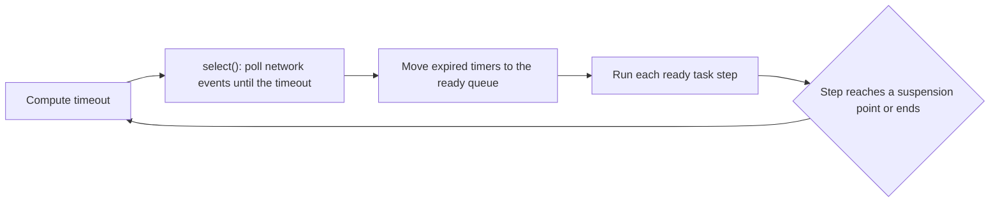

## 1. The question this idea answers

An agent service spends most of its time waiting. A model API call takes several seconds. A Genie query and a database read take time too. While one chat waits, the service must serve other chats.

FastAPI, httpx and the Claude Agent SDK solve this with `asyncio`. Their functions are `async def`, and you call them with `await`. Two kinds of bugs appear when the model of `asyncio` in your head is wrong:

- **Code that never runs.** You call an async function without `await`. Python creates an object and runs no code. A chat turn is never saved, and no error appears.
- **Code that freezes everyone.** You call a blocking function, for example `time.sleep` or a sync database driver, inside `async def`. Every other chat stops until it returns.

This lesson gives the exact rules. What can one thread do? Where does it switch? How do you predict the output order of a small async program?

## 2. Mental model

> [!analogy] One cook, many orders
> A small kitchen has one cook and many orders. The cook starts order A and puts it in the oven. The oven needs 10 minutes, so the cook starts order B. When the oven bell rings, the cook returns to order A. One cook serves many orders because most of each order is waiting.
>
> The cook is the thread. The kitchen routine (check the bells, take the next ready order) is the event loop. Each order is a task. "Put it in the oven and do something else" is an `await` that suspends.
>
> If the cook stands in front of the oven and stares at it for 10 minutes, no other order moves. That is a blocking call such as `time.sleep(10)`.
>
> **Where it stops working:** a real cook can stop a dish at any moment. The event loop cannot. It gets control back only when the running task reaches a suspension point. Also, a second cook makes a real kitchen faster. One event loop has exactly one "cook", so CPU-heavy work does not become faster with more tasks.

## 3. Terms

| Term | Plain meaning |
|---|---|
| event loop | The scheduler of `asyncio`. It runs ready tasks one at a time in one thread, and it watches timers and network events. |
| coroutine function | A function defined with `async def`. |
| coroutine object | The object that a call of a coroutine function returns. Its body has not run yet. |
| `await` | The expression that runs an awaitable and gives its result. It can suspend the current task. |
| awaitable | An object that `await` accepts: a coroutine object, a task or a future. |
| suspension point | An `await` where the task really gives control to the event loop, for example `await asyncio.sleep(1)` or a network read. Also called an await point. |
| task | A coroutine object that the event loop schedules and runs on its own. `asyncio.create_task` creates one. |
| `asyncio.run` | Creates a new event loop, runs one coroutine to the end, then closes the loop. |
| `asyncio.gather` | Runs several awaitables at the same time and returns their results in input order. |
| `asyncio.TaskGroup` | A context manager that runs tasks and cancels the others when one fails. |
| blocking call | A normal function call that waits without a suspension point, for example `time.sleep` or a sync HTTP request. |
| cancellation | A request to stop a task. The task receives `asyncio.CancelledError` at its next suspension point. |
| debug mode | An event loop mode with extra checks. For example, it logs every step that holds the thread for 100 ms or more. |

## 4. Method and math

### 4.1 One thread, one loop

The Python docs state the rule (asyncio "Developing with asyncio" page, checked on 2026-10-13):

> "An event loop runs in a thread (typically the main thread) and executes all callbacks and Tasks in its thread. While a Task is running in the event loop, no other Tasks can run in the same thread. When a Task executes an `await` expression, the running Task gets suspended, and the event loop executes the next Task."

The loop repeats one iteration forever. The CPython source (`asyncio/base_events.py`, method `_run_once`, Python 3.13) does these steps in order:

1. Compute a timeout. It is 0 if a task is ready. Otherwise it is the time until the next timer, for example the end of an `asyncio.sleep`.
2. Wait on the operating system selector for network events, up to that timeout.
3. Move every expired timer to the ready queue.
4. Run each ready callback once. A task step runs until the task reaches its next suspension point or ends.



A source comment in step 4 says: "This is the only place where callbacks are actually *called*." So no task runs while another task step runs. This is why one blocking step stops everything.

> [!note] Which Python
> The sandbox ran Python 3.13.16. The page https://docs.python.org/3/library/asyncio.html now shows Python 3.15.0 (checked on 2026-10-13). The quotes in this lesson are the same in both versions. Python 3.15 adds `TaskGroup.cancel()`.

### 4.2 Calling a coroutine function runs nothing

```python
import asyncio, inspect

async def count_orders(plant):
    await asyncio.sleep(1)
    return 42

print(inspect.iscoroutinefunction(count_orders))   # the function
obj = count_orders("P1")                           # calling it runs NO code
print(obj)
print(inspect.iscoroutine(obj))
print(asyncio.run(obj))                             # now the body runs
```

```text
True
<coroutine object count_orders at 0x7fd2a6b5dd80>
True
42
```

The docs say: "Note that simply calling a coroutine will not schedule it to be executed". The body runs only when something awaits the coroutine object, or wraps it in a task.

> [!trap] A forgotten await is only a warning
> This program forgets `await` in front of `save_turn()`:
>
> ```python
> async def save_turn():
>     print("saved")
>
> async def main():
>     save_turn()          # forgot await
>     print("main done")
>
> asyncio.run(main())
> ```
>
> The real output (path shortened):
>
> ```text
> l1_b.py:7: RuntimeWarning: coroutine 'save_turn' was never awaited
>   save_turn()          # forgot await
> RuntimeWarning: Enable tracemalloc to get the object allocation traceback
> main done
> ```
>
> The exit code was 0. "saved" never printed. In a service, this warning goes to a log that nobody reads, and the turn is lost. Run tests with `-W error::RuntimeWarning` so that the warning fails the test.

### 4.3 Sequential awaits and concurrent awaits

Two `await` lines in a row run one after the other. `asyncio.gather` runs its awaitables at the same time. This test used a coroutine that waits 1 second:

```python
async def fetch_orders(plant):
    print(f"start {plant}")
    await asyncio.sleep(1)
    print(f"done {plant}")
    return f"{plant}: 42 orders"

async def seq():
    t0 = time.perf_counter()
    a = await fetch_orders("P1")
    b = await fetch_orders("P2")
    print(f"sequential: {time.perf_counter()-t0:.2f} s", a, b)

async def conc():
    t0 = time.perf_counter()
    res = await asyncio.gather(fetch_orders("P1"), fetch_orders("P2"), fetch_orders("P3"))
    print(f"gather: {time.perf_counter()-t0:.2f} s", res)

asyncio.run(seq())
asyncio.run(conc())
```

```text
start P1
done P1
start P2
done P2
sequential: 2.00 s P1: 42 orders P2: 42 orders
start P1
start P2
start P3
done P1
done P2
done P3
gather: 1.00 s ['P1: 42 orders', 'P2: 42 orders', 'P3: 42 orders']
```

The docs: "If any awaitable in *aws* is a coroutine, it is automatically scheduled as a Task." And: "The order of result values corresponds to the order of awaitables in *aws*."

> [!example] Worked example: three tool calls
> One agent turn needs three independent tool calls. They wait 0.8 s, 1.2 s and 0.5 s.
>
> 1. Sequential: total = 0.8 + 1.2 + 0.5 = 2.5 s.
> 2. With `gather`: all three wait at the same time. Total = max(0.8, 1.2, 0.5) = 1.2 s.
> 3. Saving: 2.5 − 1.2 = 1.3 s per turn, or 52 % of 2.5 s.
>
> The saving exists only because each call spends its time at a suspension point. Three CPU-bound calls of 0.8, 1.2 and 0.5 s take 2.5 s with or without `gather`.

### 4.4 Tasks start only when the current task suspends

`asyncio.create_task(coro)` schedules the coroutine and returns a task at once. The new task does not run yet. It runs when the current task reaches a suspension point.

```python
async def step(name, delay):
    print(f"{name} start")
    await asyncio.sleep(delay)
    print(f"{name} end")
    return name

async def main():
    print("main 1")
    t = asyncio.create_task(step("T", 0))
    print("main 2")
    r = await step("S", 0.1)
    print("main 3", r)
    print("main 4", await t)
```

```text
main 1
main 2
S start
T start
T end
S end
main 3 S
main 4 T
```

> [!example] Worked example: why "S start" comes before "T start"
> 1. `main` prints "main 1". It creates task T. T is in the ready queue, but `main` still holds the thread.
> 2. `main` prints "main 2".
> 3. `await step("S", 0.1)` does not create a task. It runs `step` inside `main`, so "S start" prints at once.
> 4. `asyncio.sleep(0.1)` is the first suspension point. `main` gives control. The loop runs T: "T start".
> 5. T reaches `asyncio.sleep(0)` and suspends. On the next iteration, T resumes and prints "T end". T is finished.
> 6. After 0.1 s, S resumes: "S end". `main` prints "main 3 S".
> 7. `await t` returns at once, because T is already done: "main 4 T".

The docs add a warning about tasks: "Save a reference to the result of this function, to avoid a task disappearing mid-execution. The event loop only keeps weak references to tasks." A task that you create and forget can be garbage collected before it finishes.

### 4.5 Not every await is a suspension point

`await` on a coroutine runs its body directly. If the body never reaches a real suspension point, the task never gives control.

```python
async def parse(i):          # an async def with no await inside
    return i * 2

async def a(yield_point):
    for i in range(3):
        await parse(i)                    # does NOT give control away
        if yield_point:
            await asyncio.sleep(0)        # gives control away
        print(f"A{i}")

async def b():
    for i in range(3):
        print(f"B{i}")
        await asyncio.sleep(0)
```

```text
-- no real await point in A --
A0
A1
A2
B0
B1
B2
-- A awaits asyncio.sleep(0) --
B0
A0
B1
A1
B2
A2
```

The docs on `asyncio.sleep`: "Setting the delay to 0 provides an optimized path to allow other tasks to run." A long loop of CPU work inside `async def` can use `await asyncio.sleep(0)` to give other tasks a turn. It does not make the work faster.

> [!key] The switching rule
> One thread runs every task. The event loop switches tasks only when the running task reaches a suspension point. Between two suspension points, a task holds the thread alone, for as long as its code runs.

### 4.6 A blocking call freezes every task

This test runs a heartbeat task that wakes every 0.1 s and records the gap since its last wake. Then three workers run with `gather`. Each worker waits 1 second, first with `asyncio.sleep`, then with `time.sleep`.

```python
async def worker(kind):
    if kind == "time.sleep":
        time.sleep(1.0)            # blocks the thread
    else:
        await asyncio.sleep(1.0)   # suspends only this task
```

```text
asyncio.sleep 3 workers took 1.00 s, heartbeats=15, longest gap=0.11 s
time.sleep    3 workers took 3.00 s, heartbeats=6, longest gap=3.05 s
```

Two facts come from this output:

1. With `time.sleep`, the three workers ran one after the other: 3.00 s, not 1.00 s. `gather` cannot help, because no worker ever suspends.
2. The heartbeat did not run for 3.05 s. In a chat service, every other user's stream would freeze for 3 seconds.

The docs: "Blocking (CPU-bound) code should not be called directly. For example, if a function performs a CPU-intensive calculation for 1 second, all concurrent asyncio Tasks and IO operations would be delayed by 1 second."

| Blocking call inside `async def` | Non-blocking choice |
|---|---|
| `time.sleep(n)` | `await asyncio.sleep(n)` |
| `requests.get(url)` | `await httpx.AsyncClient().get(url)` |
| A sync database driver call | An async driver, or `await asyncio.to_thread(...)` ([L3](/notes/software-engineering/python/01-asyncio/l3-sync-code-calling-async-code)) |
| A large file read or a heavy JSON parse | `await asyncio.to_thread(...)` |
| A sync SDK client | The async client of the SDK, or `asyncio.to_thread` |

**Find blocking calls with debug mode.** `asyncio.run(main(), debug=True)` logs any step that holds the thread too long. The docs: "Callbacks taking longer than 100 milliseconds are logged." A coroutine with a hidden `time.sleep(0.3)` gave (path shortened):

```text
WARNING:asyncio:Executing <Task finished name='Task-1' coro=<load_shift_report() done, defined at l1_h.py:4> result='ok' created at /usr/lib/python3.13/asyncio/runners.py:101> took 0.300 seconds
```

### 4.7 gather and TaskGroup when a call fails

Two tool calls run together: `genie` takes 0.5 s, `sql` fails after 0.1 s. Each line prints the last three digits of the thread id. They are the same (472) on every line.

```text
0.00s thread=472 genie start
0.00s thread=472 sql start
0.10s thread=472 gather raised: sql failed
0.50s thread=472 genie end
---
0.00s thread=472 genie start
0.00s thread=472 sql start
0.10s thread=472 TaskGroup raised: (ValueError('sql failed'),)
```

| | `gather` (default) | `TaskGroup` |
|---|---|---|
| First failure | Raised to the caller at once | Raised as an `ExceptionGroup` after the others stop |
| Other awaitables | "won't be cancelled and will continue to run" (docs) | Cancelled. `genie end` never printed. |
| Result order | Input order | You read each task's result |
| Use it when | Each result is optional and you use `return_exceptions=True` | The calls belong together and a failure ends the step |

### 4.8 Production view

| Concern | What to do |
|---|---|
| Latency | Run independent tool calls with `gather` or `TaskGroup`. Total time becomes the longest call, not the sum. |
| Blocking | Keep every blocking call out of `async def`. Use async libraries or `asyncio.to_thread`. |
| Detection | Enable debug mode in tests and staging. Alert on "Executing ... took" log lines. |
| Lost work | Fail tests on "never awaited" warnings. Keep a reference to every background task. |
| Failure | Use `TaskGroup` when one failed call must stop the others. |
| CPU work | One loop uses one core at a time. Move heavy CPU work to a thread or a process. |

## 5. Video

```video
{
  "src": "/notes/media/python/manim/m01-event-loop-one-thread.mp4",
  "caption": "One thread switches between three tasks at each suspension point. A single time.sleep call stops the heartbeat and every other task for the full second."
}
```

## 6. Code

These exercises go in `python/01-event-loop.ipynb`. A Jupyter kernel already runs an event loop. In a notebook cell, `asyncio.run(main())` fails with `RuntimeError: asyncio.run() cannot be called from a running event loop`. Write `await main()` in the cell instead. This was tested with ipykernel 7.4.0.

**Exercise 1.1: predict, then run.** Copy the programs of sections 4.4 and 4.5. Before you run each one, record your predicted output in a Markdown cell.

Acceptance tests:

- Your notebook shows the prediction and the real output side by side.
- For each line that you predicted wrong, a sentence names the suspension point that you missed.

**Exercise 1.2: a heartbeat probe.** Write `async def probe(interval, duration)` that wakes every `interval` seconds and returns the longest gap between two wakes.

Acceptance tests:

- Next to three workers that use `asyncio.sleep(1)`, the longest gap is less than `2 * interval`.
- Next to one worker that calls `time.sleep(1)`, the longest gap is at least 1.0 s.
- The probe stops after `duration` seconds and leaves no task running.

**Exercise 1.3: parallel tool calls.** Write `async def run_tools(calls)`. Each call is a pair `(name, coroutine function)`. Run all calls at the same time with `TaskGroup` and return a dictionary of results by name.

Acceptance tests:

- Three calls that sleep 0.3 s, 0.5 s and 0.2 s finish in less than 0.6 s in total.
- If one call raises `ValueError`, the function raises an `ExceptionGroup` that holds it, and the `finally` block of every other call runs.
- The dictionary keys keep the input order.

## 7. Common mistakes

1. **"Calling an async function runs it."** It only creates a coroutine object. Use `await`, `create_task`, `gather` or `asyncio.run`.
2. **"`async def` makes code non-blocking."** Only suspension points give control. A `time.sleep` inside `async def` blocks every task.
3. **"Each `await` lets other tasks run."** An `await` on a coroutine that never reaches a real suspension point does not switch tasks.
4. **"`gather` makes CPU work parallel."** One loop runs one task step at a time on one thread.
5. **"`gather` stops the other calls after a failure."** By default it does not. Use `TaskGroup` for that.
6. **Forgetting the reference to a task.** The loop keeps only weak references. Store the task, or use `TaskGroup`.

## 8. One-minute explanation

`asyncio` runs many tasks in one thread. The event loop takes the next ready task and runs it until the task reaches a suspension point, for example `await asyncio.sleep` or a network read. Then the loop runs another ready task, and it returns to the first task when its timer or network event is ready. Calling an `async def` function runs no code: it returns a coroutine object, and only `await`, a task or `asyncio.run` runs its body. `asyncio.gather` and `TaskGroup` run several awaitables at the same time, so the total wait becomes the longest wait instead of the sum. The loop can switch only at a suspension point, so a blocking call such as `time.sleep` or a sync database call freezes every task. In a test, three workers with `time.sleep(1)` took 3.00 s, and a heartbeat task did not run for 3.05 s. Use async libraries, or move blocking calls to a thread with `asyncio.to_thread`.

## 9. Check questions

```check
{
  "question": "Predict the exact output of this program, line by line. Then explain the position of \"created A\".\n\nasync def job(name, delay):\n    print(f\"{name} start\")\n    await asyncio.sleep(delay)\n    print(f\"{name} end\")\n    return name.lower()\n\nasync def main():\n    t1 = asyncio.create_task(job(\"A\", 0.2))\n    print(\"created A\")\n    res = await asyncio.gather(job(\"B\", 0.3), job(\"C\", 0.1))\n    print(\"gather\", res)\n    print(\"A result\", await t1)\n\nasyncio.run(main())",
  "hint": "A created task runs only when main reaches its first suspension point. gather keeps input order.",
  "answer": "The real output (Python 3.13): created A / A start / B start / C start / C end / A end / B end / gather ['b', 'c'] / A result a. \"created A\" comes first because create_task only schedules task A. Task A starts when main suspends inside gather. The ends follow the delays: C (0.1 s), A (0.2 s), B (0.3 s). gather returns results in input order, B then C, not in finish order."
}
```

```check
{
  "question": "An async FastAPI endpoint calls a sync database driver that takes 2 seconds. Ten users call it at the same moment. About how long does the last user wait, and what happens to other streaming chats meanwhile?",
  "answer": "About 20 seconds. The call has no suspension point, so the event loop runs the ten calls one after the other: 10 × 2 s. During those 20 seconds, no other task runs on that loop, so every other streaming chat freezes. The fix is an async driver or await asyncio.to_thread(the_sync_call)."
}
```

```check
{
  "question": "A coroutine has a loop of 10,000 iterations. Each iteration does await parse(row), and parse is an async def with no await inside. Does another task get a turn during the loop? How do you give one?",
  "answer": "No. await parse(row) runs the body of parse directly, and the body never reaches a real suspension point, so the task never gives control. Add await asyncio.sleep(0) every N iterations to give other tasks a turn. The CPU work itself does not become faster."
}
```

```check
{
  "question": "Two tool calls run with asyncio.gather. One raises an exception after 0.1 s. The other runs for 5 s and writes to a database at the end. Does the write happen? What changes with TaskGroup?",
  "answer": "With default gather, the exception reaches the caller after 0.1 s, but the other call is not cancelled and keeps running, so the write happens about 5 s later. With TaskGroup, the failure cancels the other task, so the write does not happen, and the caller receives an ExceptionGroup."
}
```

## 10. Links

- Next: [L2: Async generators](/notes/software-engineering/python/01-asyncio/l2-async-generators)
- Blocking calls and threads: [L3: Sync code calling async code](/notes/software-engineering/python/01-asyncio/l3-sync-code-calling-async-code)
- The loop inside an agent: [Claude Agent SDK: the agent loop](/notes/ai/claude-agent-sdk/01-foundations/l2-the-agent-loop)
- [Glossary](/notes/software-engineering/python/glossary)
