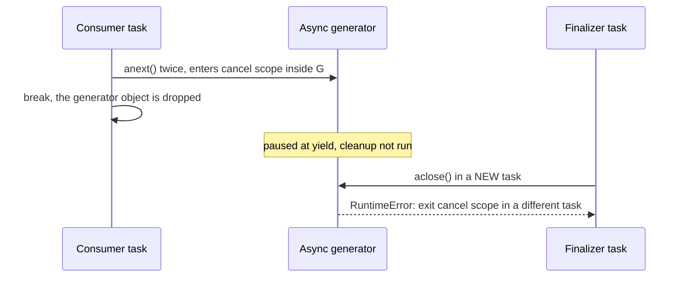

## 1. The question this idea answers

An agent service is a chain of streams. The Claude Agent SDK `query()` yields messages while the agent works. A model API stream yields events. The web layer yields server-sent events to the browser. Each link in the chain is an **async generator** or an object with the same protocol.

A stream has a start and an end, and both need care. At the end, the producer must release what it holds: a CLI subprocess, an HTTP connection, a temporary folder, a store flush. The hard question is the early end. The consumer can stop with `break`, the request can be cancelled, a timeout can fire. When does the producer's cleanup run, and in which task?

The Claude Agent SDK docs warn against `break` in the message loop. This lesson explains the mechanism behind that warning with real output, and gives safe patterns.

## 2. Mental model

> [!analogy] A pass-through window between a kitchen and a waiter
> The cook (the generator) places one plate in the window and then stands still. The cook makes the next plate only when the waiter (the consumer) takes the plate and rings the bell. This is `async for`: each loop pass rings the bell once.
>
> When the cook has no more plates, the cook cleans the stove and closes the window. That is the normal end, and the `finally` block runs at once.
>
> If the waiter walks away (`break`) and says nothing, the cook stands at the window with the stove on. Later, a night cleaner (the garbage collector and the event loop) notices and closes the kitchen. The cleanup happens, but late, and by a different person.
>
> **Where it stops working:** a real cook can cook ahead while the waiter is away. A generator never runs ahead. Its code runs only while the consumer awaits the next value. So a slow consumer also slows the producer.

## 3. Terms

| Term | Plain meaning |
|---|---|
| async generator function | An `async def` function that contains `yield`. |
| async generator object | The object that a call of an async generator function returns. Its body has not run yet. |
| async iterator | An object with an `__anext__` method that returns an awaitable. Async generators are async iterators. |
| `async for` | A loop that awaits `__anext__` again and again until `StopAsyncIteration`. |
| `anext()` | The built-in function that calls `__anext__`. `await anext(g)` returns the next value. |
| `StopAsyncIteration` | The exception that tells `async for` that the stream has ended. |
| `aclose()` | A method that throws `GeneratorExit` into the generator at its paused `yield`, so its `finally` blocks run. |
| `contextlib.aclosing` | A context manager that calls `aclose()` when its block ends, also after `break` or an exception. |
| finalizer hook | A function that the event loop registers. It closes an async generator that was garbage collected before it finished. |
| `shutdown_asyncgens` | An event loop method that closes every open async generator. `asyncio.run` calls it before it closes the loop. |
| cancel scope | An anyio object that must be entered and left in the same task. The Claude Agent SDK uses anyio. |
| pipeline | A chain of async generators where each one reads from the previous one. |

## 4. Method and math

### 4.1 The protocol

The Python language reference (checked on 2026-10-13): "When an asynchronous generator function is called, it returns an asynchronous iterator known as an asynchronous generator object." And: "Calling one of the asynchronous generator's methods returns an awaitable object, and the execution starts when this object is awaited on."

```python
async def events(n):
    try:
        for i in range(n):
            await asyncio.sleep(0.01)
            print(f"  gen: yield {i}")
            yield i
    finally:
        print(f"  gen: finally (task={asyncio.current_task().get_name()})")

async def main():
    g = events(3)
    print(type(g).__name__, inspect.isasyncgenfunction(events), inspect.isasyncgen(g))
    print("anext ->", await anext(g))
    print("anext ->", await g.__anext__())
    print("anext ->", await anext(g))
    try:
        await anext(g)
    except StopAsyncIteration:
        print("StopAsyncIteration")
```

```text
async_generator True True
  gen: yield 0
anext -> 0
  gen: yield 1
anext -> 1
  gen: yield 2
anext -> 2
  gen: finally (task=Task-1)
StopAsyncIteration
```

Three facts come from this output:

1. Nothing ran at `events(3)`. The first line from the generator appears only at the first `anext`.
2. The generator pauses at each `yield` until the next `anext`. This is a pull model.
3. At the normal end, `finally` runs inside the consumer's task (Task-1), before `StopAsyncIteration` reaches the consumer.

`async for x in g:` is this loop in short form:

```python
while True:
    try:
        x = await anext(g)
    except StopAsyncIteration:
        break
    ...  # loop body
```

### 4.2 Early exit with break: cleanup runs late, in another task

Four cases ran, each in its own `asyncio.run`. The consumer stops at the second value. The generator prints the task in which its `finally` runs. The first case, `case_sync`, is the same loop over a normal generator (`def` with `yield`, no `await`). The third case, `case_named`, is `case_temp` with `g = events(5)` held in a variable, and it prints "main returns" before it ends.

```python
async def case_temp():                      # generator is a temporary object
    async for x in events(5):
        if x == 1:
            break
    print(f"after break (task={asyncio.current_task().get_name()})")
    await asyncio.sleep(0)
    print("after one loop pass")

async def case_aclosing():                  # generator closed by aclosing
    async with contextlib.aclosing(events(5)) as g:
        async for x in g:
            if x == 1:
                break
    print(f"after break (task={asyncio.current_task().get_name()})")
```

```text
== case_sync
  sync gen: finally
after break (task=Task-1)
asyncio.run returned
== case_temp
after break (task=Task-4)
after one loop pass
  async gen: finally (task=Task-5)
asyncio.run returned
== case_named
after break (task=Task-8)
main returns
  async gen: finally (task=Task-9)
asyncio.run returned
== case_aclosing
  async gen: finally (task=Task-12)
after break (task=Task-12)
asyncio.run returned
```

| Case | When `finally` runs | In which task |
|---|---|---|
| Sync generator, `for` + `break` | At once, before "after break" | The consumer |
| Async, temporary object | On a later loop iteration, after the consumer suspends | A new task (Task-5) |
| Async, held in a variable | At the end of `asyncio.run` | A new task (Task-9) |
| Async, inside `aclosing` | At once, before "after break" | The consumer (Task-12) |

Why? A sync generator is closed as soon as nothing refers to it. An async generator cannot be closed that way, because its cleanup may need `await`. So the event loop registers a finalizer hook. This is the hook in CPython 3.13 (`asyncio/base_events.py`):

```python
def _asyncgen_finalizer_hook(self, agen):
    self._asyncgens.discard(agen)
    if not self.is_closed():
        self.call_soon_threadsafe(self.create_task, agen.aclose())
```

The hook creates **a new task** that runs `aclose()`. A second test printed a line after each `await asyncio.sleep(0)` that followed the `break`. The `finally` line appeared between pass 1 and pass 2, in Task-2, while `main` was Task-1. A generator that a variable still holds is not garbage collected, so it stays open until `asyncio.run` calls `shutdown_asyncgens`. The docs of that method: "Schedule all currently open asynchronous generator objects to close with an aclose() call."

The language reference states the risk directly: "If an asynchronous generator happens to exit early by break, the caller task being cancelled, or other exceptions, the generator's async cleanup code will run and possibly raise exceptions or access context variables in an unexpected context--perhaps after the lifetime of tasks it depends, or during the event loop shutdown when the async-generator garbage collection hook is called. To prevent this, the caller must explicitly close the async generator by calling aclose method".

A proposal to make `async for` close its iterator, PEP 533 "Deterministic cleanup for iterators", has the status Deferred (checked on 2026-10-13).

### 4.3 Why "another task" breaks real cleanup

Some cleanup must happen in the task that started it. anyio cancel scopes and task groups have this rule. This generator enters a cancel scope, and the consumer leaves with `break`:

```python
async def stream_with_scope():
    with anyio.CancelScope():
        for i in range(5):
            await asyncio.sleep(0.01)
            yield i

async def main():
    async for x in stream_with_scope():
        if x == 1:
            break
    print("after break")
    await asyncio.sleep(0.05)
    print("main ends")
```

```text
after break
Task exception was never retrieved
future: <Task finished name='Task-2' coro=<<async_generator_athrow without __name__>()> exception=RuntimeError('Attempted to exit cancel scope in a different task than it was entered in')>
...
RuntimeError: Attempted to exit cancel scope in a different task than it was entered in
main ends
```

(The traceback is shortened at "...".)

The finalizer task (Task-2) ran `aclose()`. The cancel scope was entered in the consumer's task and left in Task-2, so anyio raised. The program kept running, the error went only to the log, and the scope's cleanup did not complete. The same generator inside `async with contextlib.aclosing(...)` printed its cleanup line before "after break", with no error.



### 4.4 The Claude Agent SDK warning about break

The Python SDK reference says, in the `ClaudeSDKClient` section (checked on 2026-10-13):

> "**Important:** When iterating over messages, avoid using `break` to exit early as this can cause asyncio cleanup issues. Instead, let the iteration complete naturally or use flags to track when you've found what you need."

The [agent loop lesson](/notes/ai/claude-agent-sdk/01-foundations/l2-the-agent-loop) adds a second reason: trailing system events can arrive after the `ResultMessage`.

The SDK source (commit b6e9d12) shows what is at stake. `query()` is an async generator function. It reads from `InternalClient.process_query` in `_internal/client.py`, whose `finally` block holds this comment:

```python
finally:
    # ``async for`` does NOT close its iterator when the loop body
    # raises (PEP 533 was deferred). Explicitly aclose the inner
    # generator first so its ``finally: await query.close()`` runs —
    # i.e. the subprocess is terminated — *before* we remove the temp
    # CLAUDE_CONFIG_DIR it is reading/writing.
```

So the cleanup of `query()` stops the CLI subprocess. On a resume from a session store, it also removes a temporary config folder. The SDK uses anyio (`import anyio` in `_internal/query.py`). After a `break`, this cleanup runs later in a finalizer task, as section 4.2 showed. The docs do not name the exact error. Sections 4.2 and 4.3 show the class of problems: late cleanup, cleanup in a different task, and errors that only reach a log.

| Pattern | Cleanup | When to use it |
|---|---|---|
| Read to the end, record what you need in variables | Normal end, same task | Default. The docs recommend it. |
| `async with contextlib.aclosing(query(...)) as stream:` then `break` | Same task, at once | You must stop early. Not mentioned in the SDK docs. It is the general Python fix. |
| `break` with no `aclosing` | Late, other task | Avoid |

> [!key] Close what you leave
> An async generator runs its cleanup in your task only when it ends normally or when you call `aclose()`. If you leave early, close it yourself with `contextlib.aclosing`. Otherwise the event loop closes it later, in another task.

### 4.5 Cancellation reaches the generator at its await

When the consumer task is cancelled, `CancelledError` appears at the point where the generator is suspended:

```python
async def model_stream():
    try:
        for i in range(10):
            await asyncio.sleep(0.2)   # waiting for the next token chunk
            yield f"chunk{i}"
    except asyncio.CancelledError:
        log("gen: CancelledError at the await point")
        raise
    finally:
        log("gen: finally")

# a consumer task reads it with async for, and main cancels that task after 0.5 s
```

```text
0.20s got chunk0
0.40s got chunk1
0.50s gen: CancelledError at the await point
0.50s gen: finally
0.50s consumer cancelled, t.cancelled()=True
```

Here the generator was inside the consumer's `__anext__` call, so the cleanup ran in the consumer's task, at once. The asyncio docs: "It is recommended that coroutines use try/finally blocks to robustly perform clean-up logic. In case asyncio.CancelledError is explicitly caught, it should generally be propagated when clean-up is complete."

### 4.6 A timeout on anext ends the generator

A common idea: wait at most 0.2 s for each item. This generator is slow only for its second item:

```python
g = slow_stream()            # item 1 takes 0.3 s, the others 0.05 s
for _ in range(4):
    try:
        item = await asyncio.wait_for(anext(g), timeout=0.2)
        log(f"item {item}")
    except TimeoutError:
        log("timeout waiting for the next item")
    except StopAsyncIteration:
        log("StopAsyncIteration: the generator is finished")
```

```text
0.05s item 0
0.26s gen: finally
0.26s timeout waiting for the next item
0.26s StopAsyncIteration: the generator is finished
0.26s StopAsyncIteration: the generator is finished
```

`wait_for` cancels the `anext` awaitable, and the cancellation enters the generator. The generator ends. Items 1 to 4 are lost. FastAPI's own SSE code avoids this. A comment in `fastapi/routing.py` (0.143.0) says that a producer task reads the generator "so `anyio.fail_after` never wraps the generator's `__anext__` directly - avoiding CancelledError that would finalize the generator".

> [!trap] Put the timeout on a queue, not on the generator
> To detect idle time without ending the stream, let one task read the generator into an `asyncio.Queue`. Put the timeout on `queue.get()`. A timeout then cancels only the wait on the queue.

### 4.7 Streaming patterns

A pipeline chains generators. This test turns a fake model stream into batches for a UI. Each event takes 0.1 s.

```python
async def text_only(events):
    async for kind, value in events:
        if kind == "text":
            yield value

async def batched(chunks, max_wait):
    buf, last = [], time.perf_counter()
    async for c in chunks:
        buf.append(c)
        if time.perf_counter() - last >= max_wait:
            yield "".join(buf); buf, last = [], time.perf_counter()
    if buf:
        yield "".join(buf)

async for part in batched(text_only(fake_model()), max_wait=0.25):
    log(f"send to UI: {part!r}")
```

```text
0.40s send to UI: 'Line 3 had 2 stops '
0.60s send to UI: 'today.'
```

The fake model sent six events: four text deltas, one tool event and one done event. `text_only` dropped two. `batched` sent two UI updates instead of four.

| Pattern | Shape | Example in an agent service |
|---|---|---|
| Transform | `async for x in src: yield f(x)` | SDK message → SSE frame |
| Filter | `if keep(x): yield x` | Only text deltas to the UI |
| Batch | Collect until a size or a time limit | Fewer UI updates, fewer database writes |
| Fan-in | Several reader tasks put items into one queue | Merge a model stream and a heartbeat |

### 4.8 Production view

| Concern | What to do |
|---|---|
| Resource leaks | Put every resource of a generator in `try/finally`. Close early exits with `contextlib.aclosing`. |
| SDK streams | Read `query()` and `receive_response()` to the end. Record the values that you need. |
| Timeouts | Never wrap `anext()` in `wait_for` if the stream must survive. Use a reader task and a queue. |
| Cancellation | Let `CancelledError` propagate after cleanup. Never swallow it. |
| Observability | Log once in each generator's `finally`, with the task name. A cleanup line from an unexpected task shows a missing `aclose()`. |
| Throughput | A generator runs only when the consumer asks. A slow consumer slows the producer. Batch the slow side. |

## 5. Video

```video
{
  "src": "/notes/media/python/manim/m02-async-generator-early-exit.mp4",
  "caption": "After break, an async generator stays paused and a finalizer task closes it later. With aclosing, the cleanup runs at once in the consumer's own task."
}
```

## 6. Code

These exercises go in `python/02-async-generators.ipynb`. In a notebook cell, use `await main()`, not `asyncio.run(main())`.

**Exercise 2.1: the cleanup timing lab.** Reproduce the four cases of section 4.2 with your own generator. Print the task name in `finally` and after the loop.

Acceptance tests:

- Your output shows the same task pattern as the table in section 4.2.
- A Markdown cell explains, in your own words, why the temporary case runs `finally` in a new task.

**Exercise 2.2: stop early, safely.** Write `async def first_match(make_stream, predicate)`. It returns the first item for which `predicate(item)` is true and closes the stream before it returns.

Acceptance tests:

- With the generator of section 4.3 (anyio cancel scope), no `RuntimeError` appears in the output or the log.
- The generator's `finally` line prints before `first_match` returns.
- If no item matches, the function returns `None` after the stream ends.

**Exercise 2.3: an idle signal that keeps the stream alive.** Write `async def with_idle(source, seconds)`. It yields each item of `source`. When no item arrives for `seconds`, it yields the string `"idle"` and continues waiting.

Acceptance tests:

- With the slow stream of section 4.6 and `seconds = 0.2`, the output holds all five items and at least one `"idle"`.
- The source generator's `finally` runs exactly once, after the last item.
- If the consumer leaves early inside `aclosing`, the reader task stops and the source's `finally` runs before `with_idle` finishes closing.

## 7. Common mistakes

1. **"`break` closes the async generator."** It does not. The generator stays paused until a finalizer task or `asyncio.run` closes it.
2. **"Cleanup runs in my task."** After an early exit without `aclose()`, it runs in another task, where anyio cancel scopes fail.
3. **`asyncio.wait_for(anext(g), t)` as an idle timeout.** The timeout ends the generator. Put the timeout on a queue.
4. **Two readers of one generator.** In the test, `await asyncio.gather(anext(g), anext(g))` raised `RuntimeError: anext(): asynchronous generator is already running`. Use one reader task that puts each item into one queue per consumer.
5. **Swallowing `CancelledError` in a generator.** It breaks `TaskGroup` and timeouts. Run the cleanup, then raise it again.
6. **`yield` inside `finally`.** In the test, `await g.aclose()` then raised `RuntimeError: async generator ignored GeneratorExit`.

## 8. One-minute explanation

An async generator is an `async def` function with `yield`. Calling it runs nothing. Each `await anext(g)`, or each pass of `async for`, runs the body until the next `yield`, so values flow only when the consumer asks. At the normal end, the `finally` block runs in the consumer's task. If the consumer leaves early with `break`, the generator stays paused. The event loop closes it later with `aclose()` in a new task, or at the end of `asyncio.run`. Cleanup in a new task can fail: an anyio cancel scope raised "Attempted to exit cancel scope in a different task than it was entered in". This is the mechanism behind the Claude Agent SDK warning about `break`, whose cleanup stops the CLI subprocess. Read SDK streams to the end, or wrap them in `contextlib.aclosing` when you must stop early. Never put a timeout directly around `anext()`, because the cancellation ends the generator.

## 9. Check questions

```check
{
  "question": "A consumer runs async for msg in stream(): ... break. The generator has a finally block that closes an HTTP connection. When and in which task does the finally run, and what changes with contextlib.aclosing?",
  "hint": "Section 4.2, the table.",
  "answer": "Without aclosing, the finally does not run at the break. If the generator was a temporary object, the event loop's finalizer hook creates a new task that calls aclose(), so the finally runs a little later in that new task. If a variable still holds the generator, it runs only when asyncio.run calls shutdown_asyncgens. With aclosing, aclose() runs when the async with block ends, so the finally runs at once, in the consumer's own task."
}
```

```check
{
  "question": "Why does the Claude Agent SDK warn against break in the message loop? Give the mechanism, not only the rule.",
  "answer": "query() is an async generator. Its finally blocks stop the CLI subprocess (and, on a resume from a session store, remove a temporary folder), and the SDK uses anyio. After a break, the generator stays paused. The finalizer hook later closes it in a different task, or asyncio.run closes it at shutdown. Cleanup that runs late or in another task can fail, for example anyio raises when a cancel scope is left in a different task, and the error only reaches the log. Trailing events after the ResultMessage are also lost. So read to the end, or use contextlib.aclosing if you must stop early."
}
```

```check
{
  "question": "Your code runs item = await asyncio.wait_for(anext(stream), timeout=30) to detect an idle model stream. After one timeout, every next call raises StopAsyncIteration. Why, and what is the fix?",
  "answer": "wait_for cancels the anext awaitable at the timeout. The CancelledError is thrown into the generator at its suspension point, so the generator runs its finally and ends. Every later anext raises StopAsyncIteration. The fix: one reader task reads the generator into an asyncio.Queue, and the timeout goes on queue.get(), so a timeout cancels only the wait on the queue."
}
```

```check
{
  "question": "A pipeline is model_stream → text_only → batched → send_to_ui. The UI is slow and takes 1 s per update. What happens to model_stream, and why?",
  "answer": "model_stream also becomes slow. Async generators are pull-based: each one runs only when the next one asks for a value. While send_to_ui spends 1 s, nobody calls anext on batched, so text_only and model_stream stay paused. To decouple them, a reader task can read model_stream into a queue, or batching can reduce the number of slow updates."
}
```

## 10. Links

- Previous: [L1: The event loop and coroutines](/notes/software-engineering/python/01-asyncio/l1-event-loop-and-coroutines)
- Next: [L3: Sync code calling async code](/notes/software-engineering/python/01-asyncio/l3-sync-code-calling-async-code)
- The SDK side: [The agent loop](/notes/ai/claude-agent-sdk/01-foundations/l2-the-agent-loop)
- Streams to the browser: [FastAPI StreamingResponse and SSE](/notes/software-engineering/python/02-web-streaming/l1-fastapi-streaming-response-and-sse)
- [Glossary](/notes/software-engineering/python/glossary)
