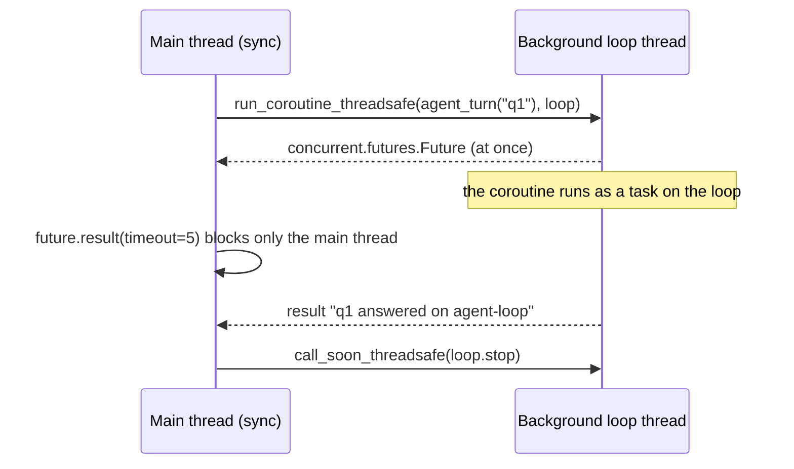

## 1. The question this idea answers

An agent service mixes two worlds. The Claude Agent SDK is async: `query()` is an async generator. Many other libraries are sync: a sync database driver, a sync HTTP client, a sync web framework. Code from each world must call code from the other world.

| Direction | Example | Risk |
|---|---|---|
| Sync calls async | A sync web handler, a script or a test must run `query()` | `asyncio.run` fails inside a running loop. Objects break across loops. |
| Async calls sync | An `async def` endpoint calls a sync database driver | The blocking call freezes every task ([L1](/notes/software-engineering/python/01-asyncio/l1-event-loop-and-coroutines)). |
| Sync reads an async stream | A sync framework must stream SDK messages one by one | A naive bridge returns nothing until the whole stream ends. |

This lesson gives one tool for each case and measures it.

## 2. Mental model

> [!analogy] An office and a kitchen
> Sync code is an office worker who does one task at a time and waits at the desk. Async code is a kitchen with one cook who switches between orders ([L1](/notes/software-engineering/python/01-asyncio/l1-event-loop-and-coroutines)).
>
> - **`asyncio.run`**: the office worker opens a temporary kitchen for one order, cooks it, and closes the kitchen.
> - **A background loop**: a kitchen stays open in the back room. The office passes order tickets through a hatch (`run_coroutine_threadsafe`) and waits until the plate arrives.
> - **`asyncio.to_thread`**: the cook gives a slow paper task to an office helper and keeps cooking.
>
> **Where it stops working:** in real life, a pan from one kitchen works in another kitchen. In `asyncio`, many objects belong to the loop where they were first used: locks, queues, async HTTP clients. Use them in a second loop and they raise errors.

## 3. Terms

| Term | Plain meaning |
|---|---|
| running loop | The event loop that runs in the current thread at this moment. `asyncio.get_running_loop()` returns it. |
| `asyncio.run` | Creates a new event loop, runs one coroutine to the end, then closes the loop. |
| worker thread | An extra operating system thread that runs a function next to the main thread. |
| default executor | The thread pool of an event loop. `asyncio.to_thread` and `run_in_executor(None, ...)` use it. |
| `asyncio.to_thread` | Runs a sync function in the default executor and returns a coroutine that gives its result. |
| background loop | An event loop that runs forever in its own thread and accepts work from other threads. |
| `run_coroutine_threadsafe` | Sends a coroutine from another thread to a running loop. Returns a `concurrent.futures.Future`. |
| `concurrent.futures.Future` | A thread-safe result holder. `future.result(timeout)` blocks the calling thread until the result is ready. |
| `call_soon_threadsafe` | The only safe way to ask a loop in another thread to run a callback. |
| loop-bound object | An object that remembers the loop where it was first used, for example `asyncio.Lock`. |
| thread pool of FastAPI | AnyIO worker threads that run `def` endpoints. The default limit is 40 threads. |
| bridge | Code that turns an async generator into a sync generator with a thread and a queue. |
| sentinel | A unique object that marks the end of a stream in a queue. |

## 4. Method and math

### 4.1 asyncio.run makes a new loop and refuses a running one

The docs (checked on 2026-10-13): "This function runs the passed coroutine, taking care of managing the asyncio event loop, *finalizing asynchronous generators*, and closing the executor." And: "This function cannot be called when another asyncio event loop is running in the same thread." The docs also say that it "should ideally only be called once".

Two calls in a row in one thread create two loops, and both are closed at the end:

```text
a on MainThread loop=5248
b on MainThread loop=1856
loops closed after run: [True, True]
```

A sync helper that hides `asyncio.run` works from sync code and fails from async code:

```python
async def agent_turn(q):
    await asyncio.sleep(0.1)
    return f"answer to {q!r}"

def answer_sync(q):            # a sync helper that "hides" the async call
    return asyncio.run(agent_turn(q))

print(answer_sync("downtime on line 3"))   # fine: no loop is running here

async def handler():           # but now call the helper from async code
    return answer_sync("orders today")

try:
    asyncio.run(handler())
except RuntimeError as e:
    print("RuntimeError:", e)
```

```text
answer to 'downtime on line 3'
RuntimeError: asyncio.run() cannot be called from a running event loop
<sys>:0: RuntimeWarning: coroutine 'agent_turn' was never awaited
```

(A last line, the tracemalloc hint, is omitted.) The warning appears because `agent_turn(q)` already created a coroutine object, and `asyncio.run` refused it. The same `RuntimeError` text appears in the Python 3.15 source (checked on 2026-10-13).

| Place | A loop is already running? | `asyncio.run` works? |
|---|---|---|
| A script, a `def main()` | No | Yes |
| A `def` FastAPI endpoint (it runs in a worker thread) | No | Yes |
| An `async def` FastAPI endpoint | Yes | No: write `await` |
| A Jupyter cell (ipykernel 7.4.0, tested) | Yes | No: write `await main()` |
| An async SDK tool handler | Yes | No: write `await` |

### 4.2 Objects belong to their loop

```python
lock = asyncio.Lock()   # module-level, shared by every call

async def guarded(hold):
    async with lock:
        await asyncio.sleep(hold)

async def two_users():
    await asyncio.gather(guarded(0.1), guarded(0.1))

asyncio.run(two_users())        # first loop: the lock binds to it
asyncio.run(two_users())        # second loop
```

```text
RuntimeError: <asyncio.locks.Lock object at 0x7f7f05b51a90 [locked]> is bound to a different event loop
```

A module-level `httpx.AsyncClient` gave a similar result. The first `asyncio.run(client.get(...))` returned 200. The second one raised `RuntimeError: Event loop is closed`, because the pooled connection still belonged to the first loop.

> [!trap] One asyncio.run per request breaks shared async objects
> A sync service that calls `asyncio.run` for each request creates a new loop each time. A module-level `asyncio.Lock`, `asyncio.Queue` or async HTTP client that was used in an earlier loop then fails. Create such objects inside the coroutine that `asyncio.run` runs, or use one background loop for the whole process (section 4.5).

### 4.3 Each worker thread can run its own loop

A thread has no running loop until something starts one. So each worker thread can call `asyncio.run` on its own:

```python
# here agent_turn waits 1.0 s and returns its thread name and an id of its loop
def run_turn_in_thread(q):          # sync code: one new loop per call
    return asyncio.run(agent_turn(q))

with ThreadPoolExecutor(max_workers=3, thread_name_prefix="w") as pool:
    for r in pool.map(run_turn_in_thread, ["c", "d", "e"]):
        print(r)
```

```text
c on w_0 loop=3456
d on w_1 loop=5200
e on w_2 loop=3104
3 turns in 3 threads: 1.00 s
```

Each turn waited 1.0 s, and the three ran at the same time in three loops. The cost: one thread for the whole duration of each turn, and no sharing of loop-bound objects between the turns.

### 4.4 asyncio.to_thread: a blocking call inside async code

The docs: `to_thread` will "Asynchronously run function *func* in a separate thread." It is "primarily intended to be used for executing IO-bound functions/methods that would otherwise block the event loop if they were run in the main thread."

A heartbeat task ran next to three blocking calls of 1.0 s each:

```python
def read_report_blocking(name):     # a sync library call, for example a sync DB driver
    time.sleep(1.0)
    return f"{name} read on {threading.current_thread().name}"

res = await asyncio.gather(*(asyncio.to_thread(read_report_blocking, f"r{i}") for i in range(3)))
```

```text
process_cpu_count = 2 -> default pool size = 6
r0 read on asyncio_0
r1 read on asyncio_1
r2 read on asyncio_2
3 blocking calls via to_thread: 1.00 s, longest heartbeat gap 0.10 s
```

Compare L1: the same calls made directly took 3.00 s and froze the heartbeat for 3.05 s.

The pool has a limit. CPython 3.13 sets the default size in `ThreadPoolExecutor.__init__`: `max_workers = min(32, (os.process_cpu_count() or 1) + 4)`. The sandbox had 2 CPUs, so 6 threads.

```text
 6 calls, default pool of 6 threads: 1.00 s
 7 calls, default pool of 6 threads: 2.00 s
12 calls, default pool of 6 threads: 2.01 s
```

> [!example] Worked example: pool size and wait time
> A container has 4 CPUs. The default pool has min(32, 4 + 4) = 8 threads. 20 requests arrive at once, and each one makes a blocking call of 0.5 s through `to_thread`.
>
> 1. Rounds needed: ceil(20 / 8) = 3.
> 2. The last request finishes after about 3 × 0.5 = 1.5 s.
> 3. With 24 requests: ceil(24 / 8) = 3 rounds, still 1.5 s. With 25: 4 rounds, 2.0 s.

> [!trap] Cancelling the task does not stop the thread
> A task awaited `to_thread(slow_report)` and was cancelled after 0.2 s. The output: `0.20s awaiting task cancelled`, then `1.00s thread end (the work finished anyway)`. Python cannot stop a running thread. The thread finishes its work, and nobody reads the result.

### 4.5 run_coroutine_threadsafe: one long-lived background loop

For a sync program that sends many coroutines, one loop in a background thread avoids a new loop per call. The docs: "Submit a coroutine to the given event loop. Thread-safe." It returns "a concurrent.futures.Future to wait for the result from another OS thread."

```python
loop = asyncio.new_event_loop()
t = threading.Thread(target=loop.run_forever, name="agent-loop", daemon=True)
t.start()

f1 = asyncio.run_coroutine_threadsafe(agent_turn("q1"), loop)
f2 = asyncio.run_coroutine_threadsafe(agent_turn("q2"), loop)
print(f1.result(timeout=5)); print(f2.result(timeout=5))

f3 = asyncio.run_coroutine_threadsafe(agent_turn("slow", delay=3), loop)
try:
    f3.result(timeout=0.2)
except TimeoutError:
    print("caller timed out; cancel ->", f3.cancel())

loop.call_soon_threadsafe(loop.stop); t.join(); loop.close()
# the print lines for the type, the timing and the final states are omitted here
```

```text
concurrent.futures._base.Future
q1 answered on agent-loop
q2 answered on agent-loop
two turns: 0.50 s, caller thread = MainThread
caller timed out; cancel -> True
f3.cancelled() = True
loop closed: True
```



Three rules come from the docs. First, the function "is meant to be called from a different OS thread than the one where the event loop is running". Second, "Almost all asyncio objects are not thread safe", so other threads reach the loop only through `run_coroutine_threadsafe` and `call_soon_threadsafe`. Third, the future "can also be used to cancel the task in the event loop". The Python 3.15 docs add a full `loop_in_thread()` context manager example for this pattern (checked on 2026-10-13).

### 4.6 How FastAPI runs def endpoints

The FastAPI docs (checked on 2026-10-13): "When you declare a *path operation function* with normal `def` instead of `async def`, it is run in an external threadpool that is then awaited, instead of being called directly (as it would block the server)."

The source of FastAPI 0.143.0 (`routing.py`, `run_endpoint_function`) does exactly this: a coroutine function is awaited, and any other function goes to `run_in_threadpool`, which calls `anyio.to_thread.run_sync`. The anyio 4.15.1 source creates the default limiter with `CapacityLimiter(40)`. So at most 40 `def` endpoints run at the same time by default.

A test app ran on uvicorn 0.53.0. Five requests hit each endpoint at the same time. Each endpoint waits 1 s.

| Endpoint | Body | 5 parallel requests | Thread |
|---|---|---|---|
| `def sync_endpoint()` | `time.sleep(1.0)` | 1.19 s | AnyIO worker thread |
| `async def async_blocking()` | `time.sleep(1.0)` | 5.03 s | MainThread |
| `async def async_ok()` | `await asyncio.sleep(1.0)` | 1.04 s | MainThread |
| `def sync_runs_loop()` | `asyncio.run(agent_turn())` | 1.02 s | AnyIO worker thread |
| `async def async_runs_loop()` | `asyncio.run(agent_turn())` | HTTP 500 | MainThread |

The server log for the last row held `RuntimeError: asyncio.run() cannot be called from a running event loop`.

> [!key] Match the function kind to the body
> An `async def` body must only await. A `def` body may block, because FastAPI moves it to a worker thread. The bad mix is a blocking call in `async def`: five requests took 5.03 s instead of about 1 s.

### 4.7 A bridge from an async generator to a sync generator

A sync framework sometimes needs a sync generator, while the SDK gives an async generator. The naive bridge collects everything first:

```python
async def collect():
    return [m async for m in sdk_messages()]
for m in asyncio.run(collect()):
    ...
```

The bridge below runs the async generator on its own loop in a worker thread. It puts each item into a `queue.Queue`. The sync generator takes items from the queue as they arrive.

```python
_DONE = object()

class _Failed:
    def __init__(self, exc): self.exc = exc

def iter_in_thread(make_agen):
    q = queue.Queue()

    async def pump():
        try:
            async for item in make_agen():
                q.put(item)
        except Exception as exc:
            q.put(_Failed(exc))
        finally:
            q.put(_DONE)

    worker = threading.Thread(target=asyncio.run, args=(pump(),), name="bridge", daemon=True)
    worker.start()
    while True:
        item = q.get()                 # blocks this (sync) thread only
        if item is _DONE:
            break
        if isinstance(item, _Failed):
            raise item.exc
        yield item
    worker.join()
```

The test source yields four messages, one every 0.2 s. A second run raises `ConnectionError` before the last message.

```text
0.80s naive got SystemMessage
0.80s naive got AssistantMessage
0.80s naive got AssistantMessage
0.80s naive got ResultMessage
0.20s bridge got SystemMessage (consumer thread=MainThread)
0.40s bridge got AssistantMessage (consumer thread=MainThread)
0.60s bridge got AssistantMessage (consumer thread=MainThread)
0.80s bridge got ResultMessage (consumer thread=MainThread)
0.20s got SystemMessage
0.40s got AssistantMessage
0.60s got AssistantMessage
0.80s ConnectionError raised in the sync consumer: CLI process exited
```

The naive bridge delivered the first message after 0.80 s. The queue bridge delivered it after 0.20 s, and the error reached the sync consumer as a normal exception.

> [!trap] This bridge does not stop when the consumer leaves
> A consumer read two items of a 10-item stream and left with `break`. The output: `0.40s consumer left; bridge thread alive = True`, then `2.01s source: finally (the source stopped)`. The source ran to its end with nobody reading. With an SDK stream, the agent would keep working and spending tokens. A production bridge needs a stop signal from the consumer to the loop, for example `loop.call_soon_threadsafe(task.cancel)`. Exercise 3.3 adds it.

### 4.8 Which tool for which case

| You are in | You need | Use |
|---|---|---|
| Sync code, no loop in this thread | One async call | `asyncio.run(coro)` |
| Sync code, many async calls | Shared clients, many calls | One background loop + `run_coroutine_threadsafe` |
| Async code | A blocking library call | `await asyncio.to_thread(func, *args)` |
| Async code | Another coroutine | `await coro`. Never `asyncio.run`. |
| Sync code | An async stream, item by item | A thread + `queue.Queue` bridge with a stop signal |
| FastAPI | Blocking work in an endpoint | A `def` endpoint, or `to_thread` inside `async def` |

### 4.9 Production view

| Concern | What to do |
|---|---|
| Capacity | Each blocking call holds one pool thread. Size the pool for the number of parallel blocking calls. Watch the 40-thread limit of FastAPI `def` endpoints. |
| Latency | Never block the loop thread. Run debug mode in staging to find slow steps ([L1](/notes/software-engineering/python/01-asyncio/l1-event-loop-and-coroutines)). |
| Cancellation | A cancelled `to_thread` call still runs to its end. Pass a stop flag to long sync work. |
| Shared objects | Create loop-bound objects inside the loop that uses them. Prefer one background loop to many `asyncio.run` calls in a long-lived process. |
| Shutdown | Stop a background loop with `call_soon_threadsafe(loop.stop)`, join the thread, then close the loop. |
| Cost | A bridge must cancel the source when the consumer leaves. Otherwise the agent keeps running. |

## 5. Code

These exercises go in `python/03-sync-async-bridges.ipynb`. Put the thread and loop code in a `.py` file in the same folder and import it. Run the experiments with `!python file.py` when a cell would conflict with the notebook's own loop.

**Exercise 3.1: measure to_thread.** Write an async function that runs N blocking calls of 0.5 s, first directly, then with `asyncio.to_thread`, and measures both.

Acceptance tests:

- For N = 4, the direct version takes about 2.0 s and the `to_thread` version about 0.5 s.
- For N = pool size + 1, the `to_thread` version takes about 1.0 s. Print the pool size that you computed.

**Exercise 3.2: a background loop service.** Write a class `LoopThread` with `start()`, `submit(coro) -> concurrent.futures.Future` and `stop()`.

Acceptance tests:

- 10 coroutines that each sleep 0.5 s, sent with `submit`, all finish in less than 1.0 s.
- `submit(coro).result(timeout=0.1)` on a 3 s coroutine raises `TimeoutError`, and after `future.cancel()` the coroutine's `finally` runs.
- After `stop()`, the thread is not alive and `loop.is_closed()` is true.
- An `asyncio.Lock` created inside one submitted coroutine works in later submitted coroutines.

**Exercise 3.3: a bridge that stops.** Extend `iter_in_thread` from section 4.7.

Acceptance tests:

- When the consumer leaves with `break` after 2 items of a 10-item stream, the source's `finally` runs within 0.3 s and the bridge thread ends.
- With a source that produces faster than the consumer reads, the queue never holds more than 10 items.
- An exception in the source still reaches the consumer as the same exception type.

## 6. Common mistakes

1. **`asyncio.run` inside `async def`.** It raises "cannot be called from a running event loop". Use `await`.
2. **A blocking call in an `async def` endpoint.** Every request waits in line. Use `def`, an async library or `to_thread`.
3. **Module-level locks or async clients with many `asyncio.run` calls.** They are bound to the first loop.
4. **Calling loop methods from another thread.** Use `run_coroutine_threadsafe` or `call_soon_threadsafe` only.
5. **"Cancel stops the thread."** The thread runs to its end.
6. **A bridge that collects everything.** The first item arrives only at the end. Use a queue.
7. **A bridge with no stop signal.** The source keeps running after the consumer leaves.

## 7. One-minute explanation

`asyncio.run` creates a new event loop, runs one coroutine, finalizes async generators and closes the loop. It refuses to run when a loop already runs in the same thread. So it fails inside `async def`, inside a Jupyter cell and inside async tool handlers, where you write `await` instead. Each thread can run its own loop, so worker threads can call `asyncio.run`. But locks and async clients stay bound to the loop that first used them. In the other direction, `asyncio.to_thread` moves a blocking call from async code into the loop's thread pool. The default pool has min(32, CPUs + 4) threads, and a cancelled call still finishes in its thread. A long-lived sync program can keep one background loop and send coroutines to it with `run_coroutine_threadsafe`. FastAPI already runs `def` endpoints in AnyIO worker threads, at most 40 by default. To turn an async stream into a sync stream, run it in a thread, pass items through `queue.Queue`, and let the consumer stop the source.

## 8. Check questions

```check
{
  "question": "A Streamlit-style sync app calls asyncio.run(run_agent(q)) for each user message. It works. Then a developer moves an httpx.AsyncClient to module level to reuse connections, and the second message fails. Why, and name two fixes.",
  "answer": "Each asyncio.run creates and closes a new event loop. The module-level async client was first used in the loop of message 1, so it is bound to that loop, and the loop is now closed. Fixes: create the client inside the coroutine for each run, or start one background loop for the process and send every turn to it with run_coroutine_threadsafe, so the shared client always lives in the same loop."
}
```

```check
{
  "question": "An async def endpoint calls a sync SQL client that takes 0.8 s. You change the line to await asyncio.to_thread(client.run, sql). The container has 2 CPUs. 10 requests arrive at once. About how long does the last one take, and why?",
  "hint": "Default pool size = min(32, CPUs + 4).",
  "answer": "The default executor has min(32, 2 + 4) = 6 threads. 10 calls need ceil(10 / 6) = 2 rounds, so the last request finishes after about 2 × 0.8 = 1.6 s. The event loop stays free for other tasks during this time."
}
```

```check
{
  "question": "What does asyncio.run_coroutine_threadsafe return, and why can the calling thread block on it without freezing the agent?",
  "answer": "It returns a concurrent.futures.Future. future.result(timeout) blocks only the calling thread, for example the main thread of a sync program. The coroutine runs as a task on the event loop in the background thread, so that loop keeps switching between its tasks while the caller waits."
}
```

```check
{
  "question": "A sync generator bridge reads SDK messages through a queue. The UI stops reading after the first AssistantMessage. What happens to the agent run if the bridge has no stop signal, and how do you fix it?",
  "answer": "The worker thread keeps running the async generator to its end, so the agent keeps calling the model and tools and spending tokens, and the items fill the queue with nobody reading. The fix: when the sync generator is closed (its finally block runs), signal the loop thread, for example loop.call_soon_threadsafe(task.cancel), so the source receives CancelledError, runs its cleanup and the thread ends. A bounded queue also limits memory."
}
```

## 9. Links

- Previous: [L2: Async generators](/notes/software-engineering/python/01-asyncio/l2-async-generators)
- Next: [FastAPI StreamingResponse and SSE](/notes/software-engineering/python/02-web-streaming/l1-fastapi-streaming-response-and-sse)
- Blocking calls measured: [L1: The event loop and coroutines](/notes/software-engineering/python/01-asyncio/l1-event-loop-and-coroutines)
- One `query()` per message: [query() vs ClaudeSDKClient](/notes/ai/claude-agent-sdk/01-foundations/l3-query-vs-claudesdkclient)
- [Glossary](/notes/software-engineering/python/glossary)
