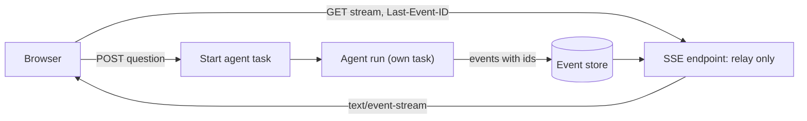

## 1. The question this idea answers

A chat UI must show the answer while the agent works: text as it arrives, a line when a Genie tool starts, a final status. The agent can run for a minute. The user must see progress after one second, not after sixty.

The common answer is **server-sent events** (SSE): one HTTP response that stays open and carries many small events. Four questions decide if it works in production:

1. What exact bytes go on the wire, and how does the client split them into events?
2. How does a FastAPI endpoint produce them?
3. What sits between the server and the browser, and can it hold the bytes back?
4. What happens to the agent run when the user closes the tab?

This lesson answers each one with a running uvicorn server and `curl -N`.

## 2. Mental model

> [!analogy] A live report over the phone
> A reporter calls the newsroom and keeps the line open. The reporter reads one short item, then makes a short pause. The pause tells the newsroom "this item is complete, print it". When nothing happens for a while, the reporter says "still here" so that the operator does not cut the line.
>
> The open call is the HTTP response. Each item is an event. The pause is the blank line. "Still here" is a comment line that the client ignores.
>
> **Where it stops working:** on a phone call, both sides can talk. SSE goes in one direction only: the server talks, the client listens. The client sends a new question with a new HTTP request. Also, a phone line delivers words at once. An HTTP proxy in the middle can collect the items and pass them on late, all together.

## 3. Terms

| Term | Plain meaning |
|---|---|
| server-sent events (SSE) | A standard format for a stream of text events from a server to a client in one HTTP response. |
| event stream | The response body in SSE format. Its media type is `text/event-stream`. |
| field | One line of an event: `data`, `event`, `id` or `retry`, then a colon and a value. |
| blank line | An empty line. It ends an event, and the client dispatches the event. |
| comment line | A line that starts with `:`. The client ignores it. Servers use it as a keep-alive. |
| keep-alive | A small message that a server sends during silence so that proxies do not close an idle connection. |
| `EventSource` | The browser API that reads an event stream and reconnects after a drop. |
| `Last-Event-ID` | The request header in which a reconnecting browser sends the last `id` that it received. |
| `StreamingResponse` | The Starlette response class that sends each item of an iterator as a body chunk. |
| `EventSourceResponse` | FastAPI's SSE response class (since 0.135.0). It formats yielded items as events. |
| chunked transfer encoding | HTTP/1.1 body framing without a known total length. Each piece is sent as it is ready. |
| proxy buffering | A proxy collects response bytes before it sends them to the client. |
| `X-Accel-Buffering` | A response header that tells nginx to enable or disable buffering for this response. |
| client disconnect | The client closes the connection before the response ends. |

## 4. Method and math

### 4.1 The wire format

The SSE rules are in the WHATWG HTML standard, section "Server-sent events" (checked on 2026-10-13). The parsing rules, in short:

| Line | What the client does |
|---|---|
| Empty line | "Dispatch the event" |
| Starts with `:` | "Ignore the line." |
| `name: value` | Field `name` gets `value`. "If value starts with a U+0020 SPACE character, remove it from value." |
| `data: x` | Append `x` and a line feed to the data buffer. Several `data` lines join with `\n`. |
| `event: x` | The event type becomes `x`. Without it, the type is `message`. |
| `id: x` | The last event ID becomes `x`, unless `x` contains U+0000 NULL. |
| `retry: x` | If `x` is only ASCII digits, the reconnection time becomes `x` milliseconds. |
| Any other field | "The field is ignored." |

The stream "must always be encoded as UTF-8". Also: "If the file ends in the middle of an event, before the final empty line, the incomplete event is not dispatched."

> [!trap] A raw newline in the payload splits the event
> A naive server writes `"data: " + text + "\n\n"`. With `text = "Line 3:\n\nno stops"`, the bytes are `data: Line 3:\n\nno stops\n\n`. The client dispatches "Line 3:" at the first blank line. The line `no stops` has no colon, so the spec treats it as a field named "no stops" and ignores it. The second half is lost.
>
> Fix: JSON-encode the payload, because `json.dumps` writes `\n` as an escape, or write one `data:` line for each line of text. FastAPI's helper does the second: `format_sse_event(data_str="Line 3:\n\nno stops")` returned `b'data: Line 3:\ndata: \ndata: no stops\n\n'`.

### 4.2 StreamingResponse by hand

`StreamingResponse` takes an iterator and sends each item as a chunk. This app formats SSE frames itself:

```python
def sse(data, event=None, id=None):
    """Format one server-sent event."""
    lines = []
    if event: lines.append(f"event: {event}")
    if id is not None: lines.append(f"id: {id}")
    for line in json.dumps(data).splitlines():
        lines.append(f"data: {line}")
    return "\n".join(lines) + "\n\n"

async def answer_events(question):
    yield "retry: 3000\n\n"
    yield sse({"question": question}, event="start", id=0)
    for i, delta in enumerate(["Line 3 ", "had 2 ", "stops."], start=1):
        await asyncio.sleep(0.5)                 # waiting for the model
        yield sse({"delta": delta}, event="text", id=i)
    yield ": keep-alive\n\n"
    yield sse({"stop_reason": "end_turn"}, event="done", id=4)
    # (the test app also wraps this body in try/finally and logs the cleanup time)

@app.get("/chat")
async def chat(q: str):
    return StreamingResponse(
        answer_events(q),
        media_type="text/event-stream",
        headers={"Cache-Control": "no-cache", "X-Accel-Buffering": "no"},
    )
```

The real `curl -sS -N "http://127.0.0.1:8766/chat?q=downtime"` output, with the arrival time of each line (measured from the first line):

```text
 0.00s | retry: 3000
 0.00s |
 0.00s | event: start
 0.00s | id: 0
 0.00s | data: {"question": "downtime"}
 0.00s |
 0.50s | event: text
 0.50s | id: 1
 0.50s | data: {"delta": "Line 3 "}
 0.50s |
 1.00s | event: text
 1.00s | id: 2
 1.00s | data: {"delta": "had 2 "}
 1.00s |
 1.50s | event: text
 1.50s | id: 3
 1.50s | data: {"delta": "stops."}
 1.50s |
 1.50s | : keep-alive
 1.50s |
 1.50s | event: done
 1.50s | id: 4
 1.50s | data: {"stop_reason": "end_turn"}
 1.50s |
```

The `-N` flag disables curl's own output buffer. Without it, curl can hold the lines and hide the timing. The response headers (`curl -D -`):

```http
HTTP/1.1 200 OK
date: Tue, 13 Oct 2026 13:53:32 GMT
server: uvicorn
cache-control: no-cache
x-accel-buffering: no
content-type: text/event-stream; charset=utf-8
Transfer-Encoding: chunked
```

Starlette added `; charset=utf-8` to the media type. No `Content-Length` header exists, because the total size is unknown. uvicorn used chunked transfer encoding.

### 4.3 The useful headers

| Header | Why |
|---|---|
| `Content-Type: text/event-stream` | The spec's media type. `EventSource` fails the connection on another type. |
| `Cache-Control: no-cache` | A cache must not store or replay a live stream. The browser's `EventSource` already sets its request cache mode to "no-store" (spec). The header protects against other caches. |
| `X-Accel-Buffering: no` | nginx docs (checked on 2026-10-13): "Buffering can also be enabled or disabled by passing “yes” or “no” in the “X-Accel-Buffering” response header field." |
| No `Content-Length` | The body length is unknown. Chunked encoding is used. |

### 4.4 Proxy buffering, measured through nginx

A proxy between uvicorn and the client can hold the bytes. The test put nginx 1.24.0 in front of a stream of three events, 0.5 s apart. An httpx client measured the arrival of each `data:` line from the start of the request.

| nginx config | `X-Accel-Buffering: no` | Arrival of the 3 events |
|---|---|---|
| Default (`proxy_buffering on`) | absent | 0.64 s, 1.13 s, 1.64 s |
| Default | present | 0.72 s, 1.22 s, 1.72 s |
| `gzip on; gzip_types text/event-stream;` | absent | 1.65 s, 1.65 s, 1.65 s |
| `gzip on; gzip_types text/event-stream;` | present | 0.80 s, 1.30 s, 1.81 s |

In this test, default proxy buffering did not delay the small events. Compression did: with gzip on and no header, all three events arrived together at the end. The header restored per-event delivery. The nginx docs explain the mechanism: "When buffering is enabled, nginx receives a response from the proxied server as soon as possible, saving it into the buffers". "When buffering is disabled, the response is passed to a client synchronously, immediately as it is received."

Starlette's `GZipMiddleware` (1.6.0, checked in the source) lists `"text/event-stream"` in `DEFAULT_EXCLUDED_CONTENT_TYPES`, so it does not compress SSE by default. The SSE spec warns too: "HTTP chunking can have unexpected negative effects on the reliability of this protocol, in particular if the chunking is done by a different layer unaware of the timing requirements."

> [!note] Your platform's proxy is a separate test
> A hosting platform puts its own proxy in front of the app. The behavior of that proxy was not tested here. Run `curl -N` against the deployed URL and check that the events arrive one by one.

### 4.5 Keep-alive comments

The spec: "Legacy proxy servers are known to, in certain cases, drop HTTP connections after a short timeout. To protect against such proxy servers, authors can include a comment line (one starting with a ':' character) every 15 seconds or so."

An agent is often silent for a long time, for example during a 40-second tool call. A hand-written `StreamingResponse` generator must produce the comments itself. To notice the silence, it needs a reader task that fills a queue and a timeout on the queue, as in [L2, section 4.6](/notes/software-engineering/python/01-asyncio/l2-async-generators). `EventSourceResponse` does this for you (section 4.8).

### 4.6 Async and sync generators

The Starlette 1.6.0 constructor decides by type:

```python
if isinstance(content, AsyncIterable):
    self.body_iterator = content
else:
    self.body_iterator = iterate_in_threadpool(content)
```

A sync generator therefore runs each `next()` call in a worker thread ([L3](/notes/software-engineering/python/01-asyncio/l3-sync-code-calling-async-code)). The test compared both kinds when the client left after 1.2 s (`curl --max-time 1.2`). Each generator produced one event every 0.5 s and wrote a log line in its `finally`.

```text
INFO:     async gen: CancelledError after 1.16 s
INFO:     async gen: finally after 1.16 s
INFO:     sync gen: produced 0 on AnyIO worker thread
INFO:     sync gen: produced 1 on AnyIO worker thread
INFO:     sync gen: produced 2 on AnyIO worker thread
```

| | Async generator | Sync generator |
|---|---|---|
| Runs on | The event loop thread | An AnyIO worker thread, one `next()` at a time |
| After the disconnect | `CancelledError` at its `await`, then `finally` at 1.16 s | Finished the step in progress (item 2), then stopped |
| `finally` ran | At once | Only after a manual `gc.collect()`, at 4.24 s |

The sync generator's cleanup depended on the garbage collector. In this test, it did not run within 3 s, and it did not run at server shutdown. It ran only when an extra endpoint called `gc.collect()`. Use async generators for streams that hold resources.

### 4.7 Client disconnect and the agent run

How does Starlette notice the disconnect? `StreamingResponse.__call__` in Starlette 1.6.0 checks the ASGI spec version that the server reports:

- Below 2.4: it runs `listen_for_disconnect` in a task group next to the stream. An `http.disconnect` message cancels the stream at once.
- 2.4 or later: it only catches `OSError` when a send fails, and raises `ClientDisconnect`. A silent generator notices nothing until its next send.

uvicorn 0.53.0 reports `"spec_version": "2.3"` for HTTP (source, `h11_impl.py`). So on uvicorn, the generator receives `CancelledError` at its next suspension point, as the 1.16 s result shows. A test that polled `await request.is_disconnected()` before each event never saw `True`: the cancellation arrived first, at 1.15 s.

> [!key] A closed tab cancels the work inside the generator
> If the agent run lives inside the response generator, a closed tab cancels the agent mid-turn, and no final answer is saved. Run the agent in its own task. Let it write each event to a store or a queue with an id. The SSE endpoint only relays events, and a reconnecting client resumes from `Last-Event-ID`. The run then finishes and saves its answer even when nobody watches.



### 4.8 FastAPI's own SSE support

FastAPI ships an SSE response class. The release notes: "0.135.0 (2026-03-01) ... Add support for Server Sent Events." The sandbox ran FastAPI 0.143.0, the latest release (2026-10-08, checked on 2026-10-13). The module `fastapi.sse` holds `EventSourceResponse`, `ServerSentEvent` and `format_sse_event`.

```python
from fastapi.sse import EventSourceResponse, ServerSentEvent

class Delta(BaseModel):
    text: str

@app.get("/plain", response_class=EventSourceResponse)
async def plain() -> AsyncIterable[Delta]:
    for t in ["Line 3 ", "had 2 ", "stops."]:
        await asyncio.sleep(0.3)
        yield Delta(text=t)

@app.post("/chat", response_class=EventSourceResponse)
async def chat():
    yield ServerSentEvent(data={"q": "downtime"}, event="start", id="0", retry=3000)
    await asyncio.sleep(2.5)                      # a slow tool call: no events
    yield ServerSentEvent(data="Line 3 had 2 stops.", event="text", id="1")
    yield ServerSentEvent(raw_data="[DONE]", event="done", id="2")
```

`GET /plain` returned the headers `content-type: text/event-stream; charset=utf-8`, `cache-control: no-cache` and `x-accel-buffering: no`, and three events such as `data: {"text":"Line 3 "}`. The `POST /chat` stream, with the ping interval lowered to 1 s for this test:

```text
 0.00s | event: start
 0.00s | data: {"q": "downtime"}
 0.00s | id: 0
 0.00s | retry: 3000
 0.00s |
 1.00s | : ping
 1.00s |
 2.00s | : ping
 2.00s |
 2.50s | event: text
 2.50s | data: "Line 3 had 2 stops."
 2.50s | id: 1
 2.50s |
 2.50s | event: done
 2.50s | data: [DONE]
 2.50s | id: 2
 2.50s |
```

| Behavior (0.143.0 source and test) | Detail |
|---|---|
| `data` encoding | Always JSON. The string became `"Line 3 had 2 stops."` with quotes. `raw_data` sends text as it is. |
| Keep-alive | `: ping` after 15 s without an event (`_PING_INTERVAL = 15.0` in `fastapi/sse.py`) |
| Headers | Sets `Cache-Control: no-cache` and `X-Accel-Buffering: no` |
| Methods | Any method. The docs: "This is useful for protocols like MCP that stream SSE over `POST`" |
| Sync generators | Run in the thread pool |
| Validation | A return type such as `AsyncIterable[Delta]` validates and serializes each item |

> [!trap] Patch the name where it is used
> The test first set `fastapi.sse._PING_INTERVAL = 1.0`, and no ping appeared. `fastapi/routing.py` imports the value with `from fastapi.sse import _PING_INTERVAL`, so it has its own name. Setting `fastapi.routing._PING_INTERVAL = 1.0` worked. `_PING_INTERVAL` is a private name. The [pytest lesson](/notes/software-engineering/python/03-tooling/l2-pytest-fixtures-and-monkeypatch) explains this rule.

The browser `EventSource` constructor takes a URL and one option, `withCredentials` (spec). It sends GET requests with no body. A chat UI that POSTs the question with the stream request reads the response with `fetch()` and a stream reader instead.

### 4.9 Production view

| Concern | What to do |
|---|---|
| Latency | Send an event at once when the turn starts. Check per-event arrival with `curl -N` through every proxy. |
| Buffering | Send `X-Accel-Buffering: no`. Never compress `text/event-stream` in a proxy. |
| Idle timeouts | Send a comment line at least every 15 s. `EventSourceResponse` does it. |
| Disconnects | Run the agent in its own task. The endpoint relays. Store events with ids for resume. |
| Resources | Use async generators. A sync generator's `finally` can depend on the garbage collector. |
| Format | JSON-encode each payload, or use `format_sse_event`. Never write raw newlines into one `data:` line. |
| Observability | Log stream start, first event time, event count, end reason (done, disconnect, error). |

## 5. Code

These exercises go in `python/04-sse.ipynb`. Run each server with `uvicorn module:app --port 8000` in a terminal, and use the notebook as the client.

**Exercise 4.1: an SSE parser.** Write `parse_sse(text)` that returns a list of `(event_type, data, last_id)` tuples by the rules of section 4.1.

Acceptance tests:

- `"data: YHOO\ndata: +2\ndata: 10\n\n"` gives one event with data `"YHOO\n+2\n10"` and type `"message"`.
- `"data:test\n\ndata: test\n\n"` gives two identical events.
- Comment lines are ignored, and a last event with no final blank line is not returned.
- The naive frame of the trap in section 4.1 loses "no stops", and your test shows it.

**Exercise 4.2: a hand-made stream with keep-alive.** Write a `StreamingResponse` endpoint over a fake agent that is silent for 5 s during a tool call.

Acceptance tests:

- `curl -N` shows a comment line at least every 2 s during the silence.
- The headers of section 4.3 are present.
- When curl stops after 3 s, the generator's `finally` logs within 1 s.

**Exercise 4.3: a run that survives the tab.** Start the agent as its own task that appends events with ids to a list. An SSE endpoint relays the list and honors `Last-Event-ID`.

Acceptance tests:

- Stop curl in the middle of the run. The run still reaches its done event and stores the final text.
- A second request with the header `Last-Event-ID: 3` receives only events with an id above 3.
- No event is sent twice inside one connection.

## 6. Common mistakes

1. **Running curl without `-N`.** curl's buffer hides the real timing.
2. **Raw text with newlines in one `data:` line.** The client splits the event and drops part of it.
3. **Compressing the stream in a proxy.** In the nginx test, gzip delivered all events at the end.
4. **No keep-alive during long tool calls.** Proxies can close an idle connection.
5. **The agent run inside the response generator.** A closed tab cancels the run.
6. **A sync generator that holds resources.** Its cleanup can depend on garbage collection.
7. **Expecting `EventSource` to POST.** It sends GET with no body. Use `fetch()` for POST streams.

## 7. One-minute explanation

Server-sent events stream text events in one HTTP response of type `text/event-stream`. Each event is a group of field lines, `data`, `event`, `id` and `retry`, and a blank line ends it. Lines that start with a colon are comments, and servers send them as keep-alives during silence. In FastAPI, a generator can yield preformatted frames into a `StreamingResponse`. Since FastAPI 0.135.0, `EventSourceResponse` formats the items, sends a ping after 15 s of silence and sets the two useful headers. Prefer async generators. On a client disconnect under uvicorn, an async generator receives `CancelledError`, and its `finally` runs at once. In the test, a sync generator's cleanup ran only after a garbage collection. Proxies can hold the bytes: through nginx with gzip on, all events arrived together until the `X-Accel-Buffering: no` header was added. Because a disconnect cancels the generator, run the agent in its own task and let the endpoint only relay stored events.

## 8. Check questions

```check
{
  "question": "A server sends: \": hello\\nevent: text\\ndata: Line 3\\ndata: had 2 stops\\nid: 7\\n\\n\". What does the browser's EventSource dispatch? What is the last event ID afterwards?",
  "answer": "The comment line is ignored. One event of type text is dispatched with data \"Line 3\\nhad 2 stops\" (the two data lines joined by a line feed). The last event ID becomes \"7\", so a reconnect sends Last-Event-ID: 7."
}
```

```check
{
  "question": "Behind a proxy, all events of a 20-second stream arrive at second 20. Locally with curl -N they arrive one by one. Name two likely causes and the fix for each.",
  "answer": "First, proxy buffering: the proxy collects the response before sending it. Fix: send X-Accel-Buffering: no (nginx) or disable buffering for this route. Second, compression in the proxy: in the nginx test, gzip on for text/event-stream delivered everything at the end. Fix: do not compress text/event-stream, or send X-Accel-Buffering: no, which restored per-event delivery in the test."
}
```

```check
{
  "question": "An async def endpoint returns StreamingResponse(run_agent_events(q)), where the generator runs the whole agent turn. The user closes the tab after 3 s. What happens on uvicorn, and why is it a problem?",
  "hint": "Section 4.7: the ASGI spec version and listen_for_disconnect.",
  "answer": "uvicorn reports ASGI spec version 2.3, so Starlette listens for http.disconnect and cancels the stream. The generator receives CancelledError at its next suspension point, so the agent run is cancelled mid-turn and its final answer is never produced or saved. Fix: run the agent in its own task that stores events, and let the endpoint only relay them."
}
```

```check
{
  "question": "Does current FastAPI ship its own SSE response class? Name it, the version that added it, and two things it does that a hand-made StreamingResponse does not.",
  "answer": "Yes: fastapi.sse.EventSourceResponse, added in FastAPI 0.135.0 (2026-03-01), together with ServerSentEvent. It sends a \": ping\" keep-alive comment after 15 s without events, and it sets Cache-Control: no-cache and X-Accel-Buffering: no. It also JSON-encodes and validates each yielded item."
}
```

## 9. Links

- Previous part: [L3: Sync code calling async code](/notes/software-engineering/python/01-asyncio/l3-sync-code-calling-async-code)
- Next: [uv and pyproject.toml](/notes/software-engineering/python/03-tooling/l1-uv-and-pyproject)
- Generators and cancellation: [L2: Async generators](/notes/software-engineering/python/01-asyncio/l2-async-generators)
- Model stream events: [Stream events](/notes/ai/llm-apis/02-streaming-and-thinking/l1-stream-events)
- Storing what the user saw: [Three copies of a conversation](/notes/ai/conversation-state/01-where-state-lives/l1-three-copies-of-a-conversation)
- [Glossary](/notes/software-engineering/python/glossary)
