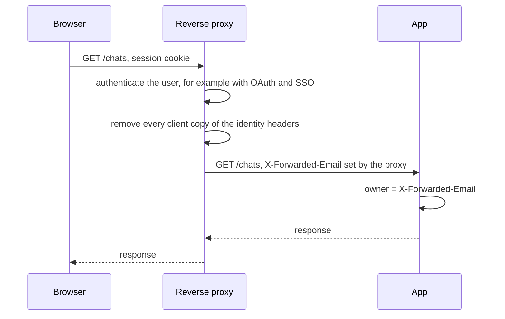

## 1. The question this idea answers

[L1](/notes/software-engineering/security-and-operations/01-access-control/l1-self-asserted-identity) took the identity from a token that the app verified itself. Many platforms work differently. A **reverse proxy** in front of the app authenticates the user, and then forwards the request to the app with headers such as `X-Forwarded-Email: alice@example.com`. Databricks Apps works this way.

But a header is just bytes in a request, and L1 says that the client chooses every byte. So when is `X-Forwarded-Email` the verified identity, and when is it a self-asserted identity with an official-looking name?

A second question follows on Databricks: which identity does the app use when it reads data? Its own service principal, or the user? This lesson answers both, with a real test of two toy proxies and the exact text of the Databricks docs.

## 2. Mental model

> [!analogy] Internal mail in an office building
> Reception checks each visitor's passport. Then reception writes the visitor's name on an envelope and sends it to the right office by internal mail. The office trusts the name on the envelope, because only reception writes those envelopes.
>
> That trust holds under two conditions. First, reception discards any envelope that a visitor brings and writes a new one. Second, the internal mail has no public slot, so no visitor can put an envelope into it directly.
>
> **Where it stops working:** in the building, you can walk to the mail room and look. An app cannot see whether the platform's proxy removes client headers or whether a side door exists. It depends on the platform's documentation. So you must know exactly what the documentation states, and treat everything else as unconfirmed.

## 3. Terms

| Term | Plain meaning |
|---|---|
| reverse proxy | A server in front of the app. Clients connect to it, and it forwards each request to the app. |
| forwarded header | A header that the proxy adds to a request before it forwards it, for example `X-Forwarded-Email`. |
| header spoofing | A client sends a header with the same name as a forwarded header, to fake a value. |
| strip | The proxy removes every client-supplied copy of a header before it adds its own. |
| direct access | A request that reaches the app without passing the proxy. |
| trusted hop | A network source that the app trusts to set forwarded headers, for example the proxy's address. |
| `X-Forwarded-For` | A header that holds the client's address as seen by each proxy. |
| service principal | A non-human identity in Databricks. Each app has its own. |
| app authorization | The app acts with its own service principal. All users share its permissions. |
| user authorization | The app acts with the user's identity, through the user's forwarded access token. Also called on-behalf-of-user authorization. |
| scope | A limit on what a token allows, for example "read SQL warehouses". |
| fail closed | When the identity is missing, the app refuses the request. |

## 4. Method and math

### 4.1 How a proxy adds identity



The app trusts the header for one reason only: the proxy wrote it after the client sent the request. That is the "value that a component under your control wrote" of L1.

> [!key] The two conditions for a trusted identity header
> 1. The proxy removes or replaces every client-supplied copy of the header.
> 2. The app is reachable only through the proxy.
>
> If either condition fails, the header is a self-asserted identity.

### 4.2 The test: two toy proxies

The test built a FastAPI app that returns the header with `request.headers.get("x-forwarded-email")` and all its copies with `getlist`. In front of it ran two toy proxies, written with Starlette and httpx. Each proxy authenticated Bob by a session cookie and then added `x-forwarded-email: bob@example.com`. The **naive** proxy forwarded all client headers first. The **strict** proxy removed client copies of the identity headers first. In every request, Bob also sent a forged header `X-Forwarded-Email: alice@example.com`.

| # | Path | The app saw (`get`) | All copies |
|---|---|---|---|
| 1 | Direct to the app port, no proxy | `alice@example.com` | `["alice@example.com"]` |
| 2 | Naive proxy | `alice@example.com` | `["alice@example.com", "bob@example.com"]` |
| 3 | Strict proxy | `bob@example.com` | `["bob@example.com"]` |
| 4 | Strict proxy, no session | The proxy answered `401 sign in first` | none |
| 5 | Naive proxy, header name `x-FORWARDED-email` | `alice@example.com` | `["alice@example.com", "bob@example.com"]` |

Row 1 breaks condition 2. Rows 2 and 5 break condition 1. In row 2, the proxy did authenticate Bob and did add the right value, and the app still read Alice. Starlette's `headers.get` returned the first copy, and the client's copy came first. Row 5 shows that header names are case-insensitive, so a strip rule must compare names in lower case.

> [!trap] "The proxy adds the header" is not enough
> A proxy that appends its value leaves the client's value in the request. Which copy the app reads depends on the framework. The proxy must remove client copies, by case-insensitive name, before it adds its own.

### 4.3 The same rule in uvicorn

Uvicorn applies this idea to the client address. Its `ProxyHeadersMiddleware` docstring (uvicorn 0.53.0) says that it "can be used when a known proxy is fronting the application, and is trusted to be properly setting the `X-Forwarded-Proto` and `X-Forwarded-For` headers". It reads those headers only when the connection comes from a trusted host. The default list is the `FORWARDED_ALLOW_IPS` environment variable or `"127.0.0.1,::1"` (source of `config.py`, checked on 2026-10-13).

So a trusted hop is decided by the network address of the connection, which the client cannot choose, not by a header. Uvicorn handles only the address and the scheme. It does nothing with identity headers.

### 4.4 What the Databricks docs say

The official page is "Access HTTP headers passed to Databricks apps" (https://docs.databricks.com/aws/en/dev-tools/databricks-apps/http-headers, checked on 2026-10-13). It says: "Databricks Apps passes specific `X-Forwarded-*` HTTP headers from the reverse proxy to your app." Its table:

| Header | Description (quoted) |
|---|---|
| `X-Forwarded-Host` | "The original host or domain requested by the client." |
| `X-Forwarded-Preferred-Username` | "The user name provided by the IdP." |
| `X-Forwarded-User` | "The user identifier provided by the IdP." |
| `X-Forwarded-Email` | "The user email provided by the IdP." |
| `X-Real-Ip` | "The IP address of the client that made the original request." |
| `X-Request-Id` | "The UUID of the request." |

The page adds: "These headers are only available when the app runs inside Databricks Apps. When testing locally, you must simulate or manually include them."

The networking page describes the path of a request: "Initial user requests to a Databricks app initiate OAuth authentication with the control plane to validate the session and authorize access to the app." Then: "Upon successful authentication, all subsequent requests are routed directly to the serverless compute plane without traversing the control plane."

The user-authorization part of the authorization page (https://docs.databricks.com/aws/en/dev-tools/databricks-apps/auth) adds one more header. Its code samples read `x-forwarded-access-token`, the user's access token.

**What the official pages do not state** (checked on 2026-10-13):

| Question | Status |
|---|---|
| Does the proxy remove client-supplied `X-Forwarded-*` headers? | Not stated. The headers page has no sentence about spoofing or trust. |
| Can a request reach the app without the platform's authentication? | Not stated in these words. The networking page describes OAuth on the initial request and direct routing afterward. |
| What is the format of `X-Forwarded-User`? | Not documented beyond "The user identifier provided by the IdP." |
| How long is the forwarded access token valid? | Not stated on the authorization page. |

**What only a community thread says.** A Databricks Community thread from July 2026 has the title "X-Forwarded-Access-Token occasionally return stale values from a previous session". It reported a Streamlit app in which the token and email headers sometimes belonged to a previous user. The answer came from an account marked as a Databricks employee, in the community forum, not in the docs. It said that the usual cause is `st.cache_resource`, which is global, so all users share one cached connection. It also said that Streamlit populates `st.context.headers` once, at the first page load, so a long-lived tab can hold a stale token. It suggested a check: call `current_user.me()` with the token, compare the result with `X-Forwarded-Email`, and fail closed on a mismatch. Treat all of this as a useful lead, not as documented behavior.

> [!note] Test what you depend on
> The platform behavior that you cannot read in the docs, you can still test in your own workspace. For example, send a forged `X-Forwarded-Email` through the app URL and log what the app receives, in a development app only.

### 4.5 Which header becomes the owner

The chat tables store one `owner_id` per chat ([ownership checks](/notes/ai/conversation-state/03-lifecycle/l1-ownership-checks)). Choose one header and never mix two.

| Header | For | Against |
|---|---|---|
| `X-Forwarded-Email` | Readable. Easy to match with old data that stored emails. | An email can change when a person changes name. |
| `X-Forwarded-User` | "The user identifier provided by the IdP", likely more stable | The format is not documented. Check it in your workspace before you depend on it. |

Whichever you choose, read it in one function, and refuse the request when it is missing.

### 4.6 The app's identity and the user's identity

The Databricks authorization page describes two models (checked on 2026-10-13).

**App authorization.** "Each Databricks app has a dedicated service principal that acts as its identity when it accesses Databricks resources." Databricks sets `DATABRICKS_CLIENT_ID` and `DATABRICKS_CLIENT_SECRET` in the app's environment. "All actions initiated by the app use the service principal's permissions." The key-concepts page adds: "All users of the app share this identity and have access to the same set of permissions."

**User authorization.** It "allows a Databricks Apps app to act with the identity of the app user". "Databricks forwards the user's access token to the app, which uses the token to access resources on the user's behalf." Apps "must declare specific authorization scopes", and "Databricks blocks access to any functionality outside the approved scopes, even if the user has permission." With no scopes selected, the app gets `iam.access-control:read` and `iam.current-user:read`, which "don't permit access to data or compute resources". The page shows no preview label for this feature (checked on 2026-10-13). "Databricks Apps can use app and user authorization independently or together."

| | App authorization | User authorization |
|---|---|---|
| Identity | The app's service principal | The authenticated user |
| Credential | `DATABRICKS_CLIENT_ID` and `DATABRICKS_CLIENT_SECRET` | The `x-forwarded-access-token` header of each request |
| Who enforces data permissions | Your code, for everything the service principal can reach | Unity Catalog: "Databricks enforces all permissions based on the user's existing Unity Catalog policies." |
| Good for | The app's own tables, such as the chat history | Data tools: SQL warehouses, Genie, governed tables |

> [!example] Worked example: one request, two identities
> Bob asks: "What was the downtime on L3 yesterday?"
>
> 1. The app reads `X-Forwarded-Email: bob@example.com`. This is the identity for the chat tables.
> 2. The app saves the turn in Lakebase. It connects as its service principal: the Lakebase resource page says that the Postgres role name "matches the service principal's client ID". That is the same database identity for every user. So the database cannot tell Alice and Bob apart. The `WHERE owner_id = 'bob@example.com'` filter does it.
> 3. The data tool runs the query with Bob's forwarded token. Unity Catalog then applies Bob's permissions, not the app's.
>
> Step 2 needs your owner checks. Step 3 gets its checks from the platform.

> [!trap] The forwarded token is a secret
> The authorization page says: "Don't print, log, or write tokens to files. This applies to all logging statements, debugging tools, and error handlers." Never put the token in a cache that other users share. Build the client for the user's token per request.

### 4.7 The local development trap

On a laptop there is no proxy, so the headers are missing. A common shortcut is "if the header is missing, use `dev@example.com`". If that shortcut reaches production, every request without the header becomes a valid user.

Fail closed instead. The system environment page lists `DATABRICKS_APP_NAME` ("The name of the running app.") among the variables set in every app. A rule such as "inside Databricks Apps, a missing identity header is always 401" removes the shortcut where it matters. For local runs, add the headers in the test client or with `curl -H`, as the Databricks page suggests.

### 4.8 Production view

| Concern | What to do |
|---|---|
| Trust | Trust identity headers only from a proxy that strips client copies, and only when the app has no other entrance. |
| Code | Read the identity in one function. Refuse missing or empty values with 401. |
| Owner key | Store one chosen header as `owner_id`. Check its format in your own workspace. |
| Data access | Use the service principal for the app's own tables, with owner filters. Use user authorization for governed data. |
| Secrets | Never log, print or cache across users the forwarded token or the client secret ([app secrets](/notes/platforms/databricks/01-apps/l2-app-resources-and-secrets)). |
| Verification | Where the stakes are high, compare the token's user with the email header, as the community answer suggests, and fail closed. |
| Testing | Test with forged headers, duplicate headers and missing headers. |

## 5. Video

```video
{
  "src": "/notes/media/security-and-operations/manim/m01-trusted-identity-header.mp4",
  "caption": "A forged X-Forwarded-Email reaches the app through a direct path and through a proxy that only appends, and is removed by a proxy that strips client copies."
}
```

## 6. Code

These exercises go in `security-and-operations/02-identity-headers.ipynb`, with FastAPI, Starlette, httpx and uvicorn.

**Exercise 2.1: the two proxies.** Write the app and the naive and strict proxies of section 4.2. Run them with uvicorn on three local ports.

Acceptance tests:

- With `curl`, all five rows of the table in section 4.2 give the same results.
- The strict proxy strips the headers by case-insensitive name, including `x-forwarded-user`, `x-forwarded-preferred-username` and `x-forwarded-access-token`.

**Exercise 2.2: the identity function.** Write `current_user(request)` for an app on Databricks Apps. It reads one chosen header.

Acceptance tests:

- A missing or empty header gives 401 when `DATABRICKS_APP_NAME` is set.
- Two copies of the header with different values give 401, not the first value.
- A local test passes the header with `TestClient` and reaches the endpoint.

**Exercise 2.3: the token stays private.** Write a function that builds a data client from the forwarded access token for one request.

Acceptance tests:

- With pytest's `caplog`, no log record contains the token value, also when the client raises an error.
- Two requests with two different tokens never share a client object.

## 7. Common mistakes

1. **"The platform adds the header, so it is safe."** Safe only if the proxy strips client copies and the app has no other entrance.
2. **A proxy that appends instead of replacing.** The client's copy can come first, and the app reads it.
3. **Comparing header names with case.** `x-FORWARDED-email` is the same header.
4. **A default user when the header is missing.** In production, that is an open door. Fail closed.
5. **Assuming the service principal enforces per-user rules.** All users share its permissions. Your code must filter by owner.
6. **Logging or caching the forwarded token.** It is the user's credential.
7. **Stating undocumented platform behavior as fact.** Say "not documented", and test it in your workspace.

## 8. One-minute explanation

Behind a reverse proxy, the app does not verify tokens itself. The proxy authenticates the user and forwards the identity in headers such as `X-Forwarded-Email`. Such a header is trustworthy only under two conditions. The proxy removes every client-supplied copy before it adds its own. And the app is reachable only through the proxy. The test showed both failures. A direct request with a forged header was accepted. A proxy that only appended its value let the app read the forged first copy. Databricks documents the forwarded headers, such as `X-Forwarded-Email` and `X-Forwarded-User`, and an initial OAuth step. Its pages do not say that client copies are stripped. A community thread, not the docs, describes stale token values caused by shared caches. The app also has two identities for data. Its own service principal is shared by all users, so the chat tables need owner filters. User authorization with the forwarded token lets Unity Catalog apply the user's own permissions. Read the identity in one function, fail closed when it is missing, and never log the token.

## 9. Check questions

```check
{
  "question": "A proxy authenticates the user and adds X-Forwarded-Email with the correct value. The app still sometimes sees another user's email. Give two possible causes from this lesson.",
  "answer": "One: the proxy appends its header but does not remove a client-supplied copy, and the app reads the first copy, which the client forged. Two: the app is reachable without the proxy, so a client can send the header directly. A third cause comes from the community thread: an app-side cache, such as a global Streamlit cache, that serves one user's connection to other users."
}
```

```check
{
  "question": "Three claims: (a) the list of X-Forwarded-* headers, (b) client-supplied X-Forwarded-* headers are removed, (c) the headers are missing when the app runs locally. Which ones does the official Databricks headers page state?",
  "answer": "(a) Stated: X-Forwarded-Host, X-Forwarded-Preferred-Username, X-Forwarded-User, X-Forwarded-Email, X-Real-Ip and X-Request-Id. (b) Not stated: the page has no sentence about stripping or spoofing. (c) Stated: the headers are only available inside Databricks Apps, and locally you must simulate or manually include them."
}
```

```check
{
  "question": "The app saves chat turns in Lakebase with its service principal and runs data queries with user authorization. For each of the two, who enforces that Bob sees only what he may see?",
  "answer": "Chat tables: the app's own code. The database sees the service principal for every user, so the app must filter every query by the owner taken from the trusted identity header. Data queries: Unity Catalog. The query runs with Bob's forwarded access token, and Databricks enforces permissions based on Bob's existing Unity Catalog policies, within the app's declared scopes."
}
```

```check
{
  "question": "Why is \"if the identity header is missing, use a development user\" dangerous, and what is the safer rule?",
  "answer": "If the shortcut reaches production, every request that arrives without the header is treated as a valid user. So anyone who can reach the app without the header gets access. The safer rule is to fail closed. Inside Databricks Apps (for example when DATABRICKS_APP_NAME is set), a missing or empty identity header gives 401. Local tests add the header explicitly."
}
```

## 10. Links

- Previous: [L1: Self-asserted identity](/notes/software-engineering/security-and-operations/01-access-control/l1-self-asserted-identity)
- Next: [Part 2, L1: Tracing agents](/notes/software-engineering/security-and-operations/02-observability/l1-tracing-agents)
- The Databricks side in detail: [User identity in Apps](/notes/platforms/databricks/02-identity-and-auth/l3-user-identity-in-apps)
- The app platform: [Databricks Apps](/notes/platforms/databricks/01-apps/l1-databricks-apps)
- What the identity protects: [Ownership checks](/notes/ai/conversation-state/03-lifecycle/l1-ownership-checks)
- [Glossary](/notes/software-engineering/security-and-operations/glossary)
