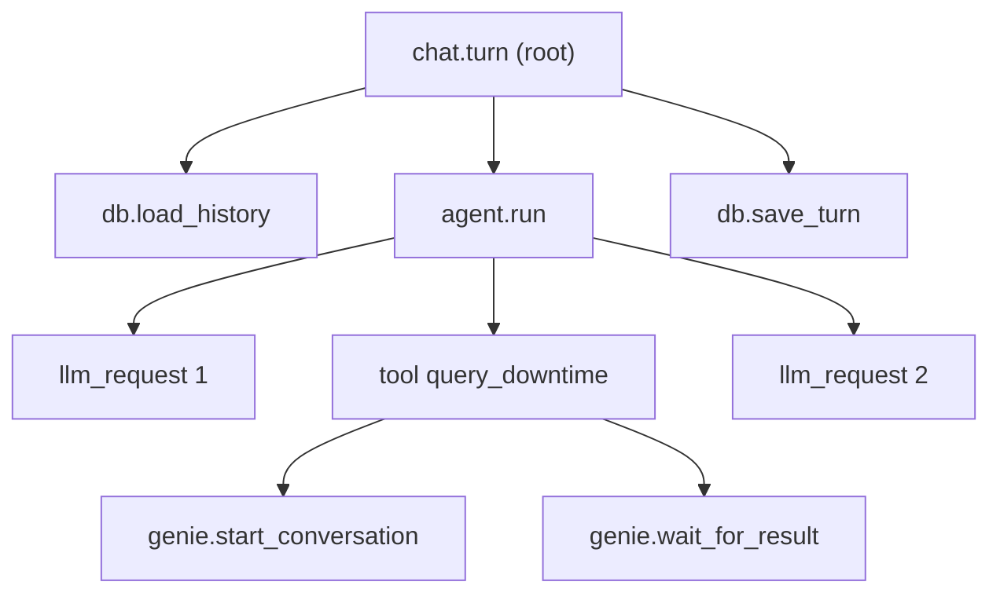

## 1. The question this idea answers

A user reports: "My question about downtime took 12 seconds, and the answer had the wrong line." The service logs show one line for the request and one line for the response. Nothing in between.

An agent answer has many steps: load the history, call the model, run a tool, call the model again, save the turn. To explain the 12 seconds, you need the time of each step and how the steps nest. To explain the wrong line, you need the tool input and the model output of each call.

A **trace** records exactly this, for one answer. This lesson explains the parts of a trace and what to record. It shows how to enable tracing for both harnesses, and how to read a trace to find the slow step.

## 2. Mental model

> [!analogy] A route card on a production order
> In a plant, a route card travels with each production order. Every station writes its start and finish time on the card: mixing, proofing, baking, packing. The order number on the card links all the entries. When an order is late, the supervisor reads the card and sees at once which station took the time.
>
> The trace is the route card. Each station entry is a **span**. The order number is the **trace id**. A station that sends the order to a subcontractor also sends the order number, so the subcontractor's entries join the same card. That is **trace context propagation**.
>
> **Where it stops working:** a route card holds only times and station names. A trace can also hold the content of each step: prompts, tool outputs, tokens. Those can contain secrets and personal data. So you must decide what each span may record before you enable it.

## 3. Terms

| Term | Plain meaning |
|---|---|
| trace | The record of one request through the system, made of linked spans. |
| span | One unit of work with a name, a start time, an end time and a parent. |
| root span | The first span of a trace. It has no parent. |
| attribute | A key and a value on a span, for example `gen_ai.usage.input_tokens = 18200`. |
| span event | A time-stamped note inside a span, like a structured log line. |
| span status | Unset, Error or Ok. |
| trace context | The trace id and the parent span id, passed between processes. |
| `traceparent` | The W3C header and environment variable that carry the trace context. |
| exporter | The component that sends finished spans to a backend. |
| OTLP | The OpenTelemetry Protocol, used to send spans, metrics and logs to a collector. |
| collector | A service that receives telemetry and forwards it to storage. |
| self time | A span's duration minus the durations of its child spans. |
| pseudonymous id | An id that links records of one user without naming the user, for example a salted hash. |

## 4. Method and math

### 4.1 One answer as a trace

The OpenTelemetry docs define the two main parts (checked on 2026-10-13): "Traces give us the big picture of what happens when a request is made to an application." And: "A span represents a unit of work or operation." Each span has a trace id and its own span id. A root span has no parent.



The other parts, quoted from the same page:

| Part | Definition |
|---|---|
| Attributes | "key-value pairs that contain metadata that you can use to annotate a Span" |
| Span events | "a structured log message (or annotation) on a Span" |
| Status Error | "some error occurred in the operation it tracks" |
| Context propagation | "the core concept that enables Distributed Tracing" |

The OpenTelemetry generative AI conventions name the attributes of a model call, for example `gen_ai.request.model`, `gen_ai.usage.input_tokens` and `gen_ai.usage.output_tokens`. Their status is "Development" (checked on 2026-10-13), so names can still change.

### 4.2 What to record and what never to record

A trace is copied to a backend, kept for weeks and read by many engineers. Decide per field.

| Record | Never record |
|---|---|
| Span names, start and end times, status | API keys, client secrets, `Authorization` headers |
| Model name, token counts, stop reason | The forwarded user access token |
| Tool name, duration, success or error class | Raw personal data: emails, names, staff ids |
| A pseudonymous user id and the chat id | Full prompts and tool outputs, unless an approved pipeline stores them |
| The flow (Flow 1 or Flow 2) and the number of history turns | Database rows that a tool returned |

The defaults of the tools agree with this table:

- The Agent SDK observability page: "Telemetry is structural by default." And: "The content your agent reads and writes is not recorded by default." About the variables that add content: "Leave these unset unless your observability pipeline is approved to store the data your agent handles."
- The OpenTelemetry generative AI conventions mark the message content attributes as opt-in, and warn that the output messages are "likely to contain sensitive information including user/PII data".
- LangSmith can hide content. The langsmith 0.14.8 client reads `LANGSMITH_HIDE_INPUTS`, `LANGSMITH_HIDE_OUTPUTS` and `LANGSMITH_HIDE_METADATA`, and each one hides only when its value is `"true"`.

> [!trap] The docs example puts a raw user id in every span
> The Agent SDK page shows `OTEL_RESOURCE_ATTRIBUTES` with `enduser.id={quote(request.user_id)}`, so that tool calls become "a per-user audit trail". That puts the user's identity on every span, metric and event. If the id is an email, use a pseudonymous id in traces, and keep the mapping in a protected table.

### 4.3 LangSmith for the LangChain harness

LangChain sends traces to LangSmith when the environment enables it. The LangSmith docs show (checked on 2026-10-13):

```bash
export LANGSMITH_TRACING=true
export LANGSMITH_API_KEY=<your-api-key>
export LANGSMITH_PROJECT=my-project          # optional
export LANGSMITH_ENDPOINT=https://eu.api.smith.langchain.com   # only for EU accounts
```

The docs also say: "By default, the trace will be logged to the project with the name `default`." For an API key linked to several workspaces, they add `LANGSMITH_WORKSPACE_ID`.

The library source (langsmith 0.14.8, checked on 2026-10-13) adds exact rules:

| Rule | Source |
|---|---|
| Each setting is read as `LANGSMITH_<NAME>`, then `LANGCHAIN_<NAME>` | `utils.get_env_var`, `namespaces=("LANGSMITH", "LANGCHAIN")` |
| Tracing is on when `TRACING_V2` or `TRACING` equals the string `"true"` | `utils.tracing_is_enabled` |
| The default endpoint is `https://api.smith.langchain.com` | `utils.get_api_url` |

> [!example] Worked example: three values that look like "on"
> The test started a fresh Python process for each value and called `langsmith.utils.tracing_is_enabled()`.
>
> | Environment | Result |
> |---|---|
> | `LANGSMITH_TRACING=true` | `True` |
> | `LANGSMITH_TRACING=True` | `False` |
> | `LANGSMITH_TRACING=1` | `False` |
> | `LANGCHAIN_TRACING_V2=true` (older name) | `True` |
>
> The comparison is `var_result == "true"`, so only lower-case `true` works. A deployment file with `True` traces nothing, and no error appears.

Traces are sent in the background. Before a short-lived process exits, call `wait_for_all_tracers()` from `langchain_core.tracers.langchain`. Otherwise the last traces can be lost.

### 4.4 OpenTelemetry for the Claude Agent SDK harness

The Agent SDK observability page explains the design: "The SDK does not produce telemetry of its own. Instead, it passes configuration through to the CLI process, and the CLI exports directly to your collector." So you configure the CLI with environment variables, either in the process environment or in `ClaudeAgentOptions.env`. "In Python, `env` is merged on top of the inherited environment."

| Variable | Value | Meaning |
|---|---|---|
| `CLAUDE_CODE_ENABLE_TELEMETRY` | `1` | Required. "Telemetry is off until you set `CLAUDE_CODE_ENABLE_TELEMETRY=1` and choose at least one exporter." |
| `CLAUDE_CODE_ENHANCED_TELEMETRY_BETA` | `1` | Required for traces, which are in beta |
| `OTEL_TRACES_EXPORTER` | `otlp` | The traces exporter. Also `OTEL_METRICS_EXPORTER` and `OTEL_LOGS_EXPORTER`. |
| `OTEL_EXPORTER_OTLP_PROTOCOL` | `grpc`, `http/json` or `http/protobuf` | The OTLP transport |
| `OTEL_EXPORTER_OTLP_ENDPOINT` | for example `http://collector.example.com:4318` | The collector |
| `OTEL_EXPORTER_OTLP_HEADERS` | for example `Authorization=Bearer ...` | Authentication. This is a secret (section 4.7). |
| `OTEL_TRACES_EXPORT_INTERVAL` | default 5000 ms | "By default, metrics export every 60 seconds and traces and logs export every 5 seconds." |

The spans (checked on 2026-10-13):

- `claude_code.interaction`: one turn of the agent loop.
- `claude_code.llm_request`: one model call, "with model name, latency, and token counts as attributes".
- `claude_code.tool`: one tool call, with the children `claude_code.tool.blocked_on_user` and `claude_code.tool.execution`.

The Monitoring reference lists attributes of `claude_code.llm_request` such as `duration_ms`, `ttft_ms`, `input_tokens`, `output_tokens`, `cache_read_tokens` and `stop_reason`. The page warns: "Tracing is in beta. Span names and attributes may change between releases."

> [!trap] Three quiet failures
> 1. The `console` exporter: "The `console` exporter writes telemetry to standard output, which the SDK uses as its message channel. Do not set `console` as an exporter value when running through the SDK."
> 2. Export errors: "The CLI fails silently on export errors by default". Set `CLAUDE_CODE_OTEL_DIAG_STDERR=1` and read the SDK's `stderr` callback while you test.
> 3. Content: `OTEL_LOG_USER_PROMPTS`, `OTEL_LOG_TOOL_DETAILS`, `OTEL_LOG_TOOL_CONTENT` and `OTEL_LOG_RAW_API_BODIES` add prompts, tool arguments, tool output and full API bodies. Leave them unset in production unless the backend is approved for that data.

**One trace for the whole request.** The docs: "When you call `query()` while an OpenTelemetry span is active in your application, the SDK injects `TRACEPARENT` and `TRACESTATE` into the child process environment". The SDK source (0.2.165, `subprocess_cli.py`) does this only when `opentelemetry-api` is installed (the `otel` extra), and an explicit value in `options.env` always wins. The test started a span with the OpenTelemetry SDK 1.44.0 and called `propagate.inject`, the same call that the SDK makes. The carrier held `traceparent: 00-3c0f3bfc7cec0c90ba289edce5c06730-53439dde90c2aaa5-03`: a version, a 32-hex-digit trace id, a 16-hex-digit parent span id and flags. The CLI's `claude_code.interaction` span then becomes a child of your `chat.turn` span.

> [!note] Databricks Apps has its own telemetry option
> The Databricks Apps telemetry page says that it "collects traces, logs, and metrics and persists them to Unity Catalog tables": `otel_spans`, `otel_logs` and `otel_metrics`. When it is enabled, the app environment gets `OTEL_EXPORTER_OTLP_ENDPOINT` (`http://localhost:4314`) and `OTEL_EXPORTER_OTLP_PROTOCOL` (`grpc`). The spans table fills only after you add OpenTelemetry instrumentation. The CLI child process inherits the app environment, so the CLI may export to that local endpoint. **Not confirmed:** this lesson did not test it in a workspace.

### 4.5 MLflow tracing on Databricks

MLflow traces both harnesses on Databricks, with limits (checked on 2026-10-13):

| Harness | Call | Limit from the Databricks docs |
|---|---|---|
| LangChain | `mlflow.langchain.autolog()` | "On serverless compute clusters, autologging is not automatically enabled." Call it yourself. |
| Claude Agent SDK | `mlflow.anthropic.autolog()`, MLflow 3.14 or later with Databricks extras | "MLflow does not support tracing direct calls to `query`. MLflow only supports tracing interactions that use `ClaudeSDKClient`." |

The second limit matters. A harness that runs one `query()` per user message gets no MLflow traces from autolog. For that harness, use the OpenTelemetry route of section 4.4. MLflow was not installed in the sandbox, so this section quotes the docs only.

### 4.6 Find the slow step

A trace answers "why was it slow?" with one computation: the **self time** of each span.

$$
\text{self}(s) = \text{duration}(s) - \sum_{c \in \text{children}(s)} \text{duration}(c)
$$

The slow step is the span with the largest self time. A parent with a long duration but a small self time is only waiting for its children.

The test built the trace of section 4.1 with the OpenTelemetry SDK 1.44.0 and an in-memory exporter. Each step slept for a scaled time (1 second of the scenario = 50 ms of real sleep). The model spans carried `gen_ai.request.model` and token counts. The exporter returned 9 spans with one trace id. The times below are converted to scenario seconds.

```text
span                                    total s   self s
chat.turn                                 11.63     0.01
  db.load_history                          0.04     0.04
  agent.run                               11.54     0.01
    llm_request                            1.40     1.40
    tool query_downtime                    7.92     0.00
      genie.start_conversation             0.35     0.35
      genie.wait_for_result                7.57     7.57
    llm_request                            2.20     2.20
  db.save_turn                             0.03     0.03
```

> [!example] Worked example: read the trace
> 1. The root takes 11.63 s. Its self time is 0.01 s, so the time is in its children.
> 2. `agent.run` takes 11.54 s, with a self time of 0.01 s.
> 3. `tool query_downtime` takes 7.92 s, with a self time of 0.00 s. Its children: 0.35 + 7.57 = 7.92 s.
> 4. The largest self time is `genie.wait_for_result`: 7.57 s. Share of the answer: 7.57 / 11.63 = 0.65, so 65%.
> 5. The two model calls: 1.40 + 2.20 = 3.60 s, so 3.60 / 11.63 = 31%.
>
> Conclusion: the data service is the slow step, not the model. A faster model would save at most 31%. The next question for the tool span: which query did it send, and is it the same query every time?

The same reading works on a real trace: sort the spans by self time, and start at the top. For a model span, also read `ttft_ms` (time to the first token) and the token counts. A long `ttft_ms` with many input tokens indicates a large context, and a rebuild in Flow 2 is a common cause ([model input](/notes/ai/conversation-state/02-chat-history-model/l2-from-stored-parts-to-model-input)).

### 4.7 No keys in plain-text configuration

Tracing adds secrets to the deployment: `LANGSMITH_API_KEY` and the bearer token in `OTEL_EXPORTER_OTLP_HEADERS`. Treat them like the model API key.

| Wrong | Right |
|---|---|
| The key as a literal value in `app.yaml` or in a committed `.env` file | A secret in a secret store, given to the app as a resource and read from the environment ([app resources and secrets](/notes/platforms/databricks/01-apps/l2-app-resources-and-secrets)) |
| The key in a code constant | The code reads an environment variable and fails at start if it is missing |
| The key logged at start for debugging | Log only whether the key is present |
| The `Authorization` header copied into a span attribute | Never record request headers in spans |

### 4.8 Production view

| Concern | What to do |
|---|---|
| Latency | Trace every answer. Sort spans by self time. Watch `ttft_ms` and tool spans. |
| Cost | Record input, output and cache-read tokens per model span. Sum them per chat and per day. |
| Reliability | Set span status Error on failed tools. Count Flow 2 rebuilds and tool timeouts. |
| Security | No keys, tokens or headers in spans. Pseudonymous user ids. Content logging disabled by default. |
| Configuration | Exact values: `LANGSMITH_TRACING=true` in lower case. Never the `console` exporter with the SDK. |
| Data retention | Set the trace backend's retention. Traces with content are copies of chats ([retention](/notes/ai/conversation-state/03-lifecycle/l2-retention-and-deletion)). |
| Testing | Test the tracing setup with an in-memory exporter. Assert span names, nesting and the absence of secrets. |

## 5. Code

These exercises go in `security-and-operations/03-tracing.ipynb`, with `opentelemetry-sdk` and its in-memory span exporter. They need no API key.

**Exercise 1.1: build and read a trace.** Create the span tree of section 4.1 with sleeps of your own choice. Write `self_times(spans)` that returns each span's self time.

Acceptance tests:

- All spans share one trace id, and exactly one span has no parent.
- For each span, self time plus the children's durations equals its duration, within 1 ms.
- Your function names the slow step that you planned.

**Exercise 1.2: no secrets in spans.** Write a span processor or a wrapper that drops attributes whose key contains `authorization`, `token`, `api_key` or `secret`. It also replaces an email attribute with a salted SHA-256 prefix.

Acceptance tests:

- A span created with `http.request.header.authorization` and `user.email` attributes is exported without the header and without the email.
- The same email always gives the same pseudonymous id. Two different emails give different ids.

**Exercise 1.3: the configuration check.** Write `check_tracing_env(env)` that runs at service start.

Acceptance tests:

- `LANGSMITH_TRACING=True` or `1` gives a warning that tracing is disabled.
- `OTEL_TRACES_EXPORTER=console` together with the Agent SDK gives an error.
- A missing `LANGSMITH_API_KEY` while tracing is on gives an error, and no message prints the value of any key.

## 6. Common mistakes

1. **Logs instead of traces.** Log lines do not show which step belongs to which answer, or how steps nest.
2. **Reading total time instead of self time.** The span with the longest duration is often only a parent that waits.
3. **`LANGSMITH_TRACING=True`.** Only lower-case `true` enables tracing in langsmith 0.14.8.
4. **The `console` exporter under the Agent SDK.** It writes into the SDK's message channel.
5. **Expecting MLflow autolog to trace `query()`.** The Databricks docs say it supports only `ClaudeSDKClient`.
6. **Recording prompts, tool outputs or emails by default.** Traces are long-lived copies that many people read.
7. **Keys in `app.yaml` or in code.** Use a secret store and environment variables.

## 7. One-minute explanation

A trace records one agent answer as a tree of spans. The root is the request, and its children are the history load, each model call, each tool call and the save. Each span has a start and end time, attributes such as the model and token counts, and a status. To find the slow step, compute each span's self time, its duration minus its children's, and start with the largest. In the worked example, the data service's wait took 65% of the answer and the model only 31%. Record structure, not content: no keys, tokens or raw personal data, and use pseudonymous user ids. The LangChain harness traces to LangSmith with `LANGSMITH_TRACING=true` in lower case and an API key from a secret store. The Claude Agent SDK produces no telemetry itself. The CLI exports OpenTelemetry when `CLAUDE_CODE_ENABLE_TELEMETRY=1`, and traces also need `CLAUDE_CODE_ENHANCED_TELEMETRY_BETA=1` and an OTLP exporter, never `console`. The SDK passes your trace context to the CLI, so both appear in one trace. MLflow on Databricks traces LangChain, but for the SDK only `ClaudeSDKClient`, not `query()`.

## 8. Check questions

```check
{
  "question": "A trace shows chat.turn at 9.0 s and its child agent.run at 8.8 s. The children of agent.run: tool lookup_orders at 6.1 s (with one child sql.execute at 6.0 s), and two llm_request spans of 1.2 s and 1.4 s. Which step is slow? Show the self-time arithmetic.",
  "answer": "Self time of tool lookup_orders = 6.1 - 6.0 = 0.1 s. Self time of sql.execute = 6.0 s. Self time of agent.run = 8.8 - (6.1 + 1.2 + 1.4) = 8.8 - 8.7 = 0.1 s. The largest self time is sql.execute with 6.0 s, so the SQL query is the slow step: 6.0 / 9.0 = 67% of the answer. The model calls take 2.6 s, 29%."
}
```

```check
{
  "question": "A deployment sets LANGSMITH_TRACING=True and LANGSMITH_API_KEY from a secret. No traces appear and no error is logged. Why?",
  "hint": "Read how langsmith compares the value.",
  "answer": "langsmith 0.14.8 enables tracing only when the value equals the string \"true\" exactly. \"True\" with a capital T is not equal, so tracing_is_enabled returns False, and nothing is sent. Set LANGSMITH_TRACING=true in lower case, and add a start-up check that warns about other values."
}
```

```check
{
  "question": "A harness calls query() once per user message. The team enables mlflow.anthropic.autolog() on Databricks and sees no traces. Explain, and name the alternative.",
  "answer": "The Databricks docs say that MLflow does not support tracing direct calls to query and only supports interactions that use ClaudeSDKClient. The alternative is the OpenTelemetry route. Enable CLI telemetry with CLAUDE_CODE_ENABLE_TELEMETRY=1, CLAUDE_CODE_ENHANCED_TELEMETRY_BETA=1, OTEL_TRACES_EXPORTER=otlp and an OTLP endpoint. Keep an application span active during query(), so that the SDK passes TRACEPARENT to the CLI."
}
```

```check
{
  "question": "List four things that must never appear in a span of a chat agent, and say what to record instead for the user.",
  "answer": "Any four of: API keys or client secrets, Authorization headers, the forwarded user access token, raw personal data such as emails or names, full prompts or tool outputs without an approved pipeline, database rows returned by tools. For the user, record a pseudonymous id, such as a salted hash, and keep the mapping to the real identity in a protected table."
}
```

## 9. Links

- Previous part: [L2: Identity headers behind a proxy](/notes/software-engineering/security-and-operations/01-access-control/l2-identity-headers-behind-a-proxy)
- Secrets for tracing keys: [App resources and secrets](/notes/platforms/databricks/01-apps/l2-app-resources-and-secrets)
- Token and cost fields of the SDK: [Cost and usage fields](/notes/ai/claude-agent-sdk/07-errors-and-cost/l2-cost-and-usage-fields)
- Where large inputs come from: [From stored parts to model input](/notes/ai/conversation-state/02-chat-history-model/l2-from-stored-parts-to-model-input)
- Traces are copies of chats: [Retention and deletion](/notes/ai/conversation-state/03-lifecycle/l2-retention-and-deletion)
- [Glossary](/notes/software-engineering/security-and-operations/glossary)
